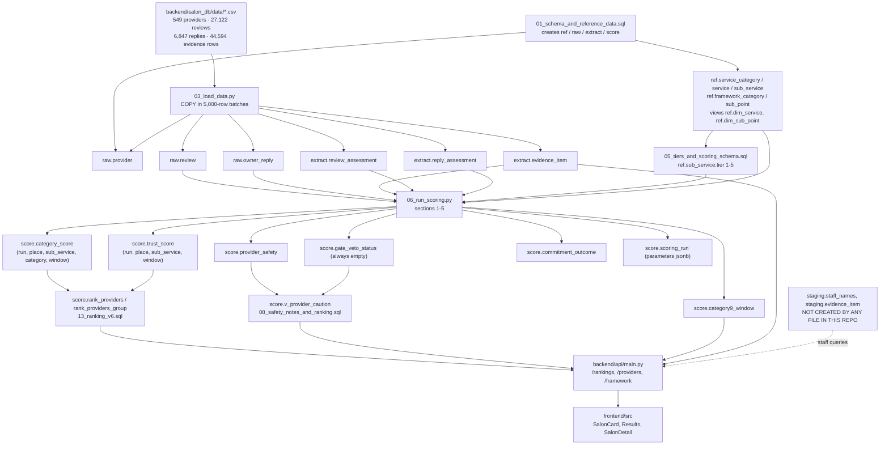

# Technical Documentation of the Beauty-Service Ranking Artefact

**Scope of this document.** Every factual claim below is traced to a file in this
repository, cited as `path:LINE` or `path:START-END`. Where a formula, default,
threshold or step is not present in the code, it is marked `[NOT IN CODEBASE]`
rather than reconstructed. Where the code and its own documentation disagree, both
are reported and the disagreement is recorded in Section 10.

**Phase 1 inventory volume.** 63 source files were read in full, totalling 9,111
lines (the file list and per-file line counts are in Appendix A). In addition, 13
CSV/JSON seed files were inspected by header and by programmatic aggregation
(141,301 data rows in total, of which `evidence_item.csv` holds 44,594); and a
further 8 frontend files (`screens/Rankings.jsx`, `screens/Results.jsx`,
`screens/SalonDetail.jsx`, `components/QuickFilters.jsx`, `api/client.js`,
`auth.py`, `contact.py`, `set_db_password.py`) were inspected by targeted search
rather than read end to end; claims drawn from those are cited to the specific
lines examined.

---

## 1. System overview

The system ingests public Google Maps data for beauty-service businesses in Sri
Lanka — one row per business, one row per review, one row per owner reply
(`backend/salon_db/01_schema_and_reference_data.sql:67-96`) — together with
pre-computed coded evidence derived from the review text
(`backend/salon_db/01_schema_and_reference_data.sql:109-125`). It produces, per
business × sub-service × duration window, a set of category scores, a composite
`trust_score`, an 80 % credible range, a safety status and a rank
(`backend/salon_db/05_tiers_and_scoring_schema.sql:60-90`;
`backend/salon_db/17_window_scoped_scores.sql:20-54`). A FastAPI service then
serves a reader-weighted ranking computed inside PostgreSQL
(`backend/api/main.py:1-10`, `backend/salon_db/13_ranking_v6.sql:38-99`).

The stages, in the order established in Section 4, are: schema and reference-data
creation (SQL), CSV bulk load (Python), irreversibility-tier assignment and score
table creation (SQL), framework migrations (SQL), scoring (Python), and request-time
ranking (SQL functions called by the API).

An important boundary: **the code that produced the coded evidence is not in this
repository.** `extract.extraction_run` records run 4 as
`'rule_based'` / `'Auto-coded by Python keyword engine'`
(`backend/salon_db/01_schema_and_reference_data.sql:379`), but no such engine exists
on disk. The only extraction code present is an archived Gemini LLM pass
(`archive/pipeline/s3_extract.py:1-8`, `archive/core/prompt.py:1-39`) which writes a
different schema entirely and is stated to be unused
(`archive/README.md:8-14`). See Section 5 and Gap 1.



---

## 2. Data model

Schemas are `ref` (dimensions), `raw` (source data), `extract` (fact tables) and
`score` (rebuilt summaries) (`backend/salon_db/01_schema_and_reference_data.sql:11`,
`:20-23`). Two further schemas are referenced by live queries but created nowhere in
this repository: `staging` (`backend/api/staff.py:60-66`) and `public` beyond the
survey table (`backend/salon_db/27_usability_survey.sql:22`). See Gap 3.

### 2.1 `ref` — service taxonomy

| Table.column | Type | Constraints | Holds | Written by |
|---|---|---|---|---|
| `service_category.code` | text | PK | `HR`, `SK`, `NL`, `BO`, `MG` | `01_…sql:242-314` |
| `service_category.name` | text | not null, unique | Display name | `01_…sql:242-314` |
| `service_category.sort_order` | int | not null | Display order | `01_…sql:242-314` |
| `service.code` | text | PK | e.g. `HR.COL` | `01_…sql:243-310` |
| `service.category_code` | text | not null, FK → `service_category` | Parent category | `01_…sql:243-310` |
| `service.name` | text | not null; unique on (category_code, name) | Display name | `01_…sql:243-310` |
| `service.sort_order` | int | not null | Display order | `01_…sql:243-310` |
| `sub_service.code` | text | PK | e.g. `HR.COL.01` | `01_…sql:244-314` |
| `sub_service.service_code` | text | not null, FK → `service` | Parent service | `01_…sql:244-314` |
| `sub_service.name` | text | not null, unique | Display name; the join key used by the tier update | `01_…sql:244-314` |
| `sub_service.sort_order` | int | not null | Display order | `01_…sql:244-314` |
| `sub_service.tier` | smallint | `check (tier between 1 and 5)` | Irreversibility tier | `05_tiers_and_scoring_schema.sql:5-25` |

Source: `backend/salon_db/01_schema_and_reference_data.sql:26-44`,
`backend/salon_db/05_tiers_and_scoring_schema.sql:5-25`.

### 2.2 `ref` — quality framework

| Table.column | Type | Constraints | Holds | Written by |
|---|---|---|---|---|
| `framework_category.category_no` | smallint | PK, `check (category_no between 1 and 8)` | Category number | `01_…sql:331-370`; row 9 added by `12_framework_v6_category9.sql:52-53` |
| `framework_category.name` | text | not null, unique | Full category name | same |
| `framework_category.weight` | numeric(6,5) | not null, default `0.14286` | **Structural** flag: `> 0` means the category takes part in ranking | `01_…sql:331-370`; `12_…sql:58-60`; `16_category9_weight_zero.sql:21-23` |
| `sub_point.code` | text | PK | `'1.1'` … `'7.5'`, `'overall'`, `'9.2'` | `01_…sql:332-371`; `12_…sql:82-94`; `18_subpoint_9_1_removed.sql:29-30` |
| `sub_point.category_no` | smallint | not null, FK → `framework_category` | Parent category | same |
| `sub_point.sort_order` | int | not null | Display order; rewritten by `09_framework_v5.sql:30-32` | same |
| `sub_point.customer_question` | text | not null | Plain-language question | `09_framework_v5.sql:109-137` |
| `sub_point.research_meaning` | text | not null | Academic definition | `09_framework_v5.sql:159-165` |
| `sub_point.is_score` | boolean | not null | Contributes to its category score | `01_…sql:332-371` |
| `sub_point.is_gate` | boolean | not null | Gate sub-point. **False on every row** | `01_…sql:332-371` |
| `sub_point.is_veto` | boolean | not null | Veto sub-point. **False on every row** | `01_…sql:332-371` |
| `sub_point.is_safety` | boolean | not null | True only on 7.1, 7.2, 7.3 | `01_…sql:364-366` |
| `sub_point.is_reported_only` | boolean | not null | True only on `overall` | `01_…sql:371` |
| `sub_point.is_computed` | boolean | not null | Calculated at scoring time | `01_…sql:342` (3.1); `12_…sql:89,94` (9.1, 9.2); `15_subpoint_is_computed_fix.sql:21-23` (3.2–3.4) |

The declared check constraint on `category_no` is `between 1 and 8`
(`backend/salon_db/01_schema_and_reference_data.sql:48`), which would reject
category 9. `12_framework_v6_category9.sql:10-17` states that the live database
instead carries `category_no >= 1 AND category_no <= 10`, and that the repo's own
constraint "was never applied to the live database". This is recorded as Gap 5.

### 2.3 `raw` — source data

| Table.column | Type | Constraints | Holds |
|---|---|---|---|
| `provider.place_id` | text | PK | Google place ID, used as the business ID |
| `provider.name` | text | not null | Business name |
| `provider.google_category` | text | — | Google's own category string |
| `provider.address`, `.city` | text | — | Address and city (city drives the ranking filter) |
| `provider.lat`, `.lng` | double precision | — | Coordinates (used by the nearby endpoint) |
| `provider.google_rating` | numeric(2,1) | — | Google star average — **reference only, never scored** |
| `provider.google_review_count` | int | — | Google's own count |
| `provider.permanently_closed`, `.temporarily_closed` | boolean | not null default false | Business status |
| `provider.place_url` | text | — | Maps link |
| `review.review_id` | text | PK | Google review ID |
| `review.place_id` | text | not null, FK → `provider` | Owning business |
| `review.stars` | smallint | not null, `check (stars between 1 and 5)` | Star rating — **never used to decide a code or polarity** |
| `review.review_text` | text | — | `null` = star-only review |
| `review.published_at` | timestamptz | not null | Publication date; drives recency and the duration filter |
| `review.source_language` | text | — | Detected language |
| `review.likes_count` | int | not null default 0 | **Unused by any downstream step in this repo** |
| `review.review_url` | text | — | Link; unused in scoring |
| `owner_reply.review_id` | text | PK, FK → `review` | The review answered |
| `owner_reply.reply_text` | text | not null | Reply body |
| `owner_reply.reply_date` | timestamptz | — | Reply date; drives the 3.4 promise test |

Source: `backend/salon_db/01_schema_and_reference_data.sql:67-96`. Index
`review_place_date_idx on raw.review (place_id, published_at)` at `:91`.

Three further `raw` objects are named in the framework document's schema table —
`raw.removed_duplicate_review` and `raw.v_review_full`
(`salon_quality_framework_v5.md:406`) — and `raw.removed_duplicate_review` is
deleted from by `backend/salon_db/26_remove_out_of_scope_salon.sql:64`, but neither
is created by any file in this repository. Gap 3.

**Columns marked unused by any downstream step:** `review.likes_count`,
`review.review_url`, `provider.google_category`, `provider.place_url` (read only by
`backend/salon_db/24_build_salon_audience_check.py:76`, a CSV-only utility),
`extract.review_assessment.overall_score`, `.star_text_mismatch`,
`.review_manipulation_flag`, `extract.reply_assessment.latency_days`,
and `extract.evidence_item.time_since_visit` (selected for display at
`backend/api/main.py:1387` and in `extract.v_evidence`, but read by no scoring path).
Each is verified below. `score.gate_veto_status.disputed_reports` is read
(`backend/api/main.py:957`, `frontend/src/screens/SalonDetail.jsx:385`) but
unreachable, its table being permanently empty.

### 2.4 `extract` — coded evidence

| Table.column | Type | Constraints | Holds | Downstream use |
|---|---|---|---|---|
| `extraction_run.run_id` | serial | PK | Run identifier | Joined for `method` by `backend/api/main.py:1415` |
| `extraction_run.method` | text | not null, `check in ('rule_based','llm','manual')` | How the run coded | Displayed |
| `extraction_run.model`, `.framework_version`, `.taxonomy_version`, `.run_at`, `.notes` | text / timestamptz | `framework_version`, `taxonomy_version` not null | Provenance | Audit only |
| `evidence_item.evidence_id` | bigserial | PK | Row id | Tie-break in evidence ordering, `main.py:1075` |
| `evidence_item.run_id` | int | not null, FK | Owning run | Join |
| `evidence_item.review_id` | text | not null, FK → `raw.review` | Source review | Join; the unit of independence |
| `evidence_item.place_id` | text | not null, FK → `raw.provider` | Business | Grouping key |
| `evidence_item.service_category_code` | text | FK → `service_category` | Coarsest service level named | Specificity ladder |
| `evidence_item.service_code` | text | FK → `service` | Service level named | Specificity ladder |
| `evidence_item.sub_service_code` | text | FK → `sub_service` | Finest level named | Specificity ladder. **0 of 44,594 seed rows carry one** (measured) |
| `evidence_item.sub_point_code` | text | not null, FK → `sub_point` | The framework sub-point coded | Maps to `category_no` |
| `evidence_item.polarity` | text | not null, `check in ('positive','negative','mixed','mention')` | Statement polarity | Drives `pos`/`neg` mass |
| `evidence_item.severity` | text | `check in ('ineffective','cosmetic','needs correction','irreversible','damage')` | Failure seriousness | Only `'damage'` is read |
| `evidence_item.time_since_visit` | text | `check in ('same day','later','not stated')` | Timing | **Unused in scoring** |
| `evidence_item.confidence` | text | not null, `check in ('high','medium','low')` | Coder confidence | Statement weight |
| `evidence_item.reviewer_fault` | boolean | not null default false | Rule A4 flag | Hard exclusion |
| `evidence_item.needs_manual_check` | boolean | not null default false | Flagged row | Hard exclusion |
| `evidence_item.evidence_text` | text | — | Justification span, capped at 100 chars | Displayed; also keyed on by `21_backfill_sub_service_code.py:100` |
| `review_assessment.(run_id, review_id)` | int, text | composite PK, FKs | Grain | Join |
| `review_assessment.overall_sentiment` | text | not null, `check in ('positive','negative','neutral')` | Review-level sentiment | Defines a "complaint"; defines a staff outcome |
| `review_assessment.overall_score` | numeric(4,3) | — | — | **Unused** |
| `review_assessment.star_text_mismatch` | text | — | — | **Unused** |
| `review_assessment.review_manipulation_flag` | boolean | not null default false | — | **Unused** |
| `reply_assessment.latency_days` | int | — | Reply latency (negative = review edited after reply) | **Unused in scoring**; `salon_quality_framework_v5.md:500` records that reply speed is "no longer shown" |
| `reply_assessment.specificity` | text | `check in ('generic','partly specific','specific')` | Sub-point 3.2 input | Scored |
| `reply_assessment.stance` | text | `check in (4 values)` | Sub-point 3.3 input | Scored |
| `reply_assessment.remedy_offered` | boolean | — | Sub-point 3.3 input | Scored |
| `reply_assessment.commitment_made` | boolean | — | Sub-point 3.4 gate | Scored |
| `reply_assessment.commitment_issue` | text | — | Promise tag string | Parsed by substring |
| `gold_label.*` | — | FKs to `review`, `sub_service`, `sub_point` | Hand labels for validating a run | **No file in this repo writes or reads it.** `archive/evaluation/gold_set.csv` holds 1 line (header only) |

Source: `backend/salon_db/01_schema_and_reference_data.sql:99-161`. Indexes at
`:126-130`: a unique grain index on
`(run_id, review_id, coalesce(service_category_code,''), coalesce(service_code,''), coalesce(sub_service_code,''), sub_point_code)`
plus three secondary indexes.

### 2.5 `score` — computed output

The four score tables declared in
`backend/salon_db/01_schema_and_reference_data.sql:164-197` are **dropped and
replaced** by `backend/salon_db/05_tiers_and_scoring_schema.sql:30`. The live shapes
are those in `05_…sql`, as widened by `12_` and `17_`:

| Table.column | Type | Constraints | Holds |
|---|---|---|---|
| `scoring_run.scoring_run_id` | serial | PK | Run id; every reader takes `max()` of this |
| `scoring_run.run_at` | timestamptz | not null default now() | Wall-clock time |
| `scoring_run.reference_date` | date | not null | The newest review date in the data |
| `scoring_run.parameters` | jsonb | not null | The scorer's whole `P` dict, read back by `score.v_provider_caution` and `/framework` |
| `gate_veto_status.*` | — | PK (run, place, sub_point); `kind in ('gate','veto')`; `status in ('badge','caution','gate applied','veto applied')` | **Always empty**: no sub-point is a gate or veto |
| `gate_veto_status.disputed_reports` | int | not null | Reports the owner disputed; "credibility not judged" (`05_…sql:45`). Read by `backend/api/main.py:957` and displayed at `frontend/src/screens/SalonDetail.jsx:385`, but the table is always empty, so the value is never seen |
| `provider_safety.safety_status` | text | not null, `check in ('clear','caution','safety concern')` | Provider-wide safety line |
| `provider_safety.safety_reports`, `.damage_level_reports` | int | not null | Counts behind it |
| `provider_safety.reason` | text | — | Free text reason |
| `category_score.(scoring_run_id, place_id, sub_service_code, category_no, window_code)` | — | composite PK after `17_…sql:34-35` | Grain |
| `category_score.score` | numeric(5,4) | not null | 0–1; 0.5 = neutral / no evidence |
| `category_score.evidence_weight` | numeric(9,3) | not null | Summed statement mass |
| `category_score.evidence_count` | int | not null | Statement count |
| `category_score.window_code` | text | not null, `check in ('6m','1y','3y','all')` | Duration window |
| `trust_score.(scoring_run_id, place_id, sub_service_code, window_code)` | — | composite PK after `17_…sql:51-52` | Grain |
| `trust_score.tier` | smallint | not null | Copied from `ref.sub_service.tier` |
| `trust_score.base_score` | numeric(5,4) | not null | Equal-weight mean of the weighted categories |
| `trust_score.gate_penalty` | numeric(4,2) | not null | **Always 0** |
| `trust_score.trust_score` | numeric(5,4) | not null | `base_score − gate_penalty`, floored at 0 |
| `trust_score.range_low`, `.range_high`, `.range_width` | numeric(5,4) | not null | 80 % range and its width |
| `trust_score.evidence_weight` | numeric(9,3) | not null | Own-evidence mass behind the range |
| `trust_score.evidence_reviews` | int | not null | Distinct reviews behind the range |
| `trust_score.badges` | text | — | Semicolon-joined badge strings. **Always null** |
| `trust_score.safety_status` | text | not null, `check in (3 values)` | Provider-wide status copied per row |
| `trust_score.rank_status` | text | not null, `check in ('ranked','available but not ranked','not ranked: safety concern')` | Precision verdict |
| `trust_score.rank_in_service` | int | — | Null unless ranked |
| `commitment_outcome.outcome` | text | not null, `check in ('kept','broken','no clear change','not testable')` after `09_framework_v5.sql:74-75` | 3.4 promise outcome |
| `category9_window.score_9_1` | numeric(5,4) | nullable | **Always null** since `18_` |
| `category9_window.score_9_2` | numeric(5,4) | nullable | The specialism share |
| `category9_window.score` | numeric(5,4) | not null | Mirrors `score_9_2`, or 0.5 |

Sources: `backend/salon_db/05_tiers_and_scoring_schema.sql:32-97`,
`backend/salon_db/12_framework_v6_category9.sql:101-115`,
`backend/salon_db/17_window_scoped_scores.sql:22-54`. Index
`trust_score_service_idx on score.trust_score (sub_service_code, rank_in_service)`
at `05_…sql:91`.

### 2.6 Views and functions

| Object | Kind | Defined at | Purpose | Used by |
|---|---|---|---|---|
| `ref.dim_service` | view | `01_…sql:200-206` | Flattens category → service → sub-service with tier | The scorer, the ranking functions, the API |
| `ref.dim_sub_point` | view | `01_…sql:208-213` | Flattens sub-point with its category and weight | **Not referenced by any file in this repo** |
| `extract.v_evidence` | view | `01_…sql:215-233` | Readable evidence join | `04_checks.sql:24` only |
| `score.v_ranking` | view | `05_…sql:100-109` | Latest-run ranking, equal weights | **Not used by the API** (`salon_quality_framework_v5.md:443`); has no `window_code` filter, so it now returns ~4× the rows |
| `score.v_provider_caution` | view | `08_…sql:54-148` | One plain sentence per cautioned provider | `main.py:505` |
| `score.rank_providers(text, numeric[])` | function | `05_…sql:115-143`, replaced `08_…sql:159-198` | 2-arg sub-service ranking | **Dropped** by `13_…sql:33` |
| `score.rank_providers(text, numeric[], text)` | function | `13_…sql:38-99` | Live 3-arg sub-service ranking | `main.py:527` |
| `score.rank_providers_group(text, text, numeric[])` | function | `07_…sql:51-161`, replaced `08_…sql:208-302` | 3-arg group ranking | **Dropped** by `13_…sql:34` |
| `score.rank_providers_group(text, text, numeric[], text)` | function | `13_…sql:103-204`, replaced `14_…sql:32-145` | Live 4-arg group ranking | `main.py:530` |
| `public.usability_responses.sus_score` | generated stored column | `27_…sql:56-59` | SUS score from the ten SUS items | `survey.py:58` |

Two surviving function bodies compete for the same signature: `13_ranking_v6.sql`
and `14_ranking_safety_fix.sql` both `create or replace
score.rank_providers_group(text, text, numeric[], text)`, with materially different
bodies. See Section 6.8 and Gap 6.

---

## 3. Reference data and classification schemes

Three distinct classification schemes are stored in the repository: a service
taxonomy, a quality framework, and an irreversibility tier scale. A fourth — an
audience (Ladies/Gents/Unisex) labelling — is derived by script rather than declared.

### 3.1 Service taxonomy — version identifier `v9`

The version string is written into every extraction run as
`taxonomy_version = 'v9'` (`backend/salon_db/01_schema_and_reference_data.sql:376-379`)
and described in the file header as "taxonomy v9 (5 / 17 / 51)" (`:240`). The
frontend mirror declares "Salon Service Taxonomy v9 — Sri Lanka" and
"4 top-level categories → 17 services → 51 sub-services"
(`frontend/src/constants/taxonomy.js:1-7`) — four, not five, because `MG` is folded
under Hair there. The framework document names a companion file
`service_taxonomy_v9.md` (`salon_quality_framework_v5.md:10`) which **is not present
in this repository**.

The complete taxonomy as inserted by
`backend/salon_db/01_schema_and_reference_data.sql:242-314`:

| Category | Service | Sub-service | Code | Tier |
|---|---|---|---|---|
| Hair (`HR`, 1) | Haircuts (`HR.CUT`, 1) | Haircut & Trim | `HR.CUT.01` | 3 |
| | | Style Cut & Restyling | `HR.CUT.02` | 4 |
| | Hair Colour (`HR.COL`, 2) | Global Colour & Root Touch-up | `HR.COL.01` | 4 |
| | | Highlights, Balayage & Ombre | `HR.COL.02` | 5 |
| | | Bleach & Fashion Colour | `HR.COL.03` | 5 |
| | Chemical Hair Treatments (`HR.CHEM`, 3) | Rebonding | `HR.CHEM.01` | 5 |
| | | Keratin & Smoothening | `HR.CHEM.02` | 4 |
| | | Perming & Texturizing | `HR.CHEM.03` | 5 |
| | Hair & Scalp Treatments (`HR.TRT`, 4) | Hair Spa & Deep Conditioning | `HR.TRT.01` | 2 |
| | | Scalp Care (Dandruff & Hair Fall) | `HR.TRT.02` | 2 |
| | | Protein, Botox & Oil Treatments | `HR.TRT.03` | 3 |
| | Hair Styling (`HR.STY`, 5) | Wash & Blow Dry | `HR.STY.01` | 1 |
| | | Temporary Straightening / Curling | `HR.STY.02` | 1 |
| | | Event & Party Hairstyle | `HR.STY.03` | 1 |
| | | Hair Extensions, Wigs & Systems | `HR.STY.04` | 4 |
| Skin & Beauty (`SK`, 2) | Facials (`SK.FAC`, 1) | Basic Clean-up & Express Facial | `SK.FAC.01` | 2 |
| | | Deep Cleansing & Anti-Aging Facial | `SK.FAC.02` | 2 |
| | | Brightening & De-Tan Facial | `SK.FAC.03` | 2 |
| | | Advanced Hydra & Oxygen Facial | `SK.FAC.04` | 2 |
| | Skin Treatments (`SK.TRT`, 2) | Targeted Acne & Pigmentation Care | `SK.TRT.01` | 4 |
| | | De-Tan Body & Face Care | `SK.TRT.02` | 2 |
| | | Chemical Peels | `SK.TRT.03` | 5 |
| | Brows & Lashes (`SK.BL`, 3) | Eyebrow Threading, Lamination & Tint | `SK.BL.01` | 3 |
| | | Eyelash Extensions & Lash Lift | `SK.BL.02` | 3 |
| | | Microblading & Micro-pigmentation | `SK.BL.03` | 5 |
| | Hair Removal & Lightening (`SK.HX`, 4) | Facial Threading & Waxing | `SK.HX.01` | 3 |
| | | Arms, Legs & Underarm Waxing | `SK.HX.02` | 3 |
| | | Full Body Waxing & Bikini Care | `SK.HX.03` | 3 |
| | | Face & Body Bleaching | `SK.HX.04` | 3 |
| Nail Care (`NL`, 3) | Nail Care (`NL.CARE`, 1) | Manicure & Pedicure | `NL.CARE.01` | 2 |
| | | Foot Spa & Intensive Heel Care | `NL.CARE.02` | 2 |
| | Nail Polish (`NL.POL`, 2) | Classic & Gel Nail Polish Application | `NL.POL.01` | 3 |
| | | Gel / Acrylic Polish Removal | `NL.POL.02` | 3 |
| | Extensions & Nail Art (`NL.EXT`, 3) | Acrylic & Gel Nail Extensions | `NL.EXT.01` | 3 |
| | | Extension Refill & Custom Nail Art | `NL.EXT.02` | 3 |
| Wedding, Events & Occasions (`BO`, 4) | Bridal Services (`BO.BRIDAL`, 1) | Bridal Trial & Consultation | `BO.BRIDAL.01` | 1 |
| | | Wedding Day Bridal Makeup & Hair | `BO.BRIDAL.02` | 1 |
| | | Homecoming & Engagement Makeup | `BO.BRIDAL.03` | 1 |
| | | Bridal Party & Photoshoot Makeup | `BO.BRIDAL.04` | 1 |
| | Groom Services (`BO.GROOM`, 2) | Wedding Day Groom Dressing & Hair | `BO.GROOM.01` | 1 |
| | | Nilame & Traditional Kandyan Dressing | `BO.GROOM.02` | 1 |
| | | Homecoming Groom Styling | `BO.GROOM.03` | 1 |
| | Draping & Dressing (`BO.DRAPE`, 3) | Saree & Kandyan Osariya Draping | `BO.DRAPE.01` | 1 |
| | | Jewellery & Ornament Setting | `BO.DRAPE.02` | 1 |
| | Events & Occasion Services (`BO.OCC`, 4) | Party, Birthday & Event Makeup | `BO.OCC.01` | 1 |
| | | HD & Commercial Photoshoot Makeup | `BO.OCC.02` | 1 |
| | | Mehendi / Henna Application | `BO.OCC.03` | 2 |
| Gents' Grooming (`MG`, 5) | Beard & Shave (`MG.BEARD`, 1) | Beard Trim & Line Up | `MG.BEARD.01` | 2 |
| | | Clean Shave | `MG.BEARD.02` | 1 |
| | | Hot Towel Shave | `MG.BEARD.03` | 1 |
| | | Beard Colouring | `MG.BEARD.04` | 3 |

That is 5 categories, 17 services and 51 sub-services. Tiers are from
`backend/salon_db/05_tiers_and_scoring_schema.sql:7-23`, joined **on
`sub_service.name`, not on code** (`:25`), so a rename would silently leave a null
tier — which `backend/salon_db/06_run_scoring.py:164-165` treats as a fatal error.

The `MG` category is handled inconsistently across layers: `ref.service_category`
still holds it (`01_…sql:309`), `frontend/src/constants/taxonomy.js:3-7` excludes it
from `DOMAINS` and folds Beard & Shave under Hair, and
`backend/api/popular_services.py:25-32` merges `MG` into `HR` with a `case`
expression. `salon_quality_framework_v5.md:519` records the question as undecided
(open item O4).

### 3.2 Quality framework — version identifiers

Four distinct version strings appear:

| String | Where | Meaning in that place |
|---|---|---|
| `'final-38 (frozen 2026-10-04)'` | `01_…sql:376-377` | Retired ten-category / 38-sub-point framework (runs 1–2) |
| `'v4 draft (7 categories, 25 sub-points, 2026-10-08)'` | `01_…sql:378` | Run 3's framework |
| `'v4'` | `01_…sql:379` | **Run 4's framework — the one every live evidence row belongs to** |
| "framework v5 (7 + Overall / 25 + overall)" | `01_…sql:240`, `04_checks.sql:4-5` | The reference data as inserted |
| "Specification v5", "**7 categories · 25 sub-points**", frozen 11 October 2026 | `salon_quality_framework_v5.md:1-6` | The specification document |
| "Framework v6" | `12_framework_v6_category9.sql:2` | After Category 9 was appended |

No single identifier is authoritative; the live evidence is tagged `v4` while the
reference data is v5 as amended to v6. Gap 2.

**Complete category list as it stands after all migrations in this repository:**

| No | Name | Weight | Set at | Status |
|---|---|---|---|---|
| 1 | Quality of the Result | 0.14286 | `01_…sql:331`; renamed `09_…sql:62` | Weighted, ranked |
| 2 | Consultation, Care & Aftercare | 0.14286 | `01_…sql:336` | Weighted, ranked |
| 3 | Management Responsiveness & Continuous Improvement | **0** | `01_…sql:341` then `12_…sql:58-60` | Reported only |
| 4 | Customer Trust & Recommendation | 0.14286 | `01_…sql:348` | Weighted, ranked |
| 5 | Staff & Customer Service | 0.14286 | `01_…sql:352` | Weighted, ranked |
| 6 | Value & Price Honesty | 0.14286 | `01_…sql:358` | Weighted, ranked |
| 7 | Safety, Hygiene & Facilities | 0.14286 | `01_…sql:363` | Weighted, ranked |
| 8 | Overall Verdict | 0.00000 | `01_…sql:370` | Reported only |
| 9 | Service Expertise & Consistency | **0** | `12_…sql:52-53` then `16_…sql:21-23` | Reported only |

Six categories therefore carry weight, each 0.14286, summing to **0.85716, not 1**.
`backend/salon_db/04_checks.sql:59-61` still asserts "The seven weighted categories
each carry 1/7 and sum to 1: 0.99998 to 1.00002" — a check that can no longer pass.
Gap 4.

**Complete sub-point list (27 rows after `18_`):**

| Code | Cat | Customer question | Research meaning | is_score | is_gate | is_veto | is_safety | is_reported_only | is_computed |
|---|---|---|---|---|---|---|---|---|---|
| 1.1 | 1 | Is the quality of the work good? | Overall verdict on a named service; technical execution quality | ✓ | — | — | — | — | — |
| 1.2 | 1 | Does the result match what I asked for? | Request-outcome match | ✓ | — | — | — | — | — |
| 1.3 | 1 | Does the result last? | Longevity against expectation; early fading or chipping | ✓ | — | — | — | — | — |
| 2.1 | 2 | Do they assess my needs and relevant risks first? | Pre-service consultation; patch or strand test | ✓ | — | — | — | — | — |
| 2.2 | 2 | Are they honest about what is possible? | Feasibility setting, risk disclosure, refusal and honest referral | ✓ | — | — | — | — | — |
| 2.3 | 2 | Do they explain how to care for the result? | Aftercare instruction | ✓ | — | — | — | — | — |
| 3.1 | 3 | Does management respond to customer complaints? | Reply coverage on complaints | ✓ | — | — | — | — | ✓ |
| 3.2 | 3 | Does management address the specific concern raised? | Reply specificity | ✓ | — | — | — | — | ✓ |
| 3.3 | 3 | Does management take ownership of the concern? | Responsibility stance and remedy | ✓ | — | — | — | — | ✓ |
| 3.4 | 3 | Does management follow through on improvement commitments? | Corrective commitment, tagged with the issue, and its fulfilment | ✓ | — | — | — | — | ✓ |
| 3.5 | 3 | If something goes wrong, do they put it right? | Service recovery by the business, and who bore the cost | ✓ | — | — | — | — | — |
| 4.1 | 4 | Would customers recommend the business? | Explicit recommendation and referral behaviour | ✓ | — | — | — | — | — |
| 4.2 | 4 | Do customers want to return? | Return intent and self-declared repeat visits | ✓ | — | — | — | — | — |
| 5.1 | 5 | Are the staff friendly and respectful? | Courtesy, respect and attentiveness | ✓ | — | — | — | — | — |
| 5.2 | 5 | Is the treatment comfortable and appropriately handled? | Pain and comfort during a treatment | ✓ | — | — | — | — | — |
| 5.3 | 5 | Do staff explain things clearly? | Explanation during service and language accommodation | ✓ | — | — | — | — | — |
| 5.4 | 5 | Is my appointment handled professionally? | Appointment reliability and unannounced substitution | ✓ | — | — | — | — | — |
| 6.1 | 6 | Is it worth the money? | Value judgement | ✓ | — | — | — | — | — |
| 6.2 | 6 | Will I pay the price I was quoted? | Quote accuracy and undisclosed charges | ✓ | — | — | — | — | — |
| 6.3 | 6 | Will they push me to buy extras? | Sales pressure | ✓ | — | — | — | — | — |
| 7.1 | 7 | Is the premises clean? | Premises cleanliness | ✓ | — | — | ✓ | — | — |
| 7.2 | 7 | Are tools and staff hygiene practices appropriate? | Tool hygiene, sterilisation practice and staff hygiene | ✓ | — | — | ✓ | — | — |
| 7.3 | 7 | Are there reports of harm or unsafe practices? | Adverse reaction, injury, delayed-onset damage, unsafe practice | ✓ | — | — | ✓ | — | — |
| 7.4 | 7 | Are products appropriate and in good condition? | Product authenticity and quality | ✓ | — | — | — | — | — |
| 7.5 | 7 | Are the facilities comfortable and suitable? | Ambience and facilities | ✓ | — | — | — | — | — |
| overall | 8 | Generic verdict on the salon | Overall sentiment without specific quality dimension | — | — | — | — | ✓ | — |
| 9.2 | 9 | Does the business specialise in this service? | Service specialisation | ✓ | — | — | — | — | ✓ |

Sources: `backend/salon_db/01_schema_and_reference_data.sql:332-371` (base rows and
flags), `09_framework_v5.sql:34-38` (3.5 created by copying 5.5),
`09_framework_v5.sql:109-137` (final question wording),
`09_framework_v5.sql:159-165` (3.1, 3.4, 3.5 meanings),
`15_subpoint_is_computed_fix.sql:21-23` (3.2–3.4 marked computed),
`12_framework_v6_category9.sql:86-94` (9.1, 9.2), `18_subpoint_9_1_removed.sql:29-30`
(9.1 deleted).

**Sub-point 9.1** — "Is the quality consistent over time?", research meaning
"Temporal stability of service outcomes across review periods"
(`12_framework_v6_category9.sql:86-89`) — was **implemented and then removed**. Its
calculation is described as "the period-comparison, shrinkage-weighted consistency
score" (`18_subpoint_9_1_removed.sql:4-5`), and the migration states it "was deleted
from 06_run_scoring.py". The formula itself is `[NOT IN CODEBASE]`.

### 3.3 Display-layer label sets

Three further label sets are stored only in the frontend and have no database
counterpart:

**Score bands** — `frontend/src/lib/scoreScale.js:4-10`. Five bands on a 0–100
scale, each with the colour used to paint it:

| Minimum (inclusive) | Label | `cls` | `color` | `ink` |
|---|---|---|---|---|
| 85 | Excellent | `excellent` | `#16a34a` | `#15803d` |
| 70 | Great | `great` | `#ca8a04` | `#a16207` |
| 50 | Good | `good` | `#ea580c` | `#c2410c` |
| 30 | Fair | `fair` | `#dc2626` | `#dc2626` |
| 0 | Weak | `weak` | `#991b1b` | `#991b1b` |

**Category display names** — `frontend/src/constants/categories.js:17-25`. These
differ from `ref.framework_category.name` for categories 2, 3 and 4:

| No | Database name | Frontend `name` | `short` | `description` |
|---|---|---|---|---|
| 1 | Quality of the Result | Quality of the Result | Quality | Good results that match what you asked for and last |
| 2 | Consultation, Care & Aftercare | Consultation & Aftercare | Care | They look after you before and after |
| 3 | Management Responsiveness & Continuous Improvement | Management Responsiveness | Management | How the business deals with complaints and mistakes |
| 4 | Customer Trust & Recommendation | Trust & Recommendation | Trust | Customers recommend it and come back |
| 5 | Staff & Customer Service | Staff & Customer Service | Staff | How the staff treat you |
| 6 | Value & Price Honesty | Value & Price Honesty | Value | Fair price, as agreed |
| 7 | Safety, Hygiene & Facilities | Safety, Hygiene & Facilities | Safety | A clean, safe, comfortable place |

`backend/api/overall.py:47-55` holds a **third** copy of these names, agreeing with
the frontend for 2 and 4 but using the database's longer form nowhere.
`salon_quality_framework_v5.md:32` gives a **fourth** on-screen name for category 3,
"Responsiveness and Adaptability", which appears in
`frontend/src/components/ResponsivenessRing.jsx:1` as section prose but not as the
category label. Gap 7.

**Sub-point short labels and blurbs** — `frontend/src/constants/subPoints.js:12-54`,
one entry per sub-point plus `overall`, each with `label`, `question` and `blurb`.
The `question` values are copies of `ref.sub_point.customer_question`; the file
states "Codes are the framework's own and match ref.sub_point exactly" (`:8-9`).
There is **no entry for 9.2**, consistent with
`frontend/src/constants/categories.js:5-14`, which removes category 9 from the
category list entirely.

**Reader priority levels** — `frontend/src/components/WeightLevels.jsx:75-80`: four
doubling levels, `1 Low · 2 Medium · 4 High · 8 Very high`, with `DEFAULT_LEVEL = 2`
(`:47`) and panel order `[1, 7, 2, 5, 6, 4]` (`:92`). Category 3 is in
`UNWEIGHTABLE` (`:36`) and gets no slider.

**Presets** — `frontend/src/constants/presets.js:13-78`, five named presets over the
seven keys:

| Preset | quality_of_work | consultation_aftercare | owner_responsiveness | customer_trust | staff_customer_service | value_price_honesty | safety_hygiene |
|---|---|---|---|---|---|---|---|
| `balanced` | 2 | 2 | 0 | 2 | 2 | 2 | 2 |
| `quality` | 8 | 4 | 0 | 2 | 2 | 1 | 2 |
| `budget` | 4 | 1 | 0 | 1 | 2 | 8 | 2 |
| `hygiene` | 2 | 2 | 0 | 2 | 4 | 1 | 8 |
| `bridal` | 8 | 4 | 0 | 4 | 2 | 1 | 2 |

`salon_quality_framework_v5.md:456` records these presets with position 3 = **1 or
2**, not 0 ("balanced 2,2,2,2,2,2,2 · quality 8,4,1,2,2,1,2 · budget 4,1,1,1,2,8,2 ·
hygiene 2,2,2,2,4,1,8 · bridal 8,4,2,4,2,1,2"). The code's `0` is never transmitted
in any case, because `toWeightList` builds the list from `WEIGHTABLE_CATEGORIES`
only and leaves position 3 at `DEFAULT_LEVEL = 2`
(`frontend/src/components/WeightLevels.jsx:60-66`), after which
`backend/api/main.py:340` forces it to 0. Three documented values, one actual.
Gap 8.

**Duration windows** — `frontend/src/components/QuickFilters.jsx:23-29`: `6m`
"6 months", `1y` "1 year", `3y` "3 years", `anytime` "All time", with
`DEFAULT_CONSISTENCY_WINDOW = "anytime"`. The API translates `anytime` → `all`
(`backend/api/main.py:356`), while the SQL functions default to `'1y'`
(`backend/salon_db/13_ranking_v6.sql:41`). Gap 9.

**Audience labels** — `frontend/src/constants/audience.js:4-8`: `ladies` "Ladies /
services for women", `gents` "Gents / services for men", `unisex` "Unisex / services
for women and men", plus an `""` → "Everyone" option (`:10-13`). The label source is
`backend/api/provider_audience.json` (`backend/api/main.py:599-603`), which holds 172
labelled businesses out of 549 (measured from
`backend/salon_db/data/provider_audience.csv`). The file is said to be written by
`salon_db/22_derive_provider_audience.py` (`backend/api/main.py:593`,
`frontend/src/constants/audience.js:2-3`) — **that script does not exist in this
repository.** Gap 10.

### 3.4 Codebook — the coding rules

The coding rules governing how a sentence becomes an evidence row live **only** in
`salon_quality_framework_v5.md`, as prose tables: 14 general rules (`:153-168`), 29
discriminating questions for confusable pairs (`:172-202`), 7 polarity rules
(`:236-244`) and 16 trap words (`:250-265`). They are reproduced and assessed in
Section 5. No code in this repository implements them.

### 3.5 Irreversibility tier scale

| Tier | Rule | Examples given |
|---|---|---|
| 1 | Gone within a day | Blow-dry, makeup |
| 2 | Days | Mehendi |
| 3 | Weeks | Nail polish (classic and gel), lash extensions, waxing |
| 4 | Months | Colour, keratin, extensions |
| 5 | Permanent, or a real risk of damage | Rebonding, perm, bleach, chemical peel, microblading |

Source: `salon_quality_framework_v5.md:342-348`, which states the tiers were
"Assigned by the researcher using this written rule" (`:340`). The per-sub-service
assignments are in `backend/salon_db/05_tiers_and_scoring_schema.sql:7-23` and
reproduced in Section 3.1.

### 3.6 Reference datasets in `data/`

| File | Data rows | Role | Loaded by |
|---|---|---|---|
| `provider.csv` | 549 | `raw.provider` | `03_load_data.py:17` |
| `review.csv` | 27,122 | `raw.review` | `03_load_data.py:18` |
| `owner_reply.csv` | 6,847 | `raw.owner_reply` | `03_load_data.py:19` |
| `review_assessment.csv` | 18,908 | `extract.review_assessment` | `03_load_data.py:20` |
| `evidence_item.csv` | 44,594 | `extract.evidence_item` | `03_load_data.py:21` |
| `reply_assessment.csv` | 6,847 | `extract.reply_assessment` | `03_load_data.py:22` |
| `review_reviewer.csv` | 27,122 | review_id → reviewer name; personal data, git-ignored | Read at API start-up, `main.py:625`; and by `23_`/`24_` |
| `sub_service_codes.csv` | 7,444 | review-level sub-service tags from "a re-run LLM extraction pass" | `21_backfill_sub_service_code.py:24`; `23_fill_service_audience.py:151` |
| `service_audience.csv` | 51 | per-sub-service audience codebook | written by `23_fill_service_audience.py:197-200` |
| `provider_audience.csv` | 172 | per-provider audience labels | Not read by any script; the API reads the `.json` sibling |
| `salon_audience_check.csv` | 548 | manual-check sheet | `24_`, `25_` |
| `salon_audience_check_new.csv` | 549 | fallback copy when Excel locks the first | `24_:86`, `25_:39` |
| `salon_audience_final.csv` | 548 | merged final labels | written by `25_merge_salon_audience.py:81-90` |
| `reviews_clean.json`, `reviews_final.json` | 0 (empty files) | — | Not referenced by any file |

`backend/salon_db/README.md:51-57` states that `data/` holds "the six CSVs
03_load_data.py loads"; it does not mention the seven further files above.

The `service_audience.csv` codebook carries, per sub-service, an `audience` label, a
`confidence` from a five-value scale ("evidence", "evidence-borderline",
"service-level", "name-based", "high"/"medium" — described at
`23_fill_service_audience.py:16-20`), a free-text `why_filled`, and the reviewer
counts behind the label. One row (`SK.BL.03` Microblading) carries
`CHECK: filled ladies by name, reviewers say unisex` — the disagreement marker
written by `23_fill_service_audience.py:193-194`.

---

## 4. Pipeline stages

### 4.0 How the execution order was established

The order below was **not** taken from the filename numbering alone. Four
independent sources were used, and they agree:

1. **An explicit ordering statement.** `backend/salon_db/README.md:1-11` states the
   files "are kept in order on purpose", that a fresh database should "run them in
   numeric order", and tabulates a "Setup, run once in order" group (`:20-27`) ahead
   of a "framework's evolution" group (`:29-45`).
2. **Declared prerequisites inside the files.**
   `backend/salon_db/01_schema_and_reference_data.sql:9-10` ("No evidence yet -- that
   is 03_load_data.py, which must run before 04_checks.sql");
   `backend/salon_db/06_run_scoring.py:37` ("Run 05_tiers_and_scoring_schema.sql ...
   first"); `backend/salon_db/12_framework_v6_category9.sql:6-7` (lists 01, 02, 05,
   09/10/11 as prerequisites); `backend/salon_db/13_ranking_v6.sql:26-27` (requires
   16 and 17); `backend/salon_db/14_ranking_safety_fix.sql:27` (requires 13);
   `backend/salon_db/17_window_scoped_scores.sql:14-16` (requires 16).
3. **Foreign-key load order in the loader itself.**
   `backend/salon_db/03_load_data.py:16-23` comments "load order follows the foreign
   keys" and fixes the sequence provider → review → owner_reply →
   review_assessment → evidence_item → reply_assessment.
4. **A runtime guard.** `backend/salon_db/06_run_scoring.py:164-165` exits with
   "Tiers are missing. Run 05_tiers_and_scoring_schema.sql first." if any
   `ref.dim_service.tier` is null, which enforces 05 before 06.

Where the numbering and the real order diverge, the code wins and is noted:
`14_ranking_safety_fix.sql` is **not** a step to run after `13_` on a fresh database —
`backend/salon_db/README.md:37-38` records it as "Folded into 13_'s latest body; kept
as the historical record of the bug and the fix", and `:47-52` states that `13_`'s
file body "always reflects the live function". Running `14_` after `13_` would
*replace* the live `rank_providers_group` with a different body (Section 6.8).

Numbers **02, 10, 11 and 22 are absent from disk.** 02, 10 and 11 were merged into
01 and 09 (`01_...sql:2-5`, `09_...sql:2-7`). 22 is referenced as
`salon_db/22_derive_provider_audience.py` by `backend/api/main.py:593` but does not
exist. Gap 10.

The real order is therefore:

| # | Stage | File | Kind |
|---|---|---|---|
| 1 | Schema + reference data | `01_schema_and_reference_data.sql` | SQL, once |
| 2 | Bulk load | `03_load_data.py` | Python, re-runnable (truncates) |
| 3 | Sanity checks | `04_checks.sql` | SQL, read-only |
| 4 | Tiers + score tables | `05_tiers_and_scoring_schema.sql` | SQL, re-runnable |
| 5 | Group ranking v1 | `07_group_level_ranking.sql` | SQL (superseded) |
| 6 | Safety view + ranking v2 | `08_safety_notes_and_ranking.sql` | SQL (functions superseded) |
| 7 | Framework v5 migration | `09_framework_v5.sql` | SQL, once |
| 8 | Category 9 appended | `12_framework_v6_category9.sql` | SQL, once |
| 9 | `is_computed` fix | `15_subpoint_is_computed_fix.sql` | SQL, re-runnable |
| 10 | Category 9 weight → 0 | `16_category9_weight_zero.sql` | SQL, re-runnable |
| 11 | Window-scoped scores | `17_window_scoped_scores.sql` | SQL, re-runnable |
| 12 | Sub-point 9.1 deleted | `18_subpoint_9_1_removed.sql` | SQL, re-runnable |
| 13 | Ranking v3 (live) | `13_ranking_v6.sql` | SQL, re-runnable |
| 14 | Scoring | `06_run_scoring.py` | Python, re-runnable (append-only) |
| 15 | Dead-row cleanup | `19_run7_rows_removed.sql` | SQL, re-runnable |
| 16 | Orphan table drop | `20_orphaned_tables_dropped.sql` | SQL, **not** re-runnable |
| 17 | Sub-service backfill | `21_backfill_sub_service_code.py` | Python |
| 18 | Out-of-scope salon removal | `26_remove_out_of_scope_salon.sql` | SQL, re-runnable |
| 19 | Survey table | `27_usability_survey.sql` | SQL, once |
| — | Audience derivation (CSV only) | `23_`, `24_`, `25_` | Python, side-chain |
| — | Request-time ranking | `backend/api/main.py` + SQL functions | Service |

Steps 9–13 must precede 14 on the ordering logic of (2) above — `13_` requires `16_`
and `17_`, and `06_run_scoring.py` writes `window_code` columns that only `17_`
creates (`06_run_scoring.py:589-596`). The numbering alone would place `13_` before
`15_`–`18_`, which the files' own prerequisites contradict.

### 4.1 Stage 1 — schema and reference data

**Purpose.** Create the four schemas and all base tables, then insert taxonomy v9
and the framework's categories and sub-points.
**Input.** None (empty database).
**Output.** Schemas `ref`, `raw`, `extract`, `score`; 17 tables; 3 views; 5 indexes; 26
`ref.sub_point` rows, 8 `ref.framework_category` rows, 5 + 17 + 51 taxonomy rows; 4
`extract.extraction_run` header rows.
**Logic.** Plain DDL followed by literal `insert` statements, wrapped in one
transaction for section 2 (`:241`, `:381`). The sequence on
`extract.extraction_run.run_id` is advanced to 4 explicitly (`:380`).
**Cardinality.** Stated in `04_checks.sql:3-5`: 5 / 17 / 51 / 8 / 26.
**Idempotency.** `create schema if not exists` (`:20-23`) is safe; every
`create table` and `insert` is not. A second run fails on the first duplicate.
**Failure handling.** Section 2 is a single transaction, so a failed insert rolls
back the whole reference-data block but leaves the tables from section 1 in place.

### 4.2 Stage 2 — bulk load

**Purpose.** Load the six seed CSVs into the tables stage 1 created.
**Input.** `backend/salon_db/data/{provider,review,owner_reply,review_assessment,evidence_item,reply_assessment}.csv`
(`03_load_data.py:16-23`).
**Output.** The six corresponding tables.
**Logic.** The script truncates all six in reverse FK order, then `COPY`s each file
in 5,000-row batches, committing after each batch:

```python
BATCH_SIZE = 5000  # rows per COPY batch — avoids Supabase statement timeout
...
cur.execute('truncate ' + ', '.join(t for t, _ in reversed(TABLES)) + ' restart identity cascade')
...
cur.copy_expert(f'copy {table} ({cols}) from stdin with (format csv, header true)', buf)
conn.commit()
```

(`backend/salon_db/03_load_data.py:25`, `:88`, `:69-70`.)

**Cardinality.** Not asserted in the script; asserted in the next stage as
549 / 27,122 / 6,847 / 44,594 (`04_checks.sql:12`). Measured from the CSVs: 549,
27,122, 6,847, 18,908, 44,594, 6,847 data rows respectively.
**Idempotency.** Re-runnable by design — the `truncate ... restart identity cascade`
makes a second run replace rather than duplicate. But `cascade` on these six tables
will also empty everything with a foreign key to them, including every `score.*`
table, so re-loading destroys all stored scores.
**Failure handling.** Connection errors are caught and turned into messages
(`:40-45`); the statement timeout is raised to 300 s (`:50`). Because each batch
commits, a mid-file failure leaves a **partially loaded** table, not a clean
rollback.

**A load failure is reachable from the repository as it stands.**
`evidence_item.csv` contains 13 rows with `sub_point_code = '5.5'` (measured), and
`ref.sub_point` as created by stage 1 contains no `'5.5'` row — it already carries
`'3.5'` (`01_...sql:346`) and sub-points 5.1–5.4 only (`:353-356`). The foreign key
at `01_...sql:117` would therefore reject those rows.
`26_remove_out_of_scope_salon.sql:26-28` independently notes that the seed CSVs
"still contain this salon, so re-running 03_load_data.py would load it back".
Gap 11.

### 4.3 Stage 3 — sanity checks

**Purpose.** Nine read-only queries, each with the figure it should return in a
comment.
**Input.** Everything loaded. **Output.** None (result sets only).
**Logic and stated expectations:** reference-data counts 5/17/51/8/26 (`:3-10`);
loaded counts 549/27122/6847/44594 (`:12-16`); zero provider mismatches between
evidence and review (`:18-21`); an evidence breakdown by category and polarity
(`:24`); a gate/veto preview that "returns no rows" because no sub-point is marked
(`:26-43`); run distribution, "all 44,594 live rows belong to run 4" (`:45-47`);
safety sub-points 7.1/7.2/7.3 (`:49-51`); the reported-only row (`:53-57`); and the
weight sum (`:59-61`).
**Idempotency.** Fully idempotent — `select` only.
**Failure handling.** None; the reader compares by eye.

Two of the nine expectations no longer hold after later migrations: check 1 expects
8 framework categories and 26 sub-points (9 and 27 after `12_` and `18_`), and check
9 expects seven weighted categories summing to 1 (six summing to 0.85716 after
`16_`). Gap 4.

### 4.4 Stage 4 — tiers and score tables

**Purpose.** Assign irreversibility tiers, then drop and rebuild the score tables
with the columns the scorer actually writes.
**Input.** `ref.sub_service`. **Output.** `ref.sub_service.tier` populated for 51
rows; `score.scoring_run`, `.gate_veto_status`, `.provider_safety`,
`.category_score`, `.trust_score`, `.commitment_outcome`; one index; the
`score.v_ranking` view; the two-argument `score.rank_providers` function.
**Logic.** A single `update ... from (values ...)` joining on `sub_service.name`
(`05_...sql:5-25`), then `drop table ... cascade` (`:30`) and `create table` for all
six.
**Cardinality.** 51 tier assignments; the score tables are created empty.
**Idempotency.** The header claims "safe to re-run" (`:1`). The tier update is
idempotent. The table rebuild is destructive-but-idempotent:
`drop table if exists ... cascade` discards every stored score, and
`drop view if exists score.v_ranking` /
`drop function if exists score.rank_providers(text, numeric[])` precede it
(`:28-29`). Re-running after stage 14 therefore erases all scoring runs.
**Failure handling.** No transaction wrapper; statements apply one at a time.

### 4.5 Stages 5–6 — superseded ranking functions

`07_group_level_ranking.sql` adds `score.rank_providers_group(text, text,
numeric[])`, described as ranking "one level up" when a sub-service has too few
precise providers (`:1-11`), and explicitly "not a re-score" (`:13-18`).
`08_safety_notes_and_ranking.sql` then adds `score.v_provider_caution` (`:54-148`)
and replaces both ranking functions so that a provider carrying a safety concern is
ranked rather than removed (`:4-22`).

Both function bodies are **dead**: `13_ranking_v6.sql:33-34` drops both
two/three-argument overloads by signature. `score.v_provider_caution` from `08_` is
the one live artefact of these two files, read by `backend/api/main.py:505`.

**Idempotency.** `create or replace` throughout; both headers say "safe to re-run".
**Failure handling.** None declared.

### 4.6 Stage 7 — framework v5 migration

**Purpose.** Move sub-point 5.5 to 3.5, rename category 1, set the final 25 customer
questions, and set the research meaning of 3.1, 3.4 and 3.5.
**Input / output.** `ref.sub_point`, `ref.framework_category`, plus every base table
in `extract`, `staging` or `score` carrying a `sub_point_code` column.
**Logic.** Three sections, each its own transaction (`09_...sql:4-7`). Section 1
re-numbers `sort_order` by parking 5.5 at −1 and shifting the rows between
(`:30-32`), inserts 3.5 by copying 5.5's row (`:34-38`), then re-codes every table
found by introspection:

```sql
for t in
    select c.table_schema, c.table_name
    from information_schema.columns c
    join information_schema.tables tb
      on tb.table_schema = c.table_schema and tb.table_name = c.table_name
    where c.column_name = 'sub_point_code'
      and c.table_schema in ('extract', 'staging', 'score')
      and tb.table_type = 'BASE TABLE'
  loop
    execute format('update %I.%I set sub_point_code = %L where sub_point_code = %L',
                   t.table_schema, t.table_name, '3.5', '5.5');
```

(`09_framework_v5.sql:45-57`.) It then deletes 5.5 (`:60`), widens the
`commitment_outcome` check to admit `'no clear change'` (`:65-76`), and aborts the
whole migration if any evidence row still reads 5.5 or if 3.5 is not unique
(`:79-87`).
**Cardinality.** Expected sub-point counts per category 1–7 are stated as
3, 3, 5, 2, 4, 3, 5 (`:91`). Section 2 raises an exception unless exactly 25 rows
are updated (`:138-141`); section 3 unless exactly 3 (`:166-169`).
**Idempotency.** Not re-runnable: `select sort_order into strict s55 ... where code =
'5.5'` (`:24`) raises `NO_DATA_FOUND` once 5.5 is gone.
**Failure handling.** Explicit — every section commits or rolls back as a unit, and
three `raise exception` guards abort on an incomplete move.

**This stage cannot run against a database built by stage 1 of this repository.**
Stage 1's reference data already contains 3.5 and no 5.5 (Section 4.2 above), so
`into strict` at `:24` fails immediately and section 1 rolls back. Sections 2 and 3
would still apply. Gap 11.

### 4.7 Stage 8 — Category 9 appended

**Purpose.** Add framework category 9 ("Service Expertise & Consistency") at weight
0.14286, set category 3's weight to 0, insert sub-points 9.1 and 9.2, and create
`score.category9_window`.
**Logic.** `insert into ref.framework_category ... values (9, 'Service Expertise &
Consistency', 0.14286)` (`12_...sql:52-53`);
`update ref.framework_category set weight = 0 where category_no = 3` (`:58-60`); two
sub-point inserts with `is_computed = true` (`:82-94`); one `create table`
(`:101-115`).
**Cardinality.** Stated: "Weighted categories after this: 1, 2, 4, 5, 6, 7, 9 (seven
at 1/7)" (`:4`).
**Idempotency.** "Run ONCE. Do NOT run inside a scoring run." (`:8`). The insert and
`create table` both fail on a second run.
**Failure handling.** Steps 1–4 are wrapped in one transaction (`:41`, `:117`). A
manual backup into a `backup_v5` schema is recorded as having been taken beforehand,
with per-table row counts (`:25-35`) — as a comment, not as executable SQL.

### 4.8 Stages 9–12 — framework corrections

| Stage | File | Change | Idempotent? | Guard |
|---|---|---|---|---|
| 9 | `15_subpoint_is_computed_fix.sql:21-23` | `is_computed = true` on 3.2, 3.3, 3.4 | Yes (`:17`) | A verification `select` at `:26-29`; one transaction |
| 10 | `16_category9_weight_zero.sql:21-23` | Category 9 weight → `0.00000` | Yes (`:17`) | Verification `select` at `:26-28` |
| 11 | `17_window_scoped_scores.sql:22-54` | Adds `window_code` to `category_score` and `trust_score`, backfills existing rows as `'1y'`, adds a check constraint, replaces the primary key | Yes — guarded by `if not exists (select 1 from information_schema.columns ...)` (`:24-27`, `:41-44`) | One transaction; verification `select` at `:57-60` |
| 12 | `18_subpoint_9_1_removed.sql:29-30` | Deletes sub-point 9.1 | Yes (`:25`) | Two verification `select`s (`:33-41`); the file records that all three FK-bearing tables were checked for 9.1 rows beforehand (`:18-23`) |

Stage 9's own header records that the fix changes no behaviour: "Nothing reads the
flag for Category 3 today: 06_run_scoring.py excludes those parts through REPLY_SP,
a list of the four codes, so the scoring is already correct"
(`15_...sql:9-12`). Stage 11 states that existing rows are backfilled as `'1y'`
because "that was already the implicit default a caller got" (`:8-11`).

### 4.9 Stage 13 — the live ranking functions

Covered in full in Section 6.7–6.8. **Purpose:** replace both ranking functions with
duration-scoped versions taking a `p_window` argument.
**Input.** `score.category_score`, `score.trust_score`, `ref.framework_category`,
`ref.dim_service`, `raw.provider`, `score.scoring_run`.
**Output.** No rows — two function definitions.
**Idempotency.** "Safe to re-run (DROP IF EXISTS + CREATE OR REPLACE)" (`:28`); one
transaction (`:30`, `:206`).
**Failure handling.** `raise exception 'p_window must be 6m, 1y, 3y or all'` on an
invalid window (`:47-49`, `:114-116`).

### 4.10 Stage 14 — scoring

**Purpose.** The single place a stored score is produced: "The API only serves what
this writes, so a number shown beside a salon comes from a run of this file and
nothing else" (`06_run_scoring.py:3-4`).

**Input.** `extract.evidence_item` joined to `raw.review` and `ref.sub_point`
(`:137-144`); `ref.framework_category` and `ref.sub_point` for the framework's shape
(`:146-147`); `ref.dim_service` for tiers (`:163`); `raw.owner_reply` left-joined to
`extract.reply_assessment`, deduplicated to the latest run per review (`:166-171`);
`raw.review` left-joined to `extract.review_assessment`, likewise (`:173-177`); and
`max(published_at)` as the reference date (`:179`).

**Output.** One new `score.scoring_run` row carrying the whole `P` dict as JSON, plus
rows in `gate_veto_status`, `provider_safety`, `category_score`, `trust_score`,
`commitment_outcome` and `category9_window` (`:584-611`).

**Logic in prose.** Five sections. (1) Gates and vetoes are detected per
provider × sub-point from in-window negative evidence; the loop's input is empty
because no sub-point is flagged, so nothing is ever recorded (`:202-219`). (2) A
provider-wide safety line is set to `'caution'` when two or more independent
safety-or-damage reports fall at least 7 days apart inside the window (`:221-240`).
(3) Category 3's reply-based parts 3.1–3.3 are computed from recency-weighted
complaints, and 3.4 from a before/after share comparison around each promise
(`:242-332`). (3b) Category 9's surviving part, 9.2, is computed per
provider × service × window as a Laplace-smoothed share (`:436-444`). (4) For each
of four duration windows, every statement is weighted and every category scored as a
Beta posterior, a composite `base_score` and `trust_score` formed, an 80 % range
computed, a rank status decided and a rank assigned within each sub-service
(`:411-575`). (5) Everything is written (`:583-611`).

**Cardinality effects stated in the code.** `print` statements report evidence-item
count and reference date (`:180`), per-window provider × sub-service row counts and
their `rank_status` distribution (`:574-575`), the number of businesses dropped per
window for having no scorable service (`:577-579`), and final totals (`:614-618`).
`salon_quality_framework_v5.md:434` records the run-4 snapshot as "7,561
business × sub-service pairs, 283 ranked", and `:516` records run 5 as "7,561 pairs,
283 ranked (same as run 4)". No figure for the current run (9) appears in the
repository.

**Idempotency and re-run behaviour.** Append-only: "every run is stored as a new
scoring run and the ranking always reads the latest, so a bad run is undone by
running it again rather than by repairing rows" (`:41-43`). Every reader selects
`max(scoring_run_id)` (`13_ranking_v6.sql:63`, `backend/api/main.py:260`). Note that
the run is **not** reproducible across days: section 4 is anchored to
`pd.Timestamp.now().date()` (`:386`), so the `6m`/`1y`/`3y` windows move with the
clock.

**Failure handling.** Database connection failures exit with a message (`:123-126`);
missing tiers exit (`:164-165`); a 300 s statement timeout is set (`:131`). All
writes are inside one `with conn, conn.cursor()` block (`:584`), so a failure part
way through rolls the whole run back — `19_run7_rows_removed.sql:14-18` records
exactly that happening to run 8 ("rolled back in full when the category9_window
insert hit a NOT NULL violation").

### 4.11 Stages 15–16 — cleanup

`19_run7_rows_removed.sql:28-32` deletes rows for scoring runs 7 and 8 from the five
score tables, leaving the `score.scoring_run` header rows "as the historical record"
(`:20-22`). The file argues the deletion changes no answer because every reader
already reads only the latest run (`:9-12`). Re-runnable (`:24`).

`20_orphaned_tables_dropped.sql:23-24` drops `extract.temp_import` (34,289 rows,
`sub_point_code` typed `double precision`) and `ref.provider_city` (548 rows). It is
deliberately **not** re-runnable: "a migration dropping a table that is already gone
should say so loudly, not silently succeed" (`:17-19`). Neither table is created by
any file in this repository, yet `26_remove_out_of_scope_salon.sql:51` and `:66`
delete from both — so stage 18 cannot run after stage 16. Gap 13.

### 4.12 Stage 17 — sub-service backfill

**Purpose.** Populate `extract.evidence_item.sub_service_code`, which "was 0%
populated before this (see 06_run_scoring.py's specificity ladder: the
'same_sub_service' rung, weight 1.0, was structurally unreachable)"
(`21_backfill_sub_service_code.py:5-8`).
**Input.** `data/sub_service_codes.csv` (7,444 rows; review-level tags, 1–7 codes
per review) and every row of `extract.evidence_item`.
**Output.** `extract.evidence_item.sub_service_code` on the subset the rules resolve.
**Logic.** See Section 5.3 for the full rule set and keyword lists.
**Cardinality.** Printed, not asserted: counts for `no_tag`, `trait_null`, `direct`,
`conflict`, `text_matched`, `unmatched`, the total row count and the number of
updates (`:122-125`), plus before/after counts of populated rows and distinct codes
(`:117-142`).
**Idempotency.** Effectively idempotent — the update is a deterministic function of
the CSV and the existing `service_code`, and re-running recomputes the same
assignment. It never clears a value.
**Failure handling.** None: `psycopg2.connect(os.environ["DATABASE_URL"])` raises
`KeyError` if the variable is unset (`:114`), and there is no try/except. A single
`conn.commit()` follows the whole `execute_values` (`:128-136`), so the update is
atomic.

### 4.13 Stage 18 — out-of-scope salon removal

**Purpose.** Delete one business, `ChIJ7xITLwBR4joRWPLdpEsOa-8` ("phoenix salon
dreads & tattoos", Hokandara), described as "a dreads and tattoo studio, not one of
the five service families" (`26_...sql:5-8`).
**Logic.** Review ids are collected into a temp table (`:36-37`), then children are
deleted before parents across 17 tables (`:40-67`).
**Cardinality.** Stated: 1 provider, 2 reviews, 1 evidence item, 1 review
assessment, 1 `ref.provider_city` row, 7 `provider_safety` rows, 1
`staging.review_assessment` row; "It was not scored for any service, so no ranking
changes" (`:11-13`). Final expectation: "548 salons remain (549 before)" (`:79-80`).
**Idempotency.** "Safe to re-run: once the salon is gone every delete matches
nothing" (`:24`).
**Failure handling.** Explicitly manual: "Run it as one transaction. The two checks
at the end must read 0; if either does not, run `rollback;` instead of `commit;`"
(`:21-22`).

This file deletes from six tables that no file in this repository creates
(`staging.reply_assessment`, `staging.review_assessment`, `staging.evidence_item`,
`extract.temp_import`, `raw.removed_duplicate_review`, `ref.provider_city`) and from
two that stage 16 has already dropped. Gaps 3 and 13.

### 4.14 Stage 19 — usability survey table

**Purpose.** Store responses to the in-app usability evaluation, replacing a Google
Form with the same 21 questions (`27_...sql:1-5`).
**Output.** `public.usability_responses`, with `sus_score` as a generated stored
column.
**Logic and cardinality.** One row per completed survey; anonymous by design, and
repeat submission is permitted (`:7-8`). Three demographic items with closed value
sets, 15 Likert items constrained `between 1 and 5`, three free-text fields capped
at 2,000 characters.
**Idempotency.** "Run once. Re-running fails on 'already exists', which is
intended." (`:18`).
**Failure handling.** One transaction (`:20`, `:68`), with two verification queries.

### 4.15 Side-chain — audience derivation (CSV only)

Three scripts form a chain that never touches the database — each states so
(`23_...py:26`, `24_...py:6`, `25_...py:16`):

| Step | Input | Output | Logic |
|---|---|---|---|
| `23_fill_service_audience.py` | `review_reviewer.csv`, `sub_service_codes.csv`, `service_audience.csv` | `service_audience.csv` (overwritten) | Classifies each reviewer's first name male/female/unknown, pools by sub-service, labels by the reviewer mix |
| `24_build_salon_audience_check.py` | `review_reviewer.csv`, `review.csv`, `provider.csv`, `api/provider_audience.json`, both check sheets | `salon_audience_check.csv` (or `..._new.csv`) | One row per salon with the current label, the reviewer-mix suggestion and an empty decision column |
| `25_merge_salon_audience.py` | both check sheets | `salon_audience_final.csv` | Five-level authority cascade |

`24_` imports `23_` by file path (`importlib.util.spec_from_file_location`,
`24_...py:14-16`) because the module name starts with a digit.
Both `24_` and `25_` hard-code the same exclusion set,
`EXCLUDE = {"ChIJ7xITLwBR4joRWPLdpEsOa-8"}` (`24_...py:21`, `25_...py:30`).
**Failure handling.** Both writers catch `PermissionError` (Excel holding the file
open) and write to a `_new` sibling instead (`24_...py:85-87`, `25_...py:84-86`).
**Idempotency.** Re-runnable; typed decisions are read fresh and never overwritten
(`24_...py:52-53`, `25_...py:14-15`).

Nothing in the chain writes `backend/api/provider_audience.json`, which is the file
the API actually reads (`backend/api/main.py:599-601`). The chain's output,
`salon_audience_final.csv`, is read by nothing. Gap 10.

### 4.16 Stage 20 — request-time ranking (the API)

**Purpose.** Serve the stored scores. "this serves them to the frontend and computes
nothing of its own ... Nothing here re-scores or re-sorts"
(`backend/api/main.py:4-10`).
**Input.** The score tables, via the two SQL functions.
**Output.** JSON.
**Logic.** A ranking request parses and validates the weights (`:308-343`),
translates the window name (`:346-356`), then walks the fallback ladder
sub-service → service → category, stopping at the first level that ranks anyone:

```python
_FALLBACK_LEVELS = (
    ("sub_service", "code", "name"),
    ("service", "service_code", "service"),
    ("category", "category_code", "category"),
)
...
        for level, code_key, name_key in _FALLBACK_LEVELS:
            code, name = sub[code_key], sub[name_key]
            found = _rank_rows(cur, level, code, w, city, status, window=cw)
            shown, rows = {"code": code, "name": name}, found
            if any(r["rank_status"] == "ranked" for r in found):
                level_used = level
                break
```

(`backend/api/main.py:491-495`, `:842-848`.) The function's own order is preserved
with `with ordinality` and `order by r.ordinality` (`:527-530`, `:510`). Rows that
are "available but not ranked" with zero evidence reviews are dropped (`:853-854`).
Three per-salon lookups then run on their own cursors in a three-worker thread pool
(`:864-869`).
**Cardinality.** Dropping the zero-evidence rows "cuts about a third of the database
work" (`:852`).
**Idempotency.** Read-only sessions throughout (`:111`); the two write routers open
their own connections (`:12-13`).
**Failure handling.** A self-healing connection pool with 4 connect attempts and
exponential backoff from 0.5 s (`:72-95`), a liveness probe on connections idle more
than 10 s (`:139`), `HTTPException(503, ...)` on exhaustion or failure (`:126`,
`:145`), and a `/health` route that deliberately returns 200 with
`"database": "unavailable"` rather than 503 (`:359-376`). A five-minute,
400-entry in-memory cache keyed on the full query sits in front of the ranking
(`:267-269`, `:834-837`, `:894-896`).

---

## 5. Extraction and coding logic

### 5.1 The live coding engine is absent

`extract.extraction_run` records run 4 — the run every live evidence row belongs to —
as:

```sql
insert into extract.extraction_run (run_id, method, model, framework_version, taxonomy_version, notes) values (4, 'rule_based', null, 'v4', 'v9', 'Auto-coded by Python keyword engine - 44,526 evidence items from 18,881 reviews across 454 salons. The live run.');
```

(`backend/salon_db/01_schema_and_reference_data.sql:379`.)

**No "Python keyword engine" exists in this repository.** Three independent checks
establish the absence. (a) A repository-wide search for the word "keyword" in `.py`,
`.sql` and `.md` files returns only two files:
`01_schema_and_reference_data.sql` (the run notes above and run 1's
`'keyword patterns + VADER lexicon (extended)'` at `:376`) and
`21_backfill_sub_service_code.py`, whose keyword lists serve a different purpose
(Section 5.3). (b) Of the seven Python files that mention `evidence_item` at all,
none writes rows to it: `03_load_data.py:21` `COPY`s the finished CSV in,
`21_backfill_sub_service_code.py` only `UPDATE`s one column of existing rows, and the
remaining five read it. No file anywhere produces `evidence_item.csv`. (c) Only three
Python files mention `sub_point_code` — `backend/api/main.py` and
`06_run_scoring.py`, which read it, and `archive/backend_old/main.py`, which is
archived. The coded evidence is therefore **input data** to this artefact, not output
of it: it arrives as `backend/salon_db/data/evidence_item.csv`.

Consequently, every rule, pattern, keyword list, matching strategy, negation rule,
deduplication rule and tie-break that turned raw review text into the 44,594 coded
rows is `[NOT IN CODEBASE]`. What exists instead is the human-readable codebook that
the framework document presents as the governing coding procedure
(`salon_quality_framework_v5.md:149-151`, `:384`; reproduced in Section 5.2), and three
later mechanisms that do operate on text or on coded rows (Sections 5.3–5.7).

The three superseded runs are documented in the same four inserts
(`01_...sql:376-378`):

| Run | Method | Model string | Framework | Notes (verbatim, abbreviated) |
|---|---|---|---|---|
| 1 | `rule_based` | `keyword patterns + VADER lexicon (extended)` | `final-38 (frozen 2026-10-04)` | "Spot-check precision about 85% on 60 rows; recall not measured. Superseded by run 4; no rows remain." |
| 2 | `manual` | `read and labelled directly by Claude in chat` | `final-38 ...` | "Covered the 157 reviews written in Sinhala, Singlish, mixed Sinhala-English or Tamil ... Superseded by run 4; no rows remain." |
| 3 | `rule_based` | `keyword auto-coding; 150 rows read and labelled by Claude (batch_001)` | `v4 draft (7 categories, 25 sub-points, 2026-10-08)` | "Auto-coded rows not re-read. Superseded by run 4; no rows remain." |
| 4 | `rule_based` | `null` | `v4` | "Auto-coded by Python keyword engine ... The live run." |

Run 1's "about 85%" precision on 60 rows is the only accuracy figure anywhere in the
repository, and it refers to a retired framework and a run with no surviving rows.
`docs/methodology.md:44` sets gates of "F1 ≥ 0.75, κ ≥ 0.70, LLM > VADER" with the
results field reading `[results: FILL]`; `salon_quality_framework_v5.md:524` records
"Evaluation not started".

### 5.2 The codebook as written

The coding rules exist only as prose in `salon_quality_framework_v5.md`. They are
reproduced in full here because they are the only statement of the coding procedure.

**Fields recorded on every evidence item** (`salon_quality_framework_v5.md:138-145`):
polarity (positive / negative / mixed / mention — "'Mention' means the topic was
raised without a judgement; it does not affect the score"); seriousness of a failure
(ineffective / cosmetic / needs correction / irreversible / damage — "Recorded for
negatives only. 'Damage' is used only for physical harm and counts double in the
score"); time since the visit (same day / later / not stated); confidence (high /
medium / low); reviewer fault ("Yes when the reviewer says they caused it"); and a
staff name when the review gives one.

**Part A — the 14 rules for every sentence** (`:153-168`), verbatim:

| # | Rule | Example |
|---|---|---|
| A1 | Code what the sentence is about, not the words in it | "Lasted 3.5 hours" is about waiting, not durability |
| A2 | A fault counts only if this business caused it | "Damaged at another salon" is not a fault here |
| A3 | The reason for the visit is not evidence | "I had hair fall, so I came for a treatment" gets no code |
| A4 | If the reviewer says it was their own fault, it is not counted | "I forgot to mention my allergy" |
| A5 | The more specific sub-point wins | "Exactly the cut I asked for" is 1.2, not 1.1 |
| A6 | Two codes only when the sentence says two things | "Friendly staff and a perfect cut" is 5.1 and 1.1 |
| A7 | Not mentioned is never negative | No patch test mentioned means no code |
| A8 | Figures of speech are not evidence | "To add insult to injury", "prices burned a hole in my pocket" |
| A9 | Advice, wishes and plans get no code | "Call before you go" |
| A10 | 3.1 to 3.4 are read only from owner replies. 3.5 and every other sub-point are read only from customer reviews | A customer writing "the owner apologised and redid it" is 3.5, not 3.3 |
| A11 | Each sentence is coded once per sub-point. Attach the code to the service named in that sentence. If none is named and the review is about one service, attach it to that service. If the review covers several services or none, attach it to the business as a whole | "Lovely clean salon" in a review of hair, makeup and waxing is coded once, for the business |
| A12 | The star rating is never used to decide a code or its polarity | |
| A13 | The same rules apply in Sinhala, Tamil and Singlish | |
| A14 | Evidence counts only for the business on whose listing the review is posted | "Salon X ruined my hair, and this salon fixed it" is evidence for this business only |

**Part B — the 29 deciding questions for confusable pairs** (`:174-202`), verbatim:

| Pair | Ask | Answer and code |
|---|---|---|
| 1.1 / 1.2 | Does it mention what the customer asked for? | Yes: 1.2. No: 1.1 |
| 1.1 / 1.3 | Is the result judged at the time of the visit, or after time has passed? | At the time: 1.1. Later: 1.3 |
| 1.1 / 5.1 | Does the praise describe the work or skill, or the person's manner? | Work or skill: 1.1. Manner: 5.1 |
| 1.1 / 4.1 | Does it say "recommend" or mention referring someone? | Yes: 4.1. No: 1.1 |
| 1.1 / 6.1 | Does it mention money, price or value? | Yes: 6.1. No: 1.1 |
| 1.3 / 7.3 | Is the customer back where they started, or worse off than before? | Back where they started: 1.3. Worse off: 7.3. Both stated: both codes |
| 1.3 / 5.4 | Is "lasted" about the result or the appointment? | Result: 1.3. Appointment: 5.4 |
| 1.3 / 7.4 | Is the product blamed directly ("old polish")? | Yes: 7.4, plus 1.3 if it did not last. No: 1.3 only |
| 2.1 / 2.2 | Did they find out about the hair or skin (look, test, ask), or tell the customer what is possible or risky? | Found out: 2.1. Told: 2.2 |
| 2.1 / 5.1 | Did they assess the hair or skin, or simply listen to what the customer wanted? | Assessed: 2.1. Listened: 5.1 |
| 2.2 / 5.3 | Was the explanation about risks or what is achievable? The topic decides, not when it was said | Yes: 2.2. No: 5.3 |
| 2.3 / 5.3 | Was it about care at home after the visit? | Yes: 2.3. No: 5.3 |
| 2.2 / 6.3 | Was the suggestion in the customer's interest, or to sell more? | Customer's interest: 2.2. To sell: 6.3 |
| 3.3 / 3.5 | Is the text an owner reply or a customer review? | Owner reply: 3.3. Customer review: 3.5 |
| 3.3 / 3.4 | Is it a remedy for this customer, or a change for future customers? | This customer: 3.3. Future customers: 3.4 |
| 3.5 / 1.1 | Did this business correct its own mistake, or was it corrected elsewhere? | Own correction: 3.5. Elsewhere: 1.1 negative |
| 3.5 / 5.1 | General manner, or how a mistake by the business was handled? | Manner: 5.1. Mistake handled: 3.5 |
| 4.1 / 4.2 | Recommending to others, or returning themselves? | Others: 4.1. Themselves: 4.2 |
| 5.1 / 5.2 | Attitude, or physical comfort during the treatment? | Attitude: 5.1. Physical: 5.2 |
| 5.1 / 5.3 | How they treated the customer, or what they explained? | Treatment of the customer: 5.1. Explanation: 5.3 |
| 5.2 / 7.3 | Did the pain end with the service, or leave a mark, injury or reaction? | Ended, or the review does not say: 5.2. Left harm: 7.3 |
| 5.4 / 7.5 | Is "crowded" about waiting, or about lack of space? | Waiting: 5.4. Space: 7.5 |
| 6.1 / 6.2 | A judgement of value, or a price different from what was agreed? | Value: 6.1. Different from agreed: 6.2 |
| 6.2 / 6.3 | Could the customer have refused the extra? | Yes, even if they gave in: 6.3. No, it was added or charged without asking: 6.2 |
| 7.1 / 7.2 | Is it part of the room (floor, mirror, furniture, washroom), or something used on the customer (tools, towels, capes, linen) or staff practice? | Room: 7.1. Used on the customer, or staff practice: 7.2 |
| 7.1 / 7.3 | Did dirty premises cause actual harm or infection? | Yes: 7.3, plus 7.1 if dirty premises are stated as the cause. No: 7.1 |
| 7.1 / 7.5 | Cleanliness, or atmosphere and comfort? | Cleanliness: 7.1. Atmosphere: 7.5 |
| 7.2 / 7.3 | Was someone actually harmed? | Yes: 7.3, plus 7.2 if poor hygiene is stated as the cause. No: 7.2 |
| 7.3 / 7.4 | Is the product judged, or only its effect? | Product judged: 7.4. Effect only: 7.3 |

A tie-break for the 1.3 / 7.3 pair is given separately: "Timing does not decide
between them: 7.3 covers harm on the day or later. If the reviewer does not blame
the service for the worse condition, code 1.3. When unsure, ask whether doing the
service again would solve it: if yes, 1.3; if the customer needs recovery, 7.3."
(`:215`).

**Part C — the 7 polarity rules** (`:238-244`), verbatim. These contain the only
negation handling stated anywhere:

| # | Rule | Example |
|---|---|---|
| C1 | Take polarity from the sentence, not from the rest of the review | "Started peeling within a day" is negative even in a warm review |
| C2 | **Negation flips it** | "Not rushed", "no hidden charges" are positive |
| C3 | "But" and "however" split the sentence; code each side | "Good cut but very late" is 1.1 positive and 5.4 negative |
| C4 | A neutral fact is not positive or negative | "Air conditioned" is positive for 7.5 only when presented as a plus |
| C5 | Praise given despite a problem is coded as praise only | "Did not rush even though it was crowded" is 5.1 positive; the crowding gets no negative |
| C6 | Use "mixed" only when one sentence gives both views on the same sub-point | "Sometimes neat, sometimes careless" |
| C7 | Seriousness is recorded only for negatives, and "damage" only for physical harm | |

**Part D — trap words** (`:250-265`), verbatim. These are the only
exclusion/disambiguation patterns stated anywhere. The document labels the section
"Trap words" without stating a count; the table holds 14 rows:

| Word | Common misreading | Check | Correct code |
|---|---|---|---|
| last, lasted, "until the end" | Durability | What lasted: the result, the visit, or a date ("last Tuesday")? | Result: 1.3. Visit: 5.4. Date: no code |
| original, fake, genuine | Product authenticity | A product, or a price, offer, photo or review? | Product: 7.4. Price or offer: 6.2. Photo or request: 1.2. Otherwise no code |
| damage, damaged | Harm by this business | Who caused it, and when? | This business: 7.3. Another business: no code, unless this business repaired it (1.1) |
| injury, burn, kill, die | Physical harm | A lasting injury, a feeling during the service, or a figure of speech? | Lasting injury: 7.3. Feeling that ended with the service ("it burned"): 5.2. Figure of speech: no code |
| lost hair, hair fall | Harm by this business | A result of the service, or the reason for the visit? | Result of the service: 7.3. Reason for the visit: no code |
| professional, experienced | Skill | Describes the work, or the person's manner? | Work: 1.1. Manner: 5.1 |
| calm, relaxing | Atmosphere | The place, the staff, or the treatment itself? | Place: 7.5. Staff: 5.1. Treatment: 5.2 |
| conditioning | Air conditioning | Air conditioning, or a hair conditioning treatment? | Air conditioning: 7.5. Hair treatment: the service name; code 1.1 only if a verdict is given |
| clean | Cleanliness | The premises, or a "clean cut" or "clean finish"? | Premises: 7.1. The work: 1.1 |
| maintained | Premises | The business, or the customer's hair or skin? | Business: 7.1 or 7.5. Hair or skin: by what the sentence says, usually 2.3 |
| crowded, busy | Complaint | Stated as a problem, or only as a fact? | Waiting problem: 5.4. Lack of space: 7.5. Only a fact: no code |
| cut | Injury | A haircut, a price reduction, or a wound? | Haircut: 1.1. Price: 6.1. Wound: 7.3 |
| reaction | Allergic reaction | A skin reaction, or someone's response? | Skin: 7.3. Staff response in a customer review: 5.1. Owner's response in an owner reply: 3.3 |
| free | Free correction | A free fix, a free offer, or an expression? | Fix of a mistake: 3.5. Offer as value: 6.1. Advertised free item not given: 6.2. "Feel free", "hassle-free": no code |

**What the coded data actually looks like**, measured from
`backend/salon_db/data/evidence_item.csv` (44,594 rows, all run 4):

| Field | Distribution |
|---|---|
| `polarity` | positive 41,909 · negative 2,574 · mixed 104 · mention 7 |
| `severity` | null 44,278 · cosmetic 121 · ineffective 99 · needs correction 93 · **damage 3** · irreversible 0 |
| `reviewer_fault` | **true on 0 rows** |
| `needs_manual_check` | true on 655 rows (1.47 %) |
| `service_category_code` | set on 17,372 rows (38.9 %) |
| `service_code` | set on 12,896 rows (28.9 %) |
| `sub_service_code` | **set on 0 rows** |
| distinct `place_id` | 455 (of 549 providers) |
| distinct `review_id` | 18,908 (of 27,122 reviews) |

Sub-point distribution: `overall` 10,306 · `5.1` 8,499 · `1.1` 8,457 · `4.1` 8,035 ·
`3.2` 5,220 · `4.2` 942 · `6.1` 740 · `7.5` 695 · `5.4` 428 · `7.1` 370 · `3.3` 190 ·
`7.3` 177 · `5.2` 141 · `7.4` 93 · `1.3` 81 · `5.3` 55 · `1.2` 37 · `2.1` 36 ·
`2.3` 20 · `2.2` 19 · **`5.5` 13** · `6.2` 12 · `6.3` 12 · `7.2` 12 · `3.4` 4 ·
**`3.1` 0**.

Several of these contradict statements elsewhere in the repository and are recorded
in Section 10: `reviewer_fault` is never true although rule A4 and three separate
filters depend on it; `sub_service_code` is never set although the top rung of the
specificity ladder requires it; 13 rows carry a sub-point code (`5.5`) that the
reference data does not contain; `3.1` has no evidence rows at all; and the figures
here (44,594 rows, 18,908 reviews, 455 salons) differ from the run-4 note's own
figures (44,526 rows, 18,881 reviews, 454 salons) at `01_...sql:379`.

### 5.3 Implemented rule set — sub-service disambiguation

`21_backfill_sub_service_code.py` is the one piece of live code that matches patterns
against review-derived text. Its matching strategy, verbatim:

```python
    for review_id, eid, svc, etext in all_rows:
        tags = csv_tags.get(review_id)
        if tags is None:
            counts["no_tag"] += 1
            continue
        if svc is None:
            counts["trait_null"] += 1
            continue
        candidates = [c for c in tags if code_to_service.get(c) == svc]
        if not candidates:
            counts["conflict"] += 1
            continue
        if len(candidates) == 1:
            counts["direct"] += 1
            updates.append((candidates[0], eid))
            continue
        text = (etext or "").lower()
        scores = {c: sum(1 for kw in KEYWORDS.get(c, []) if kw in text) for c in candidates}
        best = max(scores.values()) if scores else 0
        winners = [c for c, s in scores.items() if s == best and best > 0]
        if len(winners) == 1:
            counts["text_matched"] += 1
            updates.append((winners[0], eid))
        else:
            counts["unmatched"] += 1
```

(`backend/salon_db/21_backfill_sub_service_code.py:84-108`.)

In words: the review-level tags from the CSV are intersected with the sub-services
belonging to the evidence row's existing `service_code`. A single survivor is
assigned directly. Several survivors are disambiguated by counting **case-folded
substring** occurrences of each candidate's keywords in `evidence_text`
(lower-cased), and the candidate with the strictly highest non-zero count wins.

**Tie-break and exclusion rules, exactly as implemented:**

- Review not present in the CSV → `no_tag`, row left untouched.
- `service_code is null` (trait-type rows) → `trait_null`, row left untouched.
- No CSV tag belongs to the row's own service → `conflict`, row left untouched.
- A tie at the top, or a top score of zero → `unmatched`, row left untouched
  (`best > 0` at `:103` makes zero-match cases ineligible).
- Keyword counting is **unweighted and position-blind**; there is no negation
  handling, no word-boundary requirement and no stemming. `"smooth"` for
  `HR.CHEM.02` (`:40`) therefore also matches "smoothly"; `"heel"` for `NL.CARE.02`
  (`:60`) also matches "wheel".
- `"trim"` appears in two different code lists, `HR.CUT.01` (`:31`) and
  `MG.BEARD.01` (`:49`). Because candidates are pre-filtered to one `service_code`,
  the two never compete, so the duplication is harmless as written.

**The complete keyword table** (`:30-61`), verbatim — 30 codes, 119 patterns:

| Code | Keywords |
|---|---|
| `HR.CUT.01` | trim · usual cut · regular cut · same style · split end · quick cut |
| `HR.CUT.02` | restyle · re-style · new look · new style · makeover · transform · totally different · change my hair |
| `SK.BL.01` | thread · threading · lamination · laminate · tint · eyebrow shape |
| `SK.BL.02` | lash · eyelash · lash lift · lash extension |
| `SK.BL.03` | microblad · micro-blad · micropigment · micro-pigment · brow tattoo |
| `BO.BRIDAL.02` | wedding day · bridal day · my wedding · big day · bride |
| `BO.BRIDAL.03` | homecoming · engagement · poruwa |
| `BO.BRIDAL.04` | photoshoot · photo shoot · bridal party · bridesmaid |
| `HR.CHEM.01` | rebond · re-bond |
| `HR.CHEM.02` | keratin · smooth · smoothening · smoothing |
| `NL.EXT.01` | new set · full set · acrylic nail · gel extension · extension done |
| `NL.EXT.02` | refill · fill in · nail art · nail design |
| `HR.COL.01` | root touch · root touch-up · global colour · global color · all over colour · all over color |
| `HR.COL.02` | highlight · balayage · ombre |
| `HR.COL.03` | bleach · fashion colour · fashion color · vivid · pastel colour · pastel color |
| `HR.TRT.01` | hair spa · deep condition |
| `HR.TRT.02` | scalp · dandruff · hair fall · hairfall |
| `HR.TRT.03` | protein treatment · botox treatment · oil treatment |
| `MG.BEARD.01` | trim · line up · line-up · lineup |
| `MG.BEARD.02` | clean shave |
| `MG.BEARD.03` | hot towel |
| `SK.FAC.01` | basic facial · clean-up · cleanup · express facial |
| `SK.FAC.02` | deep cleans · anti-aging · anti aging |
| `NL.POL.01` | polish · gel polish · apply |
| `NL.POL.02` | removal · remove polish · take off |
| `HR.STY.01` | blow dry · blowdry · wash and blow · wash & blow |
| `HR.STY.02` | straighten · curl · curls · curling |
| `HR.STY.03` | event · party hairstyle · updo · occasion |
| `NL.CARE.01` | manicure · pedicure · mani · pedi |
| `NL.CARE.02` | foot spa · heel care · heel · cracked heel |

21 of the 51 sub-services carry no keyword list at all (computed by differencing
the dict's keys against `ref.sub_service`): `HR.CHEM.03`, `HR.STY.04`, `SK.FAC.03`,
`SK.FAC.04`, `SK.TRT.01`, `SK.TRT.02`, `SK.TRT.03`, `SK.HX.01`, `SK.HX.02`,
`SK.HX.03`, `SK.HX.04`, `BO.BRIDAL.01`, `BO.GROOM.01`, `BO.GROOM.02`,
`BO.GROOM.03`, `BO.DRAPE.01`, `BO.DRAPE.02`, `BO.OCC.01`, `BO.OCC.02`, `BO.OCC.03`,
`MG.BEARD.04`. `KEYWORDS.get(c, [])` (`:101`) returns an empty list for those, so a
candidate without a list can never win a tie and the row is left `unmatched`.

The file is explicit that this is deliberately partial: "This does not try to tag
every row ... Everything else ... is left untouched rather than guessed" (`:7-15`).
Its source, `data/sub_service_codes.csv`, is described as "a re-run LLM extraction
pass" (`:1-2`) — that pass is itself `[NOT IN CODEBASE]`.

### 5.4 Implemented rule set — promise issue tagging (sub-point 3.4)

```python
ISSUE_TAGS = [
    ('waiting',         ['5.4']),
    ('staff',           ['5.1']),
    ('service outcome', [c for c in spx['code'] if c.startswith('1.')]),
    ('price',           [c for c in spx['code'] if c.startswith('6.')]),
    ('hygiene',         ['7.1', '7.2', '7.3']),
]


def promise_points(issue):
    """Union of sub-points named by the ';'-separated tags; empty if none map."""
    pts = set()
    for tag in str(issue or '').lower().split(';'):
        for key, sps in ISSUE_TAGS:
            if key in tag:
                pts.update(sps)
    return pts
```

(`backend/salon_db/06_run_scoring.py:273-289`.)

`reply_assessment.commitment_issue` is lower-cased, split on `';'`, and each fragment
is tested for each of five **substring** keys. Matches union, so one promise can map
to many sub-points — a behaviour the framework document records as a deliberate
choice ("Promise issue tags are split on ';' and matched by substring; the test uses
the union of the mapped sub-points ... Most promises carry several tags",
`salon_quality_framework_v5.md:496`) and as a limitation ("Many promises carry
several issue tags at once, which makes the test in 3.4 broad", `:369`).

Two of the five keys are resolved dynamically from the live framework rather than
hard-coded: `'service outcome'` maps to every sub-point whose code starts `1.`, and
`'price'` to every code starting `6.`. The framework document's own mapping table
(`:77-83`) agrees exactly: Waiting/time → 5.4; Staff behaviour → 5.1; Service outcome
→ Category 1; Price → Category 6; Hygiene/safety → 7.1, 7.2, 7.3.

A promise whose issue string matches no key yields an empty set and is scored
`'not testable'` (`:305-306`).

### 5.5 Implemented rule set — independence and deduplication

The only deduplication rule in the live code:

```python
def independent_reports(g):
    """Different reviews, not near-copies; returns (count, first, last, days span)."""
    g = g.drop_duplicates('review_id').drop_duplicates('txt')
    return g
```

(`backend/salon_db/06_run_scoring.py:196-199`.)

`txt` is defined in the evidence query as the first 200 characters of the
whitespace-normalised, lower-cased review text:

```sql
left(lower(regexp_replace(coalesce(r.review_text, ''), '\s+', ' ', 'g')), 200) as txt
```

(`:140`.) So "near-copy" means *identical in the first 200 normalised characters*.
Every star-only review normalises to the empty string, so a provider's star-only
reviews would collapse to a single row under this rule — though such reviews carry
no text to code and in practice do not reach it.

Independence additionally requires a date spread:

```python
    spread = (g2['d'].max() - g2['d'].min()).days >= P['min_days_apart']
```

(`:229`), with `min_days_apart = 7` (`:64`). The same test appears in the gate/veto
loop as `met = n >= 2 and (last - first).days >= P['min_days_apart']` (`:213`).

The docstring of `independent_reports` promises a 4-tuple
`(count, first, last, days span)`; the function returns a DataFrame. Both call sites
use the DataFrame, so the docstring is stale. Gap 14.

`score.v_provider_caution` re-implements the same independence rule in SQL for
display, counting `count(distinct s.review_id)` without the near-copy check
(`08_safety_notes_and_ranking.sql:94-100`), while the file claims to use "the same
rules the scoring used (24-month window, independent reviews, reviewer fault and
manual-check rows dropped)" (`:44-48`) — the near-copy half is absent. Gap 15.

### 5.6 Implemented rule set — reviewer gender inference

`23_fill_service_audience.py` classifies a reviewer's first name as male, female or
unknown. This is a coding rule over text, so it is documented here.

```python
def gender_of(first):
    """'m', 'f' or None, by: the lists above, then the library, then name endings."""
    if first in _cache:
        return _cache[first]
    g = None
    if len(first) >= 2:
        if first in MALE:
            g = "m"
        elif first in FEMALE:
            g = "f"
        else:
            lib = det.get_gender(first.capitalize())
            if lib in ("male", "mostly_male"):
                g = "m"
            elif lib in ("female", "mostly_female"):
                g = "f"
            elif len(first) >= 5:
                if first.endswith(MALE_END):
                    g = "m"
                elif first.endswith(FEMALE_END):
                    g = "f"
    _cache[first] = g
    return g
```

(`backend/salon_db/23_fill_service_audience.py:84-106`.)

A three-stage cascade: a hand-built name list, then the `gender_guesser` library
(`import gender_guesser.detector as gd`, `:33`;
`det = gd.Detector(case_sensitive=False)`, `:80`), then suffix matching for names of
5 or more characters. The name is extracted as
`re.sub(r"[^A-Za-z]", "", (r["reviewer_name"].split() or [""])[0]).lower()` (`:140`)
— the first whitespace-separated token with non-letters stripped.

The suffix lists, verbatim (`:77-78`):

```python
FEMALE_END = ("ani", "ini", "uni", "shi", "nthi", "anthi", "mali", "kshi", "mini", "wini", "ushi", "ndi", "madi", "ika")
MALE_END = ("indu", "anga", "anka", "itha", "ith", "han", "sun", "uka", "eth", "ndra", "nuka")
```

The `MALE` list holds 207 distinct names (`:42-57`) and `FEMALE` 243 (`:58-76`), stated to be "The common
Sri Lankan first names in this data, which the general-purpose library does not know.
Ambiguous names (Shamila, Nadeera, Kavishka ...) are deliberately absent: leaving a
reviewer unknown is better than guessing" (`:39-41`). Two entries carry explicit
disambiguating suffixes — `anuradha_m` and `nuwanthika_m` (`:53`) — which can never
match a stripped first name and are therefore inert.

**Labelling thresholds and the classification rule:**

```python
LADIES_MAX, GENTS_MIN, MIN_REVIEWERS = 0.14, 0.60, 20
...
def classify(m, f):
    """(label, confidence, note) from weighted male / female reviewer counts."""
    n = m + f
    if n < MIN_REVIEWERS:
        return "", "", "too few reviewers with a classifiable name"
    share = m / n
    label = "ladies" if share <= LADIES_MAX else "gents" if share >= GENTS_MIN else "unisex"
    near = abs(share - LADIES_MAX) <= 0.04 or abs(share - GENTS_MIN) <= 0.08
    note = f"{share:.0%} of reviewers are men, {1 - share:.0%} women"
    return label, "evidence-borderline" if near else "evidence", note
```

(`:114`, `:125-134`.) A review tagged with *k* sub-services contributes `1/k` to each
(`:160-162`), so the counts are fractional. A sub-service below 20 classifiable
reviewers falls back to its parent service's pooled counts, marked `service-level`
(`:176-180`); failing that, three sub-services are filled from a hard-coded
`FROM_NAME` dict marked `name-based` (`:118-122`).

`25_merge_salon_audience.py` applies a different, coarser rule at the salon level —
"reviewers of both kinds -> unisex; only women -> ladies; only men -> gents"
(`24_build_salon_audience_check.py:29-37`) — with no minimum count at all, then a
name-cue regex and finally a hard-coded default:

```python
            if re.search(r"wedding|bridal|bride|ladies", n, re.I):
                final, by = "ladies", "name cue: wedding / bridal / ladies in the name (no reviewer evidence)"
            elif re.search(r"barber|gents|line ?up", n, re.I):
                final, by = "gents", "name cue: barber / gents / line up in the name (no reviewer evidence)"
            elif re.search(r"family", n, re.I):
                final, by = "unisex", "name cue: 'family' in the name (no reviewer evidence)"
            else:
                final, by = "unisex", "DEFAULT GUESS: no evidence at all (1-5 reviews, none by a classifiable reviewer), please confirm on the map"
```

(`25_merge_salon_audience.py:68-75`.) The script is candid that a first name is a
proxy: "A first name is only a proxy for gender, so this is evidence, not a fact"
(`23_...py:22-23`), and `salon_quality_framework_v5.md:373` lists it as limitation
L10, "The gender of customers a business serves was not verified".

### 5.7 Implemented rule set — staff name attribution

The staff queries map names to reviews through `staging`:

```sql
with named as (
    select distinct se.place_id, se.review_id, sn.staff_name
    from staging.staff_names sn
    join staging.evidence_item se
      on se.evidence_id::text = sn.evidence_id::text
    where sn.staff_name is not null and sn.staff_name <> ''
),
```

(`backend/api/staff.py:61-67`.) The comment explains the join is deliberately through
`staging`, not `extract`: "`staging.staff_names.evidence_id` keys into
`staging.evidence_item` (ids 1-9999), NOT `extract.evidence_item`, whose ids occupy
the same range and would silently join to unrelated rows" (`:56-59`). Neither
`staging` table is created by any file in this repository. Gap 3.

The per-review outcome rule, defined once and substituted into four queries:

```python
_REVIEW_OUTCOME = """coalesce(
        max(case ra.overall_sentiment when 'positive' then 0
                                      when 'negative' then 2
                                      when 'neutral'  then 1
                                      when 'mixed'    then 1 end),
        max(case when e.polarity = 'negative' then 2
                 when e.polarity = 'mixed'    then 1
                 else 0 end))"""
```

(`backend/api/staff.py:47-54`.) Review-level sentiment first; the "old
worst-statement rule" only as a fallback for a review with no assessment (`:46`).
The rationale is given concretely: the worst-statement rule "counted six of Surith's
feedbacks as negative: four were 5-star reviews of him ... that carried a stray
negative tag at sub-point 5.1" (`:14-19`). Note that `ra.overall_sentiment`'s own
check constraint admits only `'positive'`, `'negative'` and `'neutral'`
(`01_...sql:135`), so the `'mixed'` branch of this `case` is unreachable.

`_SUMMARY_SQL` (`:248-280`) does **not** use `_REVIEW_OUTCOME` — it inlines the
worst-statement branch alone, with no join to `review_assessment`. It is the one of
the five staff queries still on the superseded rule. Gap 16.

---

## 6. Scoring and ranking — the mathematical core

All stored scoring parameters are collected in a single dictionary at the top of the
scorer, which is also serialised verbatim into `score.scoring_run.parameters`
(`backend/salon_db/06_run_scoring.py:585`). The dictionary is reproduced in full
because it is the authoritative list of constants:

```python
# ---------------- parameters: every number the scoring uses is here ----------------
P = {
    'window_months': 24,                 # gate / veto / safety evidence window and expiry
    'min_days_apart': 7,                 # independence of two reports
    'gate_penalty': 0.15,
    ...
    'gate_min_tier': {},
    'range_level': 0.80,
    'max_range_width_by_tier': {1: 0.50, 2: 0.45, 3: 0.40, 4: 0.35, 5: 0.30},
    'confidence_weight': {'high': 1.0, 'medium': 0.7, 'low': 0.3},
    'damage_multiplier': 2.0,            # "damage counts double"
    'recency_half_life_months': 24,      # an item this old counts half
    'specificity_weight': {'same_sub_service': 1.0, 'same_service': 0.75, 'provider_level': 0.5, 'other_service_provider_trait': 0.25, 'other_service_outcome': 0.0},
    ...
    'provider_trait_categories': [3, 4, 5, 6, 7],
    'prior': [1.0, 1.0],                 # Beta(1,1): no evidence = neutral 0.5
    'category3_method': 'v5',
    'promise_window_months': 12,
    'min_before_reviews_for_promise': 10,
    'min_after_reviews_for_promise': 10,
    'stance_score': {'accepts / apologises': 1.0, 'accepts and disputes (mixed)': 0.75, 'disputes the report': 0.5, 'neither accepts nor disputes': 0.25},
    ...
    'cat9_min_service_reviews': 5,        # below this, no evidence
    ...
    'safety_sub_points': [],
}
A0, B0 = P['prior']
```

(`backend/salon_db/06_run_scoring.py:62-110`; comment blocks elided at the `...`
markers are quoted where relevant below.)

`'category3_method': 'v5'` (`:94`) is **never read** — no other line in the
repository references that key. `'gate_min_tier': {}` (`:75`) is read but always empty
(`:541`). `'safety_sub_points'` is filled at runtime from `ref.sub_point.is_safety`
(`:159`) rather than hard-coded.

### 6.1 Per-statement weighting

**Verbatim source.**

```python
    sc['w0'] = sc['confidence'].map(P['confidence_weight']) * np.power(0.5, sc['age_m'].clip(lower=0) / P['recency_half_life_months'])
    sc['pos'] = sc['polarity'].map({'positive': 1.0, 'mixed': 0.5, 'negative': 0.0})
    sc['neg'] = (1 - sc['pos']) * np.where(sc['severity'] == 'damage', P['damage_multiplier'], 1.0)
```

(`backend/salon_db/06_run_scoring.py:425-427`), with age computed as

```python
ev['age_m'] = (ref_date - ev['d']).dt.days / 30.44
```

(`:183`), and the specificity rung chosen by

```python
            spec = np.where(sub == s, SW['same_sub_service'],
                   np.where(sub_none & (svc == s_svc), SW['same_service'],
                   np.where(sub_none & svc_none & (cat_none | (cat == s_cat)), SW['provider_level'],
                   np.where(trait, SW['other_service_provider_trait'], SW['other_service_outcome']))))
            w = w0 * spec
```

(`:486-490`).

**Mathematical notation.** For statement $i$ being scored against sub-service $s$:

$$
w^{0}_{i} \;=\; c(\text{conf}_i)\cdot \tfrac{1}{2}^{\,\max(a_i,\,0)/H},
\qquad
a_i \;=\; \frac{\text{ref\_date} - d_i}{30.44}
$$

$$
w_{i,s} \;=\; w^{0}_{i}\cdot \sigma(i,s)
$$

$$
p_i \;=\;
\begin{cases}
1.0 & \text{polarity}_i = \text{positive}\\
0.5 & \text{polarity}_i = \text{mixed}\\
0.0 & \text{polarity}_i = \text{negative}
\end{cases}
\qquad
n_i \;=\; (1-p_i)\cdot
\begin{cases}
2.0 & \text{severity}_i = \text{damage}\\
1.0 & \text{otherwise}
\end{cases}
$$

The statement's contributions are $w_{i,s}\,p_i$ to positive mass and
$w_{i,s}\,n_i$ to negative mass.

**Symbol definitions.**

| Symbol | Meaning | Unit | Valid range | Source |
|---|---|---|---|---|
| $c(\cdot)$ | Confidence multiplier | dimensionless | $\{1.0, 0.7, 0.3\}$ | `:78` |
| $a_i$ | Statement age | months (days ÷ 30.44) | $(-\infty, \infty)$, clamped at 0 below | `:183`, `:425` |
| $H$ | Recency half-life | months | 24 (fixed) | `:80` |
| $\sigma(i,s)$ | Specificity weight | dimensionless | $\{1.0, 0.75, 0.5, 0.25, 0.0\}$ | `:81` |
| $w^{0}_i$ | Pre-specificity weight | dimensionless | $(0, 1.0]$ | `:425` |
| $w_{i,s}$ | Full statement weight | dimensionless | $[0, 1.0]$ | `:490` |
| $p_i$ | Positive fraction | dimensionless | $\{0, 0.5, 1\}$ | `:426` |
| $n_i$ | Negative fraction | dimensionless | $\{0, 0.5, 1, 2\}$ | `:427` |
| $d_i$ | Review publication date | date | — | `raw.review.published_at` |
| ref_date | Newest review date in the data | date | — | `:179` |

**Constants, with their literal values and files:**

| Constant | Value | Set at |
|---|---|---|
| `confidence_weight['high']` | 1.0 | `06_run_scoring.py:78` |
| `confidence_weight['medium']` | 0.7 | `06_run_scoring.py:78` |
| `confidence_weight['low']` | 0.3 | `06_run_scoring.py:78` |
| `recency_half_life_months` | 24 | `06_run_scoring.py:80` |
| days-per-month divisor | 30.44 | `06_run_scoring.py:183`; also `backend/api/overall.py:56` |
| `damage_multiplier` | 2.0 | `06_run_scoring.py:79` |
| `specificity_weight['same_sub_service']` | 1.0 | `06_run_scoring.py:81` |
| `specificity_weight['same_service']` | 0.75 | `06_run_scoring.py:81` |
| `specificity_weight['provider_level']` | 0.5 | `06_run_scoring.py:81` |
| `specificity_weight['other_service_provider_trait']` | 0.25 | `06_run_scoring.py:81` |
| `specificity_weight['other_service_outcome']` | 0.0 | `06_run_scoring.py:81` |
| `provider_trait_categories` | `[3, 4, 5, 6, 7]` | `06_run_scoring.py:92` |

**Provenance of these values.** The specificity ladder's *structure* is justified in
the code: categories 3–7 "describe the SALON rather than one service, so evidence
from another service still says something about them at quarter weight … A dirty
salon is dirty whichever service you booked", while categories 1 and 2 "are outcomes
of one service and do not travel" (`:82-91`). The damage multiplier is glossed as
"damage counts double" (`:79`) and the half-life as "an item this old counts half"
(`:80`). For the *numeric magnitudes* — why 0.75 rather than 0.8, why 24 months, why
0.7 for medium confidence — `[JUSTIFICATION NOT IN CODEBASE]`.
`salon_quality_framework_v5.md:371` states the position explicitly as limitation L8:
"The weights and thresholds (specificity values, 24-month half-life, range widths)
were set by the researcher and not tuned against data."

**Boundary behaviour.**

- *Negative age* (a review dated after `ref_date`, impossible by construction since
  `ref_date` is the maximum): `.clip(lower=0)` (`:425`) holds the weight at 1.0 and
  never above. Tested at `tests/test_scoring_core.py:74-75`.
- *Missing severity*: `np.where(sc['severity'] == 'damage', …)` (`:427`) evaluates
  false for `NaN`, so the multiplier is 1.0. A positive statement has $1-p_i=0$ and
  so gains no negative mass even if flagged `damage`
  (`tests/test_scoring_core.py:103-104`).
- *Specificity 0*: statements at the `other_service_outcome` rung carry $w=0$ and are
  excluded from the category entirely by the `use = w > 0` mask (`:491`, `:499`) —
  they do not even increment `evidence_count`.
- *Missing date*: `age_m` is `NaN`, so `w0` is `NaN` and the statement poisons the
  sums for the `'all'` window, where `duration_mask` admits undated rows (`:399-404`).
  The scorer prints a count of such rows (`:391-394`) but takes no further action.
  `backend/api/overall.py:114` handles the same case differently, substituting
  `age_m = 0.0` for an undated statement. Gap 17.
- *Unknown confidence value*: `.map()` yields `NaN`. The column is `not null` with a
  three-value check constraint (`01_…sql:121`), so this is unreachable.

The identical arithmetic is re-implemented, scalar and dependency-free, in
`backend/scoring_core.py` and its byte-identical copy `backend/api/scoring_core.py`
(verified identical by `diff`):

```python
def evidence_weight(confidence: str, age_months: float, rung: str) -> float:
    """w = confidence x recency x specificity for one statement."""
    return confidence_weight(confidence) * recency_weight(age_months) * specificity_weight(rung)
```

(`backend/api/scoring_core.py:75-77`.) Drift between the two is guarded by a test
that parses the scorer's `P` dict with `ast.literal_eval` and asserts equality
(`tests/test_scoring_core.py:24-32`, `:130-136`). The duplication of the file itself
is unguarded — see Gap 18.

### 6.2 Category score — the Beta posterior

**Verbatim source.**

```python
            scores = {}
            for c in ALL_CATS:
                m = use & (cno == c)
                pc, nc = Pw[m].sum(), Nw[m].sum()
                scores[c] = ((A0 + pc) / (A0 + B0 + pc + nc), pc + nc, int(m.sum()))
```

(`backend/salon_db/06_run_scoring.py:497-501`), with `A0, B0 = P['prior']` and
`'prior': [1.0, 1.0]` (`:93`, `:110`).

**Mathematical notation.** For category $c$ at sub-service $s$:

$$
P_{c,s} = \sum_{i \in c,\; w_{i,s}>0} w_{i,s}\,p_i,
\qquad
N_{c,s} = \sum_{i \in c,\; w_{i,s}>0} w_{i,s}\,n_i
$$

$$
\mathrm{score}_{c,s} \;=\; \mathbb{E}\!\left[\mathrm{Beta}\!\left(\alpha_0 + P_{c,s},\; \beta_0 + N_{c,s}\right)\right] \;=\; \frac{\alpha_0 + P_{c,s}}{\alpha_0 + \beta_0 + P_{c,s} + N_{c,s}}
$$

**Symbol definitions.**

| Symbol | Meaning | Unit | Valid range |
|---|---|---|---|
| $P_{c,s}$ | Positive evidence mass | weighted statement count | $[0, \infty)$ |
| $N_{c,s}$ | Negative evidence mass | weighted statement count | $[0, \infty)$ |
| $\alpha_0$ | Beta prior, positive pseudo-count | pseudo-statements | 1.0 (fixed) |
| $\beta_0$ | Beta prior, negative pseudo-count | pseudo-statements | 1.0 (fixed) |
| $\mathrm{score}_{c,s}$ | Category score | dimensionless | $(0, 1)$; exactly 0.5 with no evidence |

**Constants.** $\alpha_0 = \beta_0 = 1.0$, `backend/salon_db/06_run_scoring.py:93`,
mirrored as `PRIOR = (1.0, 1.0)` at `backend/api/scoring_core.py:42`.

**Provenance.** The code gives the reasoning: "Beta(1,1): no evidence = neutral 0.5"
(`:93`) and "No evidence leaves the Beta(1,1) prior, which is 0.5 — neutral, not
bad" (`:494-495`). `salon_quality_framework_v5.md:482` records the decision:
"The 0.5 starting point (prior 1, 1) kept — Stops a single review giving 100%; gives
empty categories a value", and `docs/decisions.md:31-37` records D4, "Missing
evidence reverts to the prior μ, never scores 0 … a salon is not BAD on a dimension
it simply has no reviews about; it is UNKNOWN". For the *strength* of the prior —
why $\alpha_0 = \beta_0 = 1$ rather than a larger pseudo-count —
`[JUSTIFICATION NOT IN CODEBASE]`. Note that `archive/core/scoring.py:49` used
`SHRINK_K = 10` for its shrinkage prior and `archive/core/scoring.py:15` used
`K_PRIOR = 10` for reliability, with the comment "tune if needed, document the value
used"; neither is in the live path.

**Boundary behaviour.**

- *Zero evidence*: $P = N = 0$ gives $1/2 = 0.5$ exactly
  (`tests/test_scoring_core.py:36-37`). No division by zero is possible: the
  denominator is at least $\alpha_0 + \beta_0 = 2$.
- *One observation*: a single unit-weight positive statement gives
  $(1+1)/(2+1) = 0.667$, not 1.0 — the prior's whole purpose.
- *All negative*: $(1+0)/(2+3) = 0.2$ for three unit-weight negatives
  (`tests/test_scoring_core.py:45-46`).
- *Division by zero*: structurally impossible, as above.
- *NULL handling*: `Pw[m].sum()` over an empty selection returns 0.0 (numpy
  convention), not `NaN`.
- *Missing dimension*: a category with no statements stays at 0.5 **and remains in
  the mean** — see 6.4.

### 6.3 Category 3 — the five reply-based parts

Category 3 is scored differently from every other category: parts 3.1–3.3 come from
owner replies (provider-wide, not windowed), 3.4 from a before/after share
comparison, and 3.5 alone from customer statements through the generic machinery of
6.2.

**Verbatim source — the complaint weight and parts 3.1–3.3:**

```python
SPEC_VALUE = {'specific': 1.0, 'partly specific': 0.5, 'generic': 0.0}

revs['w'] = np.power(0.5, ((ref_date - revs['d']).dt.days / 30.44).clip(lower=0) / P['recency_half_life_months'])
comp = revs[revs['has_text'] & revs['sentiment'].notna() & (revs['sentiment'] != 'positive')]
comp = comp.merge(rep.drop(columns='place_id'), on='review_id', how='left', indicator=True)
comp['replied'] = comp['_merge'] == 'both'

reply_parts = {}   # pid -> [part scores, complaint weight, complaint count]
for pid, c in comp.groupby('place_id'):
    parts, W = [], float(c['w'].sum())
    if W > 0:                                                                   # 3.1 complaints answered
        parts.append((A0 + c.loc[c['replied'], 'w'].sum()) / (A0 + B0 + W))
    r = c[c['replied']]
    s = r[r['specificity'].isin(SPEC_VALUE.keys())]
    if s['w'].sum() > 0:                                                        # 3.2 specificity
        parts.append((A0 + (s['w'] * s['specificity'].map(SPEC_VALUE)).sum()) / (A0 + B0 + s['w'].sum()))
    s = r[r['stance'].isin(P['stance_score'].keys())]
    if s['w'].sum() > 0:                                                        # 3.3 stance + remedy
        v = (s['stance'].map(P['stance_score'])
             + s['remedy_offered'].fillna(False).infer_objects(copy=False).astype(float)) / 2
        parts.append((A0 + (s['w'] * v).sum()) / (A0 + B0 + s['w'].sum()))
    reply_parts[pid] = [parts, W, len(c)]
```

(`backend/salon_db/06_run_scoring.py:246-267`.)

**Mathematical notation.** A *complaint* is a review with non-empty text whose latest
`overall_sentiment` is recorded and is not `'positive'`. Each complaint $j$ carries a
recency weight

$$
u_j \;=\; \tfrac{1}{2}^{\,\max\!\left(\frac{\text{ref\_date}-d_j}{30.44},\,0\right)/H}
$$

Let $\mathcal{C}$ be the provider's complaints, $\mathcal{R} \subseteq \mathcal{C}$
those that received a reply, $W = \sum_{j\in\mathcal{C}} u_j$.

$$
\text{3.1} \;=\; \frac{\alpha_0 + \sum_{j\in\mathcal{R}} u_j}{\alpha_0+\beta_0+W}
\qquad\text{(computed when } W>0\text{)}
$$

$$
\text{3.2} \;=\; \frac{\alpha_0 + \sum_{j\in\mathcal{S}_{\text{spec}}} u_j\,v^{\text{spec}}_j}{\alpha_0+\beta_0+\sum_{j\in\mathcal{S}_{\text{spec}}} u_j},
\qquad
v^{\text{spec}}_j \in \{1.0,\;0.5,\;0.0\}
$$

$$
\text{3.3} \;=\; \frac{\alpha_0 + \sum_{j\in\mathcal{S}_{\text{st}}} u_j\,v^{\text{st}}_j}{\alpha_0+\beta_0+\sum_{j\in\mathcal{S}_{\text{st}}} u_j},
\qquad
v^{\text{st}}_j \;=\; \frac{\text{stance}(j) + \mathbb{1}[\text{remedy}_j]}{2}
$$

where $\mathcal{S}_{\text{spec}}$ and $\mathcal{S}_{\text{st}}$ are the replied
complaints whose `specificity` / `stance` value is one of the recognised strings.

**Note on 3.1's denominator.** The numerator sums $u_j$ over *replied* complaints
while the denominator uses $W$, the sum over *all* complaints. This is a
Laplace-smoothed share, not a Beta posterior over a positive/negative split: the
unreplied complaints are not separately accumulated as negative mass, they are
implicit in $W - \sum_{\mathcal{R}} u_j$. Algebraically the two coincide here because
positive + negative = total. For 3.2 and 3.3 the same form is used with a
*fractional* value $v_j \in [0,1]$ per item, so the denominator is again the total
weight and the complement is the implicit negative.

**Constants:**

| Constant | Value | Set at | Justification in code |
|---|---|---|---|
| `SPEC_VALUE['specific']` | 1.0 | `06_run_scoring.py:246` | `[JUSTIFICATION NOT IN CODEBASE]`; `salon_quality_framework_v5.md:315` repeats the values |
| `SPEC_VALUE['partly specific']` | 0.5 | `:246` | as above |
| `SPEC_VALUE['generic']` | 0.0 | `:246` | as above; `frontend/src/constants/subPoints.js:25` glosses "a generic template counts as negative" |
| `stance_score['accepts / apologises']` | 1.0 | `:98` | `[JUSTIFICATION NOT IN CODEBASE]` |
| `stance_score['accepts and disputes (mixed)']` | 0.75 | `:98` | as above |
| `stance_score['disputes the report']` | 0.5 | `:98` | `salon_quality_framework_v5.md:71`: "A specific, factual rebuttal is not the lowest score" |
| `stance_score['neither accepts nor disputes']` | 0.25 | `:98` | `salon_quality_framework_v5.md:71`: "Neither accepting nor explaining is [the lowest]" |
| remedy weight inside 3.3 | 0.5 (implicit: the `/2`) | `:266` | `salon_quality_framework_v5.md:316`: "the average of the stance … and whether a remedy was offered (1 or 0)" |

**Verbatim source — part 3.4, the promise test:**

```python
def promise_outcome(pid, reply_date, issue):
    """Did complaints about the promised issue fall after the reply? One of
    'kept', 'broken', 'no clear change' or 'not testable'.
    ...
    """
    pts = promise_points(issue)
    if pd.isna(reply_date) or not pts:
        return 'not testable'
    t = text_rev[text_rev['place_id'] == pid]
    before = t[(t['d'] >= reply_date - win) & (t['d'] < reply_date)]
    after = t[(t['d'] > reply_date) & (t['d'] <= reply_date + win)]
    if len(before) < P['min_before_reviews_for_promise'] or len(after) < P['min_after_reviews_for_promise']:
        return 'not testable'
    nv = neg_rev[(neg_rev['place_id'] == pid) & neg_rev['sp'].isin(pts)]
    n_before = nv.loc[nv['review_id'].isin(before['review_id']), 'review_id'].nunique()
    n_after = nv.loc[nv['review_id'].isin(after['review_id']), 'review_id'].nunique()
    share_before, share_after = n_before / len(before), n_after / len(after)
    if share_after < share_before:
        return 'kept'
    if n_after >= 2:
        return 'broken'
    return 'no clear change'
```

(`backend/salon_db/06_run_scoring.py:292-320`), fed into the category by

```python
for pid, (k, b) in kept_broken.items():
    if k + b:
        reply_parts.setdefault(pid, [[], 0.0, 0])[0].append((A0 + k) / (A0 + B0 + k + b))
```

(`:330-332`).

**Mathematical notation.** For a promise with reply date $t_0$ and issue set
$\mathcal{P}$, over the window $\Delta = 12$ months:

$$
B = \{\text{text reviews } r : t_0 - \Delta \le d_r < t_0\},
\qquad
A = \{\text{text reviews } r : t_0 < d_r \le t_0 + \Delta\}
$$

If $t_0$ is missing, $\mathcal{P} = \emptyset$, $|B| < 10$ or $|A| < 10$, the outcome
is **not testable**. Otherwise, with $n_B$ and $n_A$ the number of distinct reviews
in $B$ and $A$ carrying a *negative* statement at a sub-point in $\mathcal{P}$:

$$
\text{outcome} =
\begin{cases}
\text{kept} & \dfrac{n_A}{|A|} < \dfrac{n_B}{|B|}\\[2mm]
\text{broken} & \dfrac{n_A}{|A|} \ge \dfrac{n_B}{|B|} \;\wedge\; n_A \ge 2\\[2mm]
\text{no clear change} & \text{otherwise}
\end{cases}
$$

$$
\text{3.4} \;=\; \frac{\alpha_0 + k}{\alpha_0+\beta_0+k+b}
\qquad\text{(computed only when } k+b>0\text{)}
$$

where $k$ and $b$ count the provider's promises scored *kept* and *broken*
respectively. Promises scored *no clear change* or *not testable* are excluded from
both counts, exactly as `salon_quality_framework_v5.md:317` states.

| Symbol | Meaning | Unit | Range |
|---|---|---|---|
| $\Delta$ | Promise comparison window | months | 12 (`:96`) |
| $|B|, |A|$ | Text reviews before / after the reply | count | $\ge 0$; both must be $\ge 10$ |
| $n_B, n_A$ | Distinct complaining reviews in each window | count | $0 \le n_B \le |B|$ |
| $k, b$ | Promises kept / broken for the provider | count | $\ge 0$ |

| Constant | Value | Set at | Provenance |
|---|---|---|---|
| `promise_window_months` | 12 | `06_run_scoring.py:95` | `salon_quality_framework_v5.md:85` restates it |
| `min_before_reviews_for_promise` | 10 | `:96` | Justified in code: "a change seen in three reviews is not a trend" (`:301-302`); `salon_quality_framework_v5.md:495` records the decision and reason |
| `min_after_reviews_for_promise` | 10 | `:97` | as above |
| "broken" minimum | 2 later complaints | `:318` | Justified in code: "A single after-window complaint is not enough to call a promise broken" (`:302-303`); `salon_quality_framework_v5.md:494` records the switch from "Rule A" to "Rule B" because "Rule A … marked improving large businesses as broken" |

**Boundary behaviour for 3.4.** A strict inequality decides *kept*
(`share_after < share_before`, `:316`), so an unchanged share with $n_A \ge 2$ is
*broken* and with $n_A \le 1$ is *no clear change*. Division by `len(before)` /
`len(after)` is guarded by the $\ge 10$ test immediately above it (`:310`). A
provider with $k = b = 0$ contributes no 3.4 part at all (`:331`).

**Verbatim source — combining into the category score:**

```python
            # Category 3 = mean of the parts that have evidence: 3.1-3.4 from
            # owner replies (provider-wide, unwindowed) and 3.5, which
            # scores[c] now holds alone.
            for c in REPLY_CATS:
                parts, r_w, r_n = reply_parts.get(pid, ([], 0.0, 0))
                ev_sc, ev_w, ev_n = scores[c]
                got = parts + ([ev_sc] if ev_w > 0 else [])
                scores[c] = (float(np.mean(got)), float(r_w + ev_w), int(r_n + ev_n)) if got else (0.5, 0.0, 0)
```

(`:503-510`.) `REPLY_CATS` is derived from `REPLY_SP = ['3.1','3.2','3.3','3.4']`
(`:156-158`), so it is `[3]`.

$$
\mathrm{score}_{3,s} \;=\;
\begin{cases}
\dfrac{1}{|G|}\displaystyle\sum_{g \in G} g & G \ne \emptyset\\[3mm]
0.5 & G = \emptyset
\end{cases}
\qquad
G \subseteq \{\text{3.1},\text{3.2},\text{3.3},\text{3.4},\text{3.5}\}
$$

An **unweighted** mean over whichever parts have evidence. A provider with one reply
and nothing else has a Category 3 score resting on a single part. The framework
document states the same ("The average of the parts that have evidence",
`salon_quality_framework_v5.md:319`) and records the consequences as limitations L4,
L5 and L7 (`:367-370`).

**Boundary behaviour.** `np.mean([])` would emit a `RuntimeWarning` and return
`NaN`; the `if got else` guard (`:510`) prevents it. Note that 3.1–3.4 are computed
**once, unwindowed**, so the same values enter the Category 3 score for all four
duration windows — the code states this deliberately: "Category 3's reply-based
scoring … is likewise computed once, unwindowed: it is reported-only, never ranked,
and an owner's reply answers a complaint that can predate the reader's chosen window
by its very nature" (`:382-385`).

### 6.4 `base_score` and `trust_score`

**Verbatim source.**

```python
            # Equal weights over the WEIGHTED categories only, 1/7 each.
            # Category 8 (Overall Verdict) is stored above but never enters
            # the mean; Category 9 is weight 0 so it is not in WEIGHTED at all.
            base = float(np.mean([scores[c][0] for c in WEIGHTED]))
            t = tier[s]
            ...
            g_applied = [x for x in gates_applied.get(pid, []) if t >= P['gate_min_tier'].get(x, 1)]
            pen = P['gate_penalty'] * len(g_applied)
            trust = max(0.0, base - pen)
```

(`backend/salon_db/06_run_scoring.py:530-543`), with

```python
WEIGHTED = [int(c) for c in fc.loc[fc['weight'] > 0, 'category_no']]        # 1,2,4,5,6,7,9 today
```

(`:148`).

**Mathematical notation.**

$$
\mathrm{base}_s \;=\; \frac{1}{|\mathcal{W}|}\sum_{c \in \mathcal{W}} \mathrm{score}_{c,s},
\qquad
\mathrm{trust}_s \;=\; \max\!\left(0,\; \mathrm{base}_s - \lambda \cdot |\mathcal{G}_s|\right)
$$

| Symbol | Meaning | Unit | Range |
|---|---|---|---|
| $\mathcal{W}$ | Categories with `weight > 0` in `ref.framework_category` | set | $\{1,2,4,5,6,7\}$ after `16_`, so $\lvert\mathcal{W}\rvert = 6$ |
| $\lambda$ | Gate penalty per applied gate | score units | 0.15 (`:65`) |
| $\mathcal{G}_s$ | Applied gates reaching this sub-service's tier | set | **always $\emptyset$** |
| $\mathrm{trust}_s$ | Composite score | dimensionless | $[0, 1)$ |

**Two code comments are now wrong.** The comment at `:530` says "1/7 each" and the
comment at `:148` says "1,2,4,5,6,7,9 today"; both predate
`16_category9_weight_zero.sql:21-23`, which set category 9's weight to 0. The *code*
reads the set from the database (`:148`), so the computed value is a mean over six
categories at 1/6 each; the comments describe seven at 1/7.
`16_category9_weight_zero.sql:11` states the correct current position: "The
weighted/ranked set returns to exactly {1,2,4,5,6,7}". Gap 19.

**The gate penalty is inert.** `'gate_min_tier': {}` (`:75`) and `gates_applied` is
populated only inside a loop whose input is
`qual[qual['is_gate'] | qual['is_veto']]` (`:209`), and no `ref.sub_point` row has
either flag set (`01_…sql:332-371`; confirmed by `04_checks.sql:28-30` and
`:53-57`). The code labels this explicitly: "INERT: gates_applied is always empty
under the current framework … so g_applied is always [] and pen is always 0. trust
below equals base on every row today" (`:536-540`). `docs/decisions.md:114-119`
records the decision and that "The machinery is retained and driven off `is_gate` /
`is_veto`, so reinstating a gate is a reference-data change, not a code change."
`salon_quality_framework_v5.md:277-278` states "Deduction from the score: None" and
"Exclusion from ranking: None. No sub-point acts as a gate or veto."

$\lambda = 0.15$ is given no justification; `[JUSTIFICATION NOT IN CODEBASE]`.
`frontend/src/components/SalonCard.jsx:187` still carries the tooltip
`"Gate applied: −0.15 to the score"` for a badge list that is always empty.

**Boundary behaviour.**

- *All-equal category scores*: $\mathrm{base}_s$ equals that common value; with no
  evidence anywhere it is exactly 0.5.
- *Missing dimension*: a category with no evidence contributes 0.5 to the mean and is
  **not dropped**. `salon_quality_framework_v5.md:479` records this as a decision
  ("A category with no evidence stays at 0.5 and remains in the score … Using 0 would
  punish silence") and `:365` as limitation L2 ("a customer's priority on a thinly
  evidenced category changes the order little").
- *Floor*: `max(0.0, …)` (`:543`) prevents a negative score. Unreachable today since
  $\lambda|\mathcal{G}_s| = 0$.
- *Reported-only categories*: 3, 8 and 9 are scored and stored but excluded from
  $\mathcal{W}$. The code states the reasoning for excluding them from precision too:
  "Reported-only categories are scored and stored, but they are not part of
  base_score, so they must not lend it precision either" (`:480-481`).

### 6.5 The 80 % credible range

**Verbatim source.**

```python
            # Precision rests on evidence about this service itself, and
            # only on the categories the score is actually built from.
            own = use & weighted & (spec >= SW['same_service'])
            if own.any():                                                         # one review = one unit of evidence, however many points it makes
                od = pd.DataFrame({'rid': rid[own], 'P': Pw[own], 'N': w[own] * (1 - pos[own]), 'w': w[own]}).groupby('rid').agg(P=('P', 'sum'), N=('N', 'sum'), w=('w', 'max'))
                share = od['P'] / (od['P'] + od['N'])
                Pt, Nt = float((od['w'] * share).sum()), float((od['w'] * (1 - share)).sum())
            else:
                Pt, Nt = 0.0, 0.0
            a, b = A0 + Pt, B0 + Nt
            ql, qh = beta.ppf(lo_q, a, b), beta.ppf(hi_q, a, b); mu = a / (a + b)
            width = float(qh - ql)
            low, high = max(0.0, trust - (mu - ql)), min(1.0, trust + (qh - mu))
```

(`backend/salon_db/06_run_scoring.py:544-556`), with the quantiles set once per
window as

```python
    lo_q, hi_q = (1 - P['range_level']) / 2, 1 - (1 - P['range_level']) / 2
```

(`:429`) and `'range_level': 0.80` (`:76`).

**Mathematical notation.** Let $\mathcal{O}_s$ be the statements that are (a)
non-zero weight, (b) in a weighted category, and (c) at specificity rung $\ge 0.75$
— that is, about this sub-service or its own service. Group them by review $r$:

$$
P_r = \sum_{i \in r} w_{i,s}\,p_i,
\qquad
N_r = \sum_{i \in r} w_{i,s}\,(1-p_i),
\qquad
\omega_r = \max_{i \in r} w_{i,s}
$$

$$
\pi_r = \frac{P_r}{P_r + N_r}
\qquad\text{(the review's positive share)}
$$

$$
P^{\dagger}_s = \sum_r \omega_r\,\pi_r,
\qquad
N^{\dagger}_s = \sum_r \omega_r\,(1-\pi_r)
$$

$$
\alpha = \alpha_0 + P^{\dagger}_s,\quad
\beta = \beta_0 + N^{\dagger}_s,\quad
\mu = \frac{\alpha}{\alpha+\beta}
$$

$$
q_{\text{lo}} = F^{-1}_{\mathrm{Beta}(\alpha,\beta)}(0.10),
\qquad
q_{\text{hi}} = F^{-1}_{\mathrm{Beta}(\alpha,\beta)}(0.90)
$$

$$
\text{width}_s = q_{\text{hi}} - q_{\text{lo}}
$$

$$
\text{range\_low}_s = \max\!\left(0,\; \mathrm{trust}_s - (\mu - q_{\text{lo}})\right),
\qquad
\text{range\_high}_s = \min\!\left(1,\; \mathrm{trust}_s + (q_{\text{hi}} - \mu)\right)
$$

| Symbol | Meaning | Unit | Range |
|---|---|---|---|
| $\pi_r$ | Review's positive share | dimensionless | $[0,1]$ |
| $\omega_r$ | Review's weight (the *maximum*, not the sum, of its statements' weights) | dimensionless | $(0, 1]$ |
| $P^{\dagger}_s, N^{\dagger}_s$ | Review-level positive / negative mass | weighted review count | $[0, \infty)$ |
| $\alpha, \beta$ | Beta shape parameters | pseudo-reviews | $\ge 1.0$ |
| $\mu$ | Posterior mean of the *precision* Beta | dimensionless | $(0,1)$ |
| $q_{\text{lo}}, q_{\text{hi}}$ | 10th / 90th posterior percentiles | dimensionless | $(0,1)$ |
| $\text{width}_s$ | Interval width | dimensionless | $(0, 1)$ |

**Three properties of this construction deserve emphasis for a statistically
literate reader.**

1. **The interval is not the posterior interval of the reported score.** It is built
   from a *different* posterior — one over review-level positive shares restricted to
   own-service evidence in weighted categories — and then *translated* so that its
   centre sits at $\mathrm{trust}_s$. The reported point estimate
   $\mathrm{trust}_s$ and the interval's own centre $\mu$ are in general different
   numbers (in the worked example of Section 7, 0.5028 against 0.5183). What is
   preserved is the interval's *width* and its *asymmetry about its own mean*, not
   coverage with respect to $\mathrm{trust}_s$.
2. **The denominator switches from statements to reviews.** The category scores of
   6.2 accumulate per *statement*; the interval accumulates per *review*, with
   $\omega_r$ taken as the maximum statement weight in the review. The code states
   why: "one review = one unit of evidence, however many points it makes" (`:547`).
   The effect is that a verbose review cannot buy precision.
3. **$\omega_r = \max$, not $\sum$.** Using the maximum caps a review's contribution
   at the weight of its single most specific, most recent, most confident statement.
   `[JUSTIFICATION NOT IN CODEBASE]` for the choice of max over mean or sum.

| Constant | Value | Set at | Provenance |
|---|---|---|---|
| `range_level` | 0.80 | `06_run_scoring.py:76` | `[JUSTIFICATION NOT IN CODEBASE]`; `salon_quality_framework_v5.md:333` restates "the 80% range" |
| $\alpha_0, \beta_0$ | 1.0, 1.0 | `:93` | As 6.2 |
| own-evidence rung floor | 0.75 (`SW['same_service']`) | `:546` | Justified in code: "Precision rests on evidence about this service itself" (`:544`) |

**Boundary behaviour.**

- *Zero own-evidence*: $P^{\dagger}=N^{\dagger}=0$, so $\alpha=\beta=1$ — the uniform
  distribution on $[0,1]$. Then $q_{\text{lo}}=0.10$, $q_{\text{hi}}=0.90$,
  $\mu=0.5$, and $\text{width}=0.80$. That exceeds every tier's maximum (0.50 down to
  0.30), so a sub-service with no own-service evidence is **never ranked**. This is
  the single most consequential boundary case in the system: it is what keeps 283 of
  7,561 pairs ranked (`salon_quality_framework_v5.md:434`).
- *One review*: $\alpha + \beta = 2 + \omega_r \le 3$, giving a width of roughly
  0.79 for a fresh, high-confidence, same-sub-service review and wider for an older
  one — still unranked. Several reviews are needed before any tier's bar is met.
- *Division by zero in $\pi_r$*: $P_r + N_r = \sum_i w_{i,s}(p_i + 1 - p_i) = \sum_i
  w_{i,s} > 0$ whenever the review has any statement in $\mathcal{O}_s$, which the
  `own` mask guarantees. So the division is safe. Note that $N_r$ here uses
  $(1 - p_i)$ **without** the damage multiplier, unlike $N_{c,s}$ in 6.2 — damage
  doubles a category score's negative mass but not the interval's.
- *Clamping*: `max(0.0, …)` and `min(1.0, …)` (`:556`) keep the reported endpoints
  inside $[0,1]$. Because the endpoints are translated rather than recomputed, a
  clamped endpoint no longer corresponds to any quantile of any distribution.
- *`beta.ppf` with $\alpha, \beta \ge 1$*: always finite, never `NaN`.

### 6.6 Rank status, the stored rank, and the safety line

**Verbatim source — rank status:**

```python
            st = safety.get(pid, ('clear',))[0]
            if st == 'safety concern': rank_status = 'not ranked: safety concern'
            elif width < P['max_range_width_by_tier'][t]: rank_status = 'ranked'
            else: rank_status = 'available but not ranked'
```

(`backend/salon_db/06_run_scoring.py:557-560`.)

$$
\text{rank\_status}_s =
\begin{cases}
\text{not ranked: safety concern} & \text{safety}(p) = \text{safety concern}\\
\text{ranked} & \text{width}_s < \theta(t_s)\\
\text{available but not ranked} & \text{otherwise}
\end{cases}
$$

| Tier $t$ | $\theta(t)$ = `max_range_width_by_tier[t]` |
|---|---|
| 1 | 0.50 |
| 2 | 0.45 |
| 3 | 0.40 |
| 4 | 0.35 |
| 5 | 0.30 |

Set at `backend/salon_db/06_run_scoring.py:77`; restated verbatim at
`salon_quality_framework_v5.md:333`. The comparison is **strict** (`<`, `:559`), so a
width of exactly 0.40 at tier 3 is *not* ranked.
`[JUSTIFICATION NOT IN CODEBASE]` for the five values; the monotone direction is
explained by the tier scale itself (Section 3.5) — a more irreversible service
demands more precision. `salon_quality_framework_v5.md:371` lists "range widths"
among the untuned thresholds (L8).

**Verbatim source — the safety line:**

```python
saf = qual[qual['sp'].isin(P['safety_sub_points']) | (qual['severity'] == 'damage')]
safety = {}
for pid in ev['place_id'].unique():
    safety[pid] = ('clear', 0, 0, None)
for pid, g in saf.groupby('place_id'):
    g2 = independent_reports(g)
    n = len(g2); dmg = int((g2['severity'] == 'damage').sum())
    spread = (g2['d'].max() - g2['d'].min()).days >= P['min_days_apart']
    safety[pid] = ('caution' if (n >= 2 and spread) else 'clear', n, dmg,
                   f'{n} independent safety or damage reports in {P["window_months"]} months' if (n >= 2 and spread) else None)
```

(`:222-231`), where `qual` is the pre-filtered pool

```python
qual = ev[in_window & negish & ~ev['reviewer_fault'] & ~ev['needs_manual_check']]
```

(`:193`), `in_window = ev['age_m'] <= P['window_months']` (`:188`) and
`negish = ev['polarity'].isin(['negative', 'mixed'])` (`:189`).

$$
\text{safety}(p) =
\begin{cases}
\text{caution} & n_p \ge 2 \;\wedge\; \left(\max_j d_j - \min_j d_j\right) \ge 7\ \text{days}\\
\text{clear} & \text{otherwise}
\end{cases}
$$

with $n_p$ the number of independent (distinct review, distinct 200-char text prefix)
qualifying reports within 24 months. A qualifying report is a negative or mixed
statement at sub-point 7.1, 7.2 or 7.3, **or** any negative statement with severity
`'damage'`, with reviewer-fault and manual-check rows excluded.

| Constant | Value | Set at | Provenance |
|---|---|---|---|
| `window_months` | 24 | `06_run_scoring.py:63` | Called "gate / veto / safety evidence window and expiry" |
| `min_days_apart` | 7 | `:64` | Called "independence of two reports" |
| minimum reports | 2 | `:230` | `salon_quality_framework_v5.md:274` restates: "Two or more independent reports within 24 months, with the first and last at least 7 days apart" |
| `safety_sub_points` | `['7.1','7.2','7.3']` at runtime | `:159` from `ref.sub_point.is_safety` | `04_checks.sql:49-51` verifies them |

`[JUSTIFICATION NOT IN CODEBASE]` for 24 months, 7 days and the threshold of 2.

**The `'safety concern'` status is unreachable.** It is set only in the loop over
`veto_applied` (`:238-240`), which the code annotates: "INERT: veto_applied is always
empty … so this branch never runs and no business ever carries the 'safety concern'
status under the current framework" (`:235-237`). A third status, set from
`veto_caution`, is likewise unreachable (`:232-234`). So `provider_safety` holds only
`'clear'` and `'caution'` — as `14_ranking_safety_fix.sql:22-23` independently
states.

**Verbatim source — the stored rank:**

```python
    # rank inside each sub-service, for this window only: clear above caution, then by trust score
    tr_w = pd.DataFrame(trust_rows, columns=['place_id', 'sub', 'tier', 'base', 'pen', 'trust', 'low', 'high', 'width', 'ew', 'nrev', 'badges', 'safety', 'status', 'rank', 'window_code'])
    rk = tr_w[tr_w['status'] == 'ranked'].copy()
    rk['clear'] = (rk['safety'] == 'clear')
    rk = rk.sort_values(['sub', 'clear', 'trust', 'ew'], ascending=[True, False, False, False])
    rk['rank'] = rk.groupby('sub').cumcount() + 1
    tr_w.loc[rk.index, 'rank'] = rk['rank']
```

(`:566-572`.)

The stored `rank_in_service` sort key, in order, is:
**(1)** `sub_service_code` ascending (the partition);
**(2)** `safety == 'clear'` descending (clear before caution);
**(3)** `trust_score` descending;
**(4)** `evidence_weight` descending.
Only rows with `rank_status = 'ranked'` receive a rank; all others stay null. No
further tie-break exists, so two rows identical on all four keys receive an order
determined by `DataFrame.sort_values`' default stable mergesort over the row
construction order — effectively arbitrary but deterministic for a given run.

### 6.7 Request-time ranking — the live sub-service function

**Verbatim source.**

```sql
  with w as (
    -- Weighted categories only (f.weight > 0, the real column on
    -- ref.framework_category): 1,2,4,5,6,7 today. Categories 3, 8 and 9 all
    -- have weight 0. user_weight is a different number: the reader's own
    -- importance level for each category, defaulting to 2 (Medium), and is
    -- what the ranking actually multiplies by.
    select f.category_no,
           coalesce(p_weights[f.category_no], 2)::numeric as user_weight
    from ref.framework_category f
    where f.weight > 0
  ),
  run as (select max(scoring_run_id) as id from score.scoring_run),
  cat17 as (
    select c.place_id, c.category_no, c.score
    from score.category_score c
    join w on w.category_no = c.category_no, run
    where c.scoring_run_id = run.id
      and c.sub_service_code = p_sub_service
      and c.window_code = p_window
  ),
  s as (
    select a.place_id, sum(a.score * w.user_weight) / nullif(sum(w.user_weight), 0) as base
    from cat17 a join w using (category_no)
    group by a.place_id
  ),
  rows as (
    select p.place_id, p.name as provider_name, p.city,
           round(greatest(s.base - t.gate_penalty, 0), 4) as personal_score,
           t.range_low, t.range_high, t.safety_status, t.badges, t.evidence_weight, t.evidence_reviews,
           case when t.rank_status = 'available but not ranked'
                then 'available but not ranked' else 'ranked' end as rank_status,
           case t.safety_status when 'clear' then 0 when 'caution' then 1 else 2 end as safety_order
    from s
    join score.trust_score t on t.place_id = s.place_id and t.sub_service_code = p_sub_service
                              and t.window_code = p_window
    join raw.provider p on p.place_id = s.place_id, run
    where t.scoring_run_id = run.id
  )
  select case when r.rank_status = 'ranked'
              then row_number() over (partition by (r.rank_status = 'ranked')
                                      order by r.safety_order, r.personal_score desc, r.evidence_weight desc)
         end as rank_no,
         r.place_id, r.provider_name, r.city, r.personal_score,
         r.range_low, r.range_high, r.safety_status, r.rank_status, r.badges, r.evidence_reviews
  from rows r
  order by (r.rank_status = 'ranked') desc, r.safety_order, r.personal_score desc, r.evidence_weight desc;
```

(`backend/salon_db/13_ranking_v6.sql:52-97`.)

**Mathematical notation.** For reader priority vector $\mathbf{v}$ (indexed by
category number):

$$
\mathrm{personal}_{p,s} \;=\; \mathrm{round}\!\left(\max\!\left(0,\; \frac{\sum_{c \in \mathcal{W}} v_c \cdot \mathrm{score}_{c,s,p}}{\sum_{c \in \mathcal{W}} v_c} - \lambda|\mathcal{G}_{p,s}|\right),\; 4\right)
$$

| Symbol | Meaning | Unit | Range |
|---|---|---|---|
| $v_c$ | Reader's importance level for category $c$ | dimensionless | $\{1, 2, 4, 8\}$ from the UI; any non-negative number from the API; default 2 |
| $\mathcal{W}$ | `{c : ref.framework_category.weight > 0}` | set | $\{1,2,4,5,6,7\}$ |
| $\lambda|\mathcal{G}|$ | `trust_score.gate_penalty` | score units | always 0 |

The weights are normalised by their own sum, so only *relative* magnitudes matter —
the comment in `frontend/src/constants/presets.js:2-3` states this: "The ranking
normalises proportionally, so these are relative importance — not a fixed budget."

**Note that `f.weight` and `v_c` are two different numbers.** `f.weight` (0.14286)
is used **only** as a boolean filter, `where f.weight > 0`; its magnitude never
enters any arithmetic. The function's own comment says so (`:53-57`). The structural
weight of 1/7 per category therefore has no numerical effect anywhere in the live
system, which is why its failure to sum to 1 after `16_` (Section 3.2) is harmless
to the scores while still invalidating `04_checks.sql:59-61`.

**Default weight.** `coalesce(p_weights[f.category_no], 2)` (`:59`) — a missing or
`NULL` weight becomes 2 (Medium). This is the **third** documented default: the
superseded functions used `coalesce(p_weights[g], 1)`
(`05_tiers_and_scoring_schema.sql:124`, `07_group_level_ranking.sql:65`,
`08_safety_notes_and_ranking.sql:168`, `:220`),
`salon_quality_framework_v5.md:446` states "Database defaults each to 1 (equal
weights)", and `backend/api/main.py:736`, `:783`, `:887` report `w or [1] *
WEIGHTED_CATEGORIES` back to the client when no weights were given. Gap 8.

**Final sort key, in order:**
**(1)** `rank_status = 'ranked'` descending — ranked rows first;
**(2)** `safety_order` ascending — clear (0), then caution (1), then concern (2);
**(3)** `personal_score` descending;
**(4)** `evidence_weight` descending.
No fifth tie-break exists; `row_number()` over the same `order by` assigns `rank_no`
to the ranked partition only. `salon_quality_framework_v5.md:334-335` describes the
same order ("Businesses without the safety mark first, then by overall score, highest
first … Equal scores are ordered by amount of evidence, most first").

**Boundary behaviour.**

- *All weights zero*: `nullif(sum(w.user_weight), 0)` (`:73`) makes `base` NULL
  rather than raising a division error, and `greatest(NULL - 0, 0)` is NULL, so the
  row sorts last under PostgreSQL's `NULLS LAST` default for `desc`. In practice
  unreachable: `backend/api/main.py:341-342` rejects an all-zero vector with 422.
- *Invalid window*: `raise exception 'p_window must be 6m, 1y, 3y or all'`
  (`:47-49`).
- *A provider with no `category_score` rows for this sub-service and window*: it
  drops out of `s`, and the inner join to `trust_score` never reaches it — it is
  absent from the result entirely rather than scoring 0.
- *`rank_status = 'not ranked: safety concern'`*: the `case` at `:81-82` maps it to
  `'ranked'`, since only `'available but not ranked'` is held back. The API's
  `safety_concern` bucket is therefore always empty, as `main.py:811-813` states.

### 6.8 Request-time ranking — the group function, and a live ambiguity

The group-level function pools a service's or category's sub-services. Its category
score is an **evidence-weighted** mean across the group:

```sql
  cat17 as (
    select c.place_id, c.category_no,
           case when sum(c.evidence_weight) > 0
                then sum(c.score * c.evidence_weight) / sum(c.evidence_weight)
                else avg(c.score) end as score
    from score.category_score c
    join members m on m.sub_service_code = c.sub_service_code
    join w on w.category_no = c.category_no, run
    where c.scoring_run_id = run.id
      and c.window_code = p_window
    group by c.place_id, c.category_no
  ),
```

(`backend/salon_db/13_ranking_v6.sql:134-145`.)

$$
\mathrm{score}^{\text{grp}}_{c,p} =
\begin{cases}
\dfrac{\sum_{s \in M} \mathrm{score}_{c,s,p}\cdot e_{c,s,p}}{\sum_{s \in M} e_{c,s,p}} & \sum_{s} e_{c,s,p} > 0\\[3mm]
\dfrac{1}{|M|}\displaystyle\sum_{s \in M} \mathrm{score}_{c,s,p} & \text{otherwise}
\end{cases}
$$

where $M$ is the group's sub-services and $e_{c,s,p}$ is
`category_score.evidence_weight`. The rationale is given at
`07_group_level_ranking.sql:21-28`: "Weighting by evidence_weight is what stops a
sub-service the provider has one passing mention of from counting as loudly as one
with thirty reviews behind it. With no evidence anywhere in the group every score is
the 0.5 prior, so a plain mean is used and the answer is still 0.5."

The range endpoints are pooled on the same weights
(`13_ranking_v6.sql:154-159`), the gate penalty is `max()` across the group
(`:153`) — "taking the largest keeps a consultation or patch-test failure from being
averaged away by gentler services beside it"
(`07_group_level_ranking.sql:33-36`) — `rank_status` is `'ranked'` if
`bool_or(t.rank_status = 'ranked')` (`:161`, `:184`), and safety is worst-wins:

```sql
           case max(case t.safety_status
                      when 'clear'   then 0
                      when 'caution' then 1
                      else 2 end)
             when 0 then 'clear'
             when 1 then 'caution'
             else 'safety concern'
           end as safety_status
```

(`13_ranking_v6.sql:164-171`). This replaced `min(t.safety_status)`
(`07_group_level_ranking.sql:106`, `08_safety_notes_and_ranking.sql:255`), which
sorted the three strings alphabetically so that `'clear'` beat `'safety concern'` —
documented as a bug and a fix at `14_ranking_safety_fix.sql:1-25`.

**A live ambiguity.** Two files in the repository each define
`score.rank_providers_group(text, text, numeric[], text)` with `create or replace`,
and the two bodies differ materially:

| | `13_ranking_v6.sql:103-204` | `14_ranking_safety_fix.sql:32-145` |
|---|---|---|
| Weight CTE | `coalesce(p_weights[f.category_no], 2)` for every weighted category (`:122-123`) | `case when f.category_no <= 7 then coalesce(p_weights[f.category_no], 2) else 2 end` (`:50-52`) |
| Category 9 | Not present (weight 0 excludes it) | Pooled separately from `score.category9_window` via a `cat9` CTE and unioned in (`:75-87`) |
| `cat17` filter | `window_code = p_window` only (`:143`) | `category_no <= 7`, **no `window_code` filter** (`:71-72`) |
| `trust_score` filter | `window_code = p_window` (`:188`) | **no `window_code` filter** (`:116`) |
| Safety roll-up | Worst-wins | Worst-wins (the stated purpose) |

`backend/salon_db/README.md:47-52` resolves the intent: `13_`'s body "has been
replaced twice since its own migration ran … and again by the duration-filtering work
in `16_`/`17_`, which folded `14_`'s fix in … The file on disk always reflects the
live function". On that account, `13_`'s body is live and `14_`'s is the historical
record. But `14_` carries no marker saying so inside the file — its own header says
"Prerequisite: 13_ranking_v6.sql applied. Safe to re-run." (`:27-28`) — so running
the migrations in numeric order installs `14_`'s body, which **omits the window
filter on both score tables** and would therefore aggregate across all four duration
windows at once. Gap 6. This report documents `13_`'s body as the live one, on the
README's authority and because `backend/api/main.py:530` passes a four-argument call
whose `p_window` only `13_`'s body honours.

### 6.9 The profile's overall salon score — a second, parallel formula

A separate figure, computed in Python at request time and never stored, is shown on a
business profile. It is explicitly display-only: "It is not stored and does not touch
the ranking" (`backend/api/overall.py:4-5`).

**Verbatim source.**

```python
WEIGHTED = (1, 2, 4, 5, 6, 7)      # follow the visitor's priorities
VERDICT = 8                        # Overall Verdict
CATEGORIES = WEIGHTED + (VERDICT,)
VERDICT_WEIGHT = 2.0               # Medium; the ranking gives it none
DEFAULT_WEIGHT = 2.0               # what an unset priority means: Medium
```

```python
    mass = {c: [0.0, 0.0, 0] for c in CATEGORIES}     # positive, negative, count
    for r in rows:
        cat = r["category_no"]
        if cat not in mass or r["polarity"] not in ("positive", "negative", "mixed"):
            continue
        d = r.get("published")
        if cutoff is not None:
            if d is None or d < cutoff or (today and d > today):
                continue
        age_m = ((ref_date - d).days / DAYS_PER_MONTH) if d is not None else 0.0
        pos, neg = sc.evidence_contribution(
            r["confidence"], age_m, "same_sub_service", r["polarity"], r.get("severity") or "normal")
        mass[cat][0] += pos
        mass[cat][1] += neg
        mass[cat][2] += 1

    categories, num, den = [], 0.0, 0.0
    for c in CATEGORIES:
        pos, neg, n = mass[c]
        score = sc.category_score(pos, neg)           # 0.5 with no evidence
        w = category_weight(c, weights)
        categories.append({"category_no": c, "name": NAMES[c],
                           "score": round(score, 4), "statements": n, "weight": w})
        num += w * score
        den += w

    total = sum(v[2] for v in mass.values())
    return {
        "score": round(num / den, 4) if (total and den) else None,
        "statements": total,
        "categories": categories,
    }
```

(`backend/api/overall.py:39-43`, `:105-134`.)

$$
\mathrm{overall}_p \;=\;
\begin{cases}
\dfrac{\sum_{c \in \{1,2,4,5,6,7\}} v_c\,\mathrm{score}^{\text{all}}_{c,p} \;+\; \nu\cdot \mathrm{score}^{\text{all}}_{8,p}}{\sum_{c \in \{1,2,4,5,6,7\}} v_c \;+\; \nu} & \text{if the business has any usable statement}\\[4mm]
\text{null} & \text{otherwise}
\end{cases}
$$

where $\mathrm{score}^{\text{all}}_{c,p}$ is the Beta posterior of 6.2 computed over
**all** of the business's statements in category $c$, across every service, with
specificity fixed at 1.0.

| Symbol | Meaning | Unit | Range | Source |
|---|---|---|---|---|
| $\nu$ | Fixed weight for the Overall Verdict | dimensionless | 2.0 | `overall.py:42` |
| $v_c$ | Reader's priority, or 2.0 if unset | dimensionless | $\ge 0$ | `overall.py:43`, `:72-81` |
| $\sigma$ | Specificity, forced | dimensionless | 1.0 always | `overall.py:116` |

**Differences from the ranking formula, all deliberate and all stated:**

| | Ranking (`13_`) | Overall (`overall.py`) |
|---|---|---|
| Categories | 1, 2, 4, 5, 6, 7 | 1, 2, 4, 5, 6, 7 **and 8** |
| Category 8 weight | 0 (excluded) | fixed 2.0 (`:42`) |
| Category 3 | scored, stored, weight 0 | **excluded entirely** (`:16-18`) |
| Specificity | full ladder | forced to 1.0 — "the question is 'this salon', not 'this service'" (`:31-33`) |
| Grain | per sub-service | whole business |
| Gate penalty | subtracted | not applied |
| Empty business | a row at 0.5 | `score: None` (`:133`) |
| Stored? | yes | no |

**Provenance.** `salon_quality_framework_v5.md:356` describes this figure exactly, and
`:490` records the decision and its reversal of an earlier one: "15 Oct — The
profile's overall salon score includes the Overall Verdict (display only; the ranking
is unchanged) … Overall Verdict is a generic signal close to the star rating, and
about a third of its reviews also carry a Trust & Recommendation statement, so it is
fixed at Medium weight and stated as an interpretive choice." The reason category 3
is dropped is given in code: "it is read from owner replies, is reported-only, and
most salons have none on record" (`overall.py:16-18`).

**Boundary behaviour.**

- *No statements at all*: `score: None`, not 0.5 — `total and den` guards the division
  (`:133`), and `tests/test_overall.py:31-33` pins it.
- *Empty category*: stays at 0.5 and remains in the average
  (`tests/test_overall.py:47-53`), the same choice as the ranking.
- *Undated statement*: `age_m = 0.0` — treated as brand new, full recency weight
  (`:114`). In a bounded window it is dropped instead (`:112`). The scorer's
  treatment differs (Gap 17).
- *Division by zero*: impossible while $\nu = 2.0 > 0$ makes $\mathrm{den} \ge 2$.
- *All-equal priorities*: the figure is **not** invariant to a uniform rescaling,
  because $\nu$ is fixed. `tests/test_overall.py:68-74` records the magnitude:
  halving all six priorities moves the score by less than 0.05, with the comment
  "Not exactly equal: category 8 is fixed at Medium, so halving the six priorities
  does raise the verdict's share a little."

**Window cut-off arithmetic.** The month subtraction is hand-rolled rather than using
a date library, with day clamping:

```python
def months_back(today, months):
    """`today` minus whole calendar months, day clamped to the month's end."""
    y, m = divmod(today.year * 12 + (today.month - 1) - months, 12)
    m += 1
    for d in (today.day, 30, 29, 28):
        try:
            return today.replace(year=y, month=m, day=d)
        except ValueError:
            continue
    return today.replace(year=y, month=m, day=28)
```

(`overall.py:60-69`), pinned by `tests/test_overall.py:120-123`
(`2026-03-31` minus 1 month = `2026-02-28`).

### 6.10 Category 9's surviving part — service specialism (9.2)

**Verbatim source.**

```python
    attr9 = evw[evw['polarity'].isin(['positive', 'negative', 'mixed'])
                & ~NOFAULT.loc[evw.index] & ~NOCHECK.loc[evw.index] & evw['svc'].notna()]
    biz_n9 = attr9.groupby('place_id')['review_id'].nunique()
    svc_n9 = attr9.groupby(['place_id', 'svc'])['review_id'].nunique()
    cat9_expertise = {}             # (place_id, service) -> (score, n), this window only
    for (pid, sv), n in svc_n9.items():
        if n < P['cat9_min_service_reviews']:
            continue
        cat9_expertise[(pid, sv)] = ((1.0 + n) / (2.0 + int(biz_n9[pid])), int(n))
```

(`backend/salon_db/06_run_scoring.py:436-444`.)

$$
\mathrm{score}_{9.2,\,p,v} \;=\; \frac{1 + n_{p,v}}{2 + N_p}
\qquad\text{computed only when } n_{p,v} \ge 5
$$

| Symbol | Meaning | Unit | Range |
|---|---|---|---|
| $n_{p,v}$ | Distinct reviews of business $p$ attributed to service $v$, in this window | count | $\ge 5$ |
| $N_p$ | Distinct reviews of $p$ attributed to **any** service, in this window | count | $\ge n_{p,v}$ |
| `cat9_min_service_reviews` | Minimum | count | 5 (`:104`) |

A Laplace-smoothed share with pseudo-counts 1 and 2 — the same $\alpha_0, \beta_0$
as elsewhere, though written as literals here rather than read from `P['prior']`.
`backend/api/service_specialism.py:9-10` names it: "The share is the
Laplace-smoothed (1+n)/(2+total) already written by the scorer".

**The denominator choice is justified in code**, with a measured consequence:
"Attributed, not all text reviews: only 29% of evidence names a service, so dividing
by every review reads 0.075 for the median salon and measures tagging coverage
rather than specialisation" (`:432-435`).

**Note an inconsistency in the smoothing.** $\sum_v n_{p,v} \ge N_p$ (a review naming
two services counts once in $N_p$ but once per service in the numerators), and the
smoothed shares do not sum to 1 in any case. The figure is a *smoothed share of
attributed reviews*, not a probability distribution over services.

**Boundary behaviour.** A service with fewer than 5 attributed reviews gets no entry,
and the write-out stores `score_9_2 = NULL` with `score = 0.5` as the NOT-NULL
fallback (`:517-525`). `score_9_1` is written as a literal `None` on every row
(`:523`), since 9.1 was removed. Category 9's own `category_score` row is always
exactly 0.5, because nothing is coded to 9.1 or 9.2 in review text and both are
`is_computed` — the code states this (`:338-343`) and `backend/api/main.py:556-559`
repeats it.

**Display thresholds** (`backend/api/service_specialism.py:15-18`):
`SPECIALISM_MIN_REVIEWS = 5` (a comment notes it "matches cat9_min_service_reviews;
scores below this are already NULL"), `SPECIALISM_BADGE_THRESHOLD = 0.75` (the share
needed to call it a specialism), `SPECIALISM_TOP_N = 3`.
`[JUSTIFICATION NOT IN CODEBASE]` for 0.75. Note that `SPECIALISM_MIN_REVIEWS` is
defined but **never used** in that file — the SQL filters on
`score_9_2 is not null` instead (`:27`).

### 6.11 Frontend score-derived figures

Four computations happen in the browser. None feeds a stored score or a rank.

**(a) Banding a continuous score into a label.**

```javascript
export function getScoreStyle(score) {
  if (score == null || Number.isNaN(Number(score))) return null;
  const v = Math.round(Number(score));
  return SCORE_SCALE.find((b) => v >= b.min);
}
```

(`frontend/src/lib/scoreScale.js:13-17`.) The 0–1 score is first scaled by
`const pct = (x) => Math.round(Number(x ?? 0) * 100)`
(`frontend/src/components/SalonCard.jsx:18`), then **rounded again** inside
`getScoreStyle`. Band boundaries are the five `min` values of Section 3.3, tested in a
`find` over a descending list so the first satisfied bound wins. Boundaries are
inclusive at the bottom: exactly 85 is "Excellent", 84.5 rounds to 85 and is also
"Excellent". A null or non-numeric score returns `null`, and several call sites then
dereference it unguarded — `SalonCard.jsx:22-25` (`toneStyle`) and
`StaffReputation.jsx:45-46` both do `getScoreStyle(…).color`. For `SalonCard` the
input is `pct(salon.personal_score)`, which coerces null to 0 and so is safe; for
`StaffReputation` the input is a computed percentage, also safe.

**(b) Category 3's headline figure, recomputed in the browser.**

```javascript
  const raw = [
    ["3.1", rq.complaints > 0 ? rq.complaints_replied / rq.complaints : null],
    ["3.2", nSpec ? ((sp.specific ?? 0) + 0.5 * (sp.partly ?? 0)) / nSpec : null],
    ["3.3", nSt
      ? (((st.accepts ?? 0) + 0.75 * (st.mixed ?? 0) + 0.5 * (st.disputes ?? 0)
          + 0.25 * (st.neither ?? 0)) / nSt + Math.min(1, (rq.remedy ?? 0) / nSt)) / 2
      : null],
    ["3.4", tested ? (pr.kept ?? 0) / tested : null],
    ["3.5", total ? totalPos / (totalPos + totalNeg) : null],
  ].filter(([, v]) => v != null);

  return {
    share: raw.length ? Math.round((raw.reduce((a, [, v]) => a + v, 0) / raw.length) * 100) : null,
    parts: raw.map(([code, v]) => ({ code, label: PART_LABELS[code], value: Math.round(v * 100) })),
  };
```

(`frontend/src/lib/responsiveness.js:71-85`.)

This is a **second, divergent implementation** of Section 6.3. The stance values
(1.0 / 0.75 / 0.5 / 0.25) and the specificity values (1 / 0.5 / 0) match
`06_run_scoring.py:98` and `:246`, and the final unweighted mean over available parts
matches `:510`. Three things do not:

1. **No Laplace smoothing.** Every part here is a raw ratio; the scorer wraps each in
   $(\alpha_0 + \cdot)/(\alpha_0+\beta_0+\cdot)$. One replied complaint out of one
   reads 1.00 here and 0.667 in the scorer.
2. **No recency weighting.** The scorer weights every complaint by
   $0.5^{a/24}$ (`:248`); this uses plain counts.
3. **The remedy term differs.** The scorer averages stance with a per-reply 0/1
   indicator, $v_j = (\text{stance}_j + \mathbb{1}[\text{remedy}_j])/2$ (`:264-266`).
   The browser averages the *mean stance* with a *capped aggregate rate*,
   $\big(\overline{\text{stance}} + \min(1, R/n)\big)/2$ where $R$ is the total
   remedy count. These coincide only when every reply has the same stance.

The file describes itself as "the same arithmetic the profile's category-3 card has
always used" (`responsiveness.js:5-6`) — which is true of the card, not of the score.
Gap 20.

**(c) Staff positive rate and the "who serves you matters" flag.**

The rule lives in Python, on the API side, and is mirrored in SQL:

```python
    rates = [s["positive"] / s["reviews"] for s in staff]
    if len(rates) < STAFF_DEPENDENT_MIN_STAFF:
        return False
    return (max(rates) - min(rates)) >= STAFF_DEPENDENT_GAP
```

(`backend/api/staff.py:143-146`; the browser displays
`Math.round(s.positive / s.reviews * 100)` at
`frontend/src/components/StaffReputation.jsx:44`.)

$$
\text{staff\_dependent}(p) \;=\; \big(|\mathcal{S}_p| \ge 2\big) \;\wedge\; \left(\max_{k \in \mathcal{S}_p} \rho_k - \min_{k \in \mathcal{S}_p} \rho_k \ge 0.25\right),
\qquad
\rho_k = \frac{\text{positive}_k}{\text{reviews}_k}
$$

where $\mathcal{S}_p$ is the staff at business $p$ named in at least
`STAFF_MIN_REVIEWS = 3` reviews.

| Constant | Value | Set at |
|---|---|---|
| `STAFF_MIN_REVIEWS` | 3 | `backend/api/staff.py:23` |
| `STAFF_DEPENDENT_MIN_STAFF` | 2 | `:34` |
| `STAFF_DEPENDENT_GAP` | 0.25 | `:35` |

**Provenance — unusually complete, and self-critical.** `staff.py:27-33`: "READ THE
GAP WITH CARE. At STAFF_MIN_REVIEWS = 3 the gap is usually set by one person at the
floor with a single non-positive review: 2/3 against a colleague's 1.0 is a gap of
0.333 before any pattern exists. Raising the floor to 4 reviews halves the businesses
that qualify, and 6 removes them all, so this flag reports a difference in what has
been said, not a measured difference in the people." The corresponding sensitivity
record is `salon_quality_framework_v5.md:507`, which adds that one of the ten
qualifying cases "is a gap between 'Dhanushka' and 'Danushka', almost certainly one
person the name extraction spelled two ways". The comment's reference to "Section 15"
resolves to that decision-log entry. The *value* 0.25 itself has
`[JUSTIFICATION NOT IN CODEBASE]`.

The flag is computed in two places from the same rule — `staff_dependent_flag` on an
already-fetched list (`:133-146`) and `_CARD_SQL`/`_FLAG_SQL` in SQL (`:125-130`,
`:329-334`) — and the Python version notes the one deliberate difference: "From the
raw counts, not the rounded positive_rate the UI shows: a rate rounded to 2dp can
cross the threshold the SQL path would not, and the two routes must answer the same
question the same way" (`:140-142`).

**(d) Display-only shares and thresholds.**

| Figure | Formula / threshold | Source |
|---|---|---|
| Popular-services share | $n_{\text{cat}} / \sum_{\text{cat}} n_{\text{cat}}$, where $n$ counts distinct reviews per service category | `backend/api/popular_services.py:39-44` |
| "Mostly X" badge | top share $\ge 0.60$ | `popular_services.py:13`, `:68` |
| "Mostly X and Y" badge | top two shares sum $\ge 0.80$ | `:14`, `:70` |
| Badge minimum | total $\ge 5$ | `:12`, `:66` |
| Top-N shown | 3 | `:15` |
| Language share | $n_{\text{lang}} / \sum n_{\text{lang}}$ over the three allowed languages only | `backend/api/languages.py:74` |
| Language section minimum | 5 counted reviews **and** 2+ languages | `languages.py:13-14`, `:67` |
| Sub-service row sort | ascending `range_high − range_low`, then descending `trust_score` | `frontend/src/lib/subServiceRows.js:20`, `:47` |
| "lowest score" sentence trigger | weakest category $< 60$ | `frontend/src/components/SalonCard.jsx:54` |
| "extra weight" sentence trigger | $v_c \ge 4$ **and** $v_c = \max_c v_c$ | `SalonCard.jsx:49` |
| SUS score | $\big(\sum_{\text{odd}} (q-1) + \sum_{\text{even}} (5-q)\big)\times 2.5$ | `backend/salon_db/27_usability_survey.sql:56-59` |

All of 0.60, 0.80, 5, 3, 60 and 4 are `[JUSTIFICATION NOT IN CODEBASE]` beyond the
restatements at `salon_quality_framework_v5.md:465-466`. The SUS formula is the
standard System Usability Scale rule and is labelled as such in the file (`:13-16`).

### 6.12 The frontend re-sorts the ranking

`backend/api/main.py:8-10` states "Ranking order comes from score.rank_providers and
score.rank_providers_group and is passed through untouched … Nothing here re-scores
or re-sorts." That is accurate of the API. It is **not** accurate of the delivered
list:

```javascript
  /* Highest score first. The API puts salons with a safety notice after every
     clear salon; the list is ordered purely by score, and a notice is shown on
     the card instead. Array.sort is stable, so equal scores keep the API's order. */
  const byScore = (a, b) => (b.personal_score ?? 0) - (a.personal_score ?? 0);
  const everyone = [...[...ranked].sort(byScore), ...provisional];
```

(`frontend/src/screens/Results.jsx:125-130`.)

The browser re-sorts the ranked rows on `personal_score` alone, which **discards sort
key (2)** of Section 6.7 — the safety precedence. The comment is explicit that this is
intended. The consequence is that `salon_quality_framework_v5.md:275` ("Businesses
with the mark are listed after businesses without it") and `:334` ("Businesses
without the safety mark first") describe the database's order, not the reader's. The
framework document separately records that all safety notices were removed from the
screens (`:499`) and that "safety is shown through the Category 7 score", so no
notice replaces the lost ordering either. Gap 21.

Three further client-side orderings exist (`Results.jsx:17-21`): `score`,
`reviewed` (by `evidence_reviews`) and `name`. These are selected by a visible
control and the file states they "reorder what is already on screen; [they never]
re-ask the server" (`:135-137`). An audience filter then hides rows and positions are
recounted over what remains (`:131-134`).

### 6.13 Archived scoring and ranking formulas — implemented, dead

`archive/README.md:3-6` states the whole folder is "Code the live system does not
use". Three formulas there are documented because a reader of
`docs/methodology.md` and `docs/project.md` will meet them described as the
artefact's core, and they are **not** what the system computes.

**Reliability $R$** — `archive/core/scoring.py:17-31`:

```python
def compute_R(sentiments: list[float], k: int = K_PRIOR) -> float:
    n = len(sentiments)
    if n == 0:
        return 0.0
    volume    = n / (n + k)
    sigma     = float(np.std(sentiments)) if n > 1 else 0.0
    agreement = max(0.0, 1.0 - sigma)   # σ can exceed 1 for wide spreads; floor at 0
    return round(volume * agreement, 4)
```

$$
R \;=\; \frac{n}{n+k}\cdot\max(0,\,1-\sigma),
\qquad k = 10 \ \ (\texttt{K\_PRIOR},\ \texttt{scoring.py:15})
$$

**Shrinkage** — `archive/core/scoring.py:51-53`:

```python
def shrink(score: float, n: int, global_mean: float, k: int = SHRINK_K) -> float:
    """(n·score + k·μ) / (n + k)"""
    return (n * score + k * global_mean) / (n + k)
```

$$
\tilde{s} \;=\; \frac{n\,s + k\,\mu}{n+k},
\qquad k = 10 \ \ (\texttt{SHRINK\_K},\ \texttt{scoring.py:49})
$$

**Recency** — `archive/core/scoring.py:38-41`: `HALFLIFE_DAYS = 365` and
$\exp(-\ln 2 \cdot \max(d,0)/365)$ — a **one-year** half-life expressed in days,
against the live system's 24 months.

**The ranking formula** — `archive/core/ranking.py:1-10`, `:43-54`:

$$
F(s) \;=\; \sum_c W_c\left[R_c^{\,t}\,C_c + (1-R_c^{\,t})\,\mu_c\right],
\qquad t = 1.0
$$

with $W_c$ the normalised user weight, $R_c$ the reliability above, $C_c$ the
category score (defaulting to 0.5), $\mu_c$ the population mean (defaulting to 0.5),
and $t$ "the explore/proven exponent (fixed at 1.0 — no UI toggle)".
`archive/core/ranking.py:41` raises `ValueError` if the weights sum to zero.

**AHP weights** — `archive/pipeline/s5_ahp.py:19-29` implements the standard AHP
priority vector and consistency ratio with Saaty's Random Index table
(`RI = {1: 0.0, 2: 0.0, 3: 0.58, 4: 0.90, 5: 1.12, 6: 1.24, 7: 1.32, 8: 1.41, 9: 1.45, 10: 1.49}`,
`:15-16`) and a pass threshold `cr < 0.10` (`:90`). The six comparison matrices are
labelled, twice, "ILLUSTRATIVE — replace with real expert data" (`:35`, `:38`), and
`archive/pipeline/s4_score.py:37` prints "WARNING: expert_weights.json not found —
using equal weights (illustrative only)". **No real AHP data exists in this
repository**, and nothing in the live system reads a weight from an expert panel.

**Status of these formulas:**

| Formula | State |
|---|---|
| $R = \frac{n}{n+k}(1-\sigma)$ | Implemented, dead. `docs/project.md:38-39` and `docs/methodology.md:33` present it as the artefact's core |
| Shrinkage toward a global mean | Implemented, dead. The live system shrinks toward a *fixed* 0.5 prior instead, never toward a population mean |
| $F(s) = \sum_c W_c[R^t C + (1-R^t)\mu]$ | Implemented, dead. `docs/project.md:38` calls it "Core formula" |
| AHP with CR < 0.10 | Implemented with illustrative matrices only; no expert data |
| 365-day half-life | Implemented, dead; the live half-life is 24 months |
| VADER baseline, gold-set F1/κ, ablation, sensitivity sweep | `archive/evaluation/*.py` exist; `archive/evaluation/gold_set.csv` holds a header line and no data rows |

This is the single largest divergence between the repository's own documentation and
its code. Gap 22.

---

## 7. Worked example

**The entity.** *Salon Keshani*, `place_id = ChIJgXhkPvFZ4joRubHBXF1Rgek`, of Sri
Jayawardanapura Kotte — row 4 of `backend/salon_db/data/provider.csv`:

```
ChIJgXhkPvFZ4joRubHBXF1Rgek,Salon Keshani,Unknown,"NO:32,battaramulla road, perakumba mw, sri jayawardanapura kotte, Sri Lanka",sri jayawardanapura kotte,6.903314,79.9066178,4.4,16,false,false,...
```

All inputs below are **real rows from the repository's own seed data**: eight
`extract.evidence_item` rows from `backend/salon_db/data/evidence_item.csv`, their
publication dates from `backend/salon_db/data/review.csv`, and the fact that this
business has **zero** rows in `backend/salon_db/data/owner_reply.csv`. No illustrative
inputs were required. The arithmetic was reproduced by re-implementing
`06_run_scoring.py`'s per-statement path over those CSV rows; figures are shown to
six decimal places and the scorer's own rounding (4 dp for scores, 3 dp for evidence
weight) is noted where it applies.

**Parameters held fixed.** `ref_date = 2026-09-17` — the maximum `published_at`
across the whole corpus (`06_run_scoring.py:179`). Window `'all'` is used throughout,
because that is the only one of the four duration windows whose membership does not
depend on the machine clock (`06_run_scoring.py:386`, `:399-404`), making the
calculation reproducible. The sub-service scored is **`HR.CUT.01` Haircut & Trim**,
tier **3** (`05_tiers_and_scoring_schema.sql:7`).

### Step 0 — the raw evidence

Eight rows, all from run 4:

| # | review_id (truncated) | `published_at` | cat | svc | sub | sub-point | polarity | severity | confidence | fault | manual check |
|---|---|---|---|---|---|---|---|---|---|---|---|
| 1 | `ChZDSUhNMG9nS0VJQ0FnSUN3M0tLdGZREAE` | 2018-06-09 | — | — | — | `overall` | positive | — | medium | false | false |
| 2 | `ChZDSUhNMG9nS0VJQ0FnSURJaE9ucVRnEAE` | 2018-12-21 | — | — | — | `overall` | negative | — | medium | false | false |
| 3 | `ChZDSUhNMG9nS0VJQ0FnSUNzMGJTM0FnEAE` | 2020-02-08 | HR | HR.CUT | — | `4.1` | positive | — | high | false | false |
| 4 | `ChZDSUhNMG9nS0VJQ0FnSUNzMGJTM0FnEAE` | 2020-02-08 | HR | HR.CUT | — | `5.1` | positive | — | high | false | false |
| 5 | `ChZDSUhNMG9nS0VJQ0FnSUNzMGJTM0FnEAE` | 2020-02-08 | HR | HR.CUT | — | `6.1` | positive | — | high | false | false |
| 6 | `ChdDSUhNMG9nS0VJQ0FnSUNKOVlxZThBRRAB` | 2023-07-02 | — | — | — | `5.1` | negative | — | high | false | false |
| 7 | `ChdDSUhNMG9nS0VJQ0FnSURnZzhLMDJnRRAB` | 2017-12-12 | — | — | — | `overall` | positive | — | low | false | **true** |
| 8 | `ChdDSUhNMG9nS0VJQ0FnSUQyZ2FtWC1nRRAB` | 2022-05-16 | — | — | — | `overall` | positive | — | low | false | **true** |

### Step 1 — the section-4 filter

`06_run_scoring.py:418-424` keeps a row only if it is `is_score` **or**
`is_reported_only`, is **not** `is_computed`, is **not** in
`REPLY_SP = ['3.1','3.2','3.3','3.4']`, has polarity in
`('positive','negative','mixed')`, and has neither `reviewer_fault` nor
`needs_manual_check` set.

Rows 7 and 8 are dropped on `needs_manual_check`. **Six statements survive.**

### Step 2 — the target sub-services

`06_run_scoring.py:455-466` builds the target set as the union of sub-services named
in the evidence with those *implied* by the service and category codes present:

```python
            named = set(pe['sub'].dropna())
            svcs_present = set(pe['svc'].dropna().unique())
            cats_present = set(pe['cat'].dropna().unique())
            inferred = set()
            for ss, sv in sub2svc.items():
                if sv in svcs_present:
                    inferred.add(ss)
                elif sub2cat.get(ss) in cats_present:
                    inferred.add(ss)
            targets = sorted(inferred | named)
```

Here `named = ∅` (no row carries a `sub_service_code`), `svcs_present = {HR.CUT}` and
`cats_present = {HR}` — the latter because `:187` rewrites `cat` from `svc` wherever
`svc` is set. Every sub-service under `HR.CUT` qualifies on the first branch, and
every other sub-service whose category is `HR` on the second. `targets` is therefore
**all 15 Hair sub-services**, of which we follow `HR.CUT.01`.

### Step 3 — per-statement weights for `HR.CUT.01`

$s_{\text{svc}} = \texttt{HR.CUT}$, $s_{\text{cat}} = \texttt{HR}$. Applying
$a_i = (\text{ref\_date} - d_i)/30.44$, $w^0_i = c(\text{conf}_i)\cdot 0.5^{a_i/24}$,
the rung test of `:486-489`, and $w_{i,s} = w^0_i\cdot\sigma$:

| # | cat | $a_i$ (months) | $0.5^{a_i/24}$ | $c$ | $w^0_i$ | rung | $\sigma$ | $w_{i,s}$ | $p_i$ | $w p_i$ | $w n_i$ |
|---|---|---|---|---|---|---|---|---|---|---|---|
| 1 | 8 | 99.28 | 0.056925 | 0.7 | 0.039847 | `provider_level` | 0.50 | 0.019924 | 1.0 | 0.019924 | 0 |
| 2 | 8 | 92.87 | 0.068416 | 0.7 | 0.047891 | `provider_level` | 0.50 | 0.023946 | 0.0 | 0 | 0.023946 |
| 3 | 4 | 79.27 | 0.101314 | 1.0 | 0.101314 | `same_service` | 0.75 | 0.075986 | 1.0 | 0.075986 | 0 |
| 4 | 5 | 79.27 | 0.101314 | 1.0 | 0.101314 | `same_service` | 0.75 | 0.075986 | 1.0 | 0.075986 | 0 |
| 5 | 6 | 79.27 | 0.101314 | 1.0 | 0.101314 | `same_service` | 0.75 | 0.075986 | 1.0 | 0.075986 | 0 |
| 6 | 5 | 38.53 | 0.328633 | 1.0 | 0.328633 | `provider_level` | 0.50 | 0.164316 | 0.0 | 0 | 0.164316 |

*Why each rung:* rows 3–5 have `sub` null and `svc = HR.CUT = s_svc`, so the second
branch gives 0.75. Rows 1, 2 and 6 have `sub`, `svc` and `cat` all null, so the third
branch (`cat_none`) gives 0.50. No row reaches 1.00 because no row carries a
`sub_service_code` — the structural consequence described at
`21_backfill_sub_service_code.py:5-8`. No row carries severity `'damage'`, so every
$n_i = 1 - p_i$.

Worked long-hand for row 6: $a = (2026\text{-}09\text{-}17 - 2023\text{-}07\text{-}02)/30.44 = 1173/30.44 = 38.5348$;
$0.5^{38.5348/24} = 0.328633$; $w^0 = 1.0\times 0.328633$; rung `provider_level`
gives $w = 0.328633 \times 0.50 = 0.164316$; $p = 0$, so
$w\,n = 0.164316\times 1 = 0.164316$.

### Step 4 — category posteriors

$\mathrm{score}_{c} = (1 + P_c)/(2 + P_c + N_c)$, `:501`:

| Category | statements | $P_c$ | $N_c$ | Arithmetic | $\mathrm{score}_c$ |
|---|---|---|---|---|---|
| 1 Quality of the Result | 0 | 0 | 0 | $1/2$ | **0.500000** |
| 2 Consultation & Aftercare | 0 | 0 | 0 | $1/2$ | **0.500000** |
| 3 Management Responsiveness | 0 | 0 | 0 | see Step 5 | **0.500000** |
| 4 Trust & Recommendation | 1 | 0.075986 | 0 | $1.075986 / 2.075986$ | **0.518303** |
| 5 Staff & Customer Service | 2 | 0.075986 | 0.164316 | $1.075986 / 2.240302$ | **0.480292** |
| 6 Value & Price Honesty | 1 | 0.075986 | 0 | $1.075986 / 2.075986$ | **0.518303** |
| 7 Safety, Hygiene & Facilities | 0 | 0 | 0 | $1/2$ | **0.500000** |
| 8 Overall Verdict | 2 | 0.019924 | 0.023946 | $1.019924 / 2.043870$ | **0.499011** |
| 9 Service Expertise | 0 | 0 | 0 | $1/2$ | **0.500000** |

Categories 1, 2 and 7 have **no evidence at all** and sit at the Beta(1,1) prior —
the "missing dimension" boundary case of Section 6.2, and the reason this business's
composite will land close to 0.5 whatever its three evidenced categories say.
Category 9 lands at 0.5 because nothing is ever coded to 9.2
(`06_run_scoring.py:338-343`).

### Step 5 — Category 3

This business has **no owner replies** in `owner_reply.csv`, so `reply_parts` holds
no entry for it: parts 3.1, 3.2 and 3.3 are never computed, and no promise exists for
3.4. It has no `3.5` evidence row either, so `scores[3]` from Step 4 carries
$P = N = 0$ and therefore `ev_w = 0`. Following `:506-510`:

`parts = []`; `ev_w = 0.0`, so `got = [] + [] = []`; the `if got else` branch returns
`(0.5, 0.0, 0)`. **Category 3 = 0.500000**, with evidence weight 0 and count 0 — the
"no complaints and no 3.5 statements → neutral 0.5" row of
`salon_quality_framework_v5.md:323`.

### Step 6 — `base_score` and `trust_score`

$\mathcal{W} = \{1, 2, 4, 5, 6, 7\}$ (six categories, after
`16_category9_weight_zero.sql`):

$$
\mathrm{base} = \frac{0.500000 + 0.500000 + 0.518303 + 0.480292 + 0.518303 + 0.500000}{6}
= \frac{3.016898}{6} = 0.502816
$$

$\mathcal{G} = \emptyset$ and $\lambda|\mathcal{G}| = 0$, so

$$
\mathrm{trust} = \max(0,\; 0.502816 - 0) = \mathbf{0.502816}
$$

stored rounded to 4 dp as `0.5028` (`:563`).

### Step 7 — the 80 % range

The `own` mask (`:546`) keeps statements that are non-zero weight, in a **weighted**
category, and at rung $\ge 0.75$. Rows 1, 2 and 6 fail the rung test (0.50); row 1
and 2 would also fail the weighted-category test (category 8). **Three statements
survive: rows 3, 4 and 5** — and all three belong to the *same review*,
`ChZDSUhNMG9nS0VJQ0FnSUNzMGJTM0FnEAE`.

Grouping by review (`:548`):

$$
P_r = 0.075986\times 3 = 0.227958,
\qquad
N_r = 0,
\qquad
\omega_r = \max(0.075986,\,0.075986,\,0.075986) = 0.075986
$$

$$
\pi_r = \frac{0.227958}{0.227958 + 0} = 1.000000
$$

$$
P^{\dagger} = 0.075986 \times 1 = 0.075986,
\qquad
N^{\dagger} = 0.075986 \times 0 = 0
$$

This is the $\omega_r = \max$ rule of Section 6.5 doing its work: a review making
three separate positive points contributes the weight of **one** statement, not three.

$$
\alpha = 1 + 0.075986 = 1.075986, \qquad \beta = 1 + 0 = 1.000000,
\qquad \mu = \frac{1.075986}{2.075986} = 0.518303
$$

$$
q_{0.10} = F^{-1}_{\mathrm{Beta}(1.075986,\,1)}(0.10) = 0.117659,
\qquad
q_{0.90} = 0.906722
$$

$$
\text{width} = 0.906722 - 0.117659 = \mathbf{0.789063}
$$

$$
\text{range\_low} = \max(0,\; 0.502816 - (0.518303 - 0.117659)) = \max(0,\,0.102173) = \mathbf{0.102173}
$$

$$
\text{range\_high} = \min(1,\; 0.502816 + (0.906722 - 0.518303)) = \min(1,\,0.891235) = \mathbf{0.891235}
$$

Note the translation of Section 6.5 point 1 in action: the interval's own centre
$\mu = 0.518303$ differs from the reported point estimate $0.502816$, and the stored
endpoints are the quantiles shifted by $\mathrm{trust} - \mu = -0.015487$.

Stored: `evidence_weight = 0.076` (3 dp), `evidence_reviews = 1`.

### Step 8 — rank status

Safety status is `'clear'`: this business has no negative or mixed statement at 7.1,
7.2 or 7.3, and no `'damage'` severity, so it never enters `saf`
(`06_run_scoring.py:222`) and keeps the initial `('clear', 0, 0, None)` (`:224-225`).

Tier 3 → $\theta(3) = 0.40$ (`:77`). The test at `:559` is
`width < P['max_range_width_by_tier'][t]`:

$$
0.789063 \;<\; 0.40 \quad\Longrightarrow\quad \textsf{false}
$$

**`rank_status = 'available but not ranked'`**, and `rank_in_service` stays
**null** — the sort at `:568` selects only rows with `status == 'ranked'`.

This is the dominant outcome in the corpus: one review of own-service evidence
produces a width of 0.79 against a bar of 0.40, and
`salon_quality_framework_v5.md:434` records that only 283 of 7,561 pairs clear their
tier's bar.

### Step 9 — the reader's weights at request time

Had the row been ranked, `score.rank_providers('HR.CUT.01', …, 'all')` would compute
(`13_ranking_v6.sql:73`) a weighted mean over $\mathcal{W}$. At the UI default — every
priority Medium, so $v_c = 2$ for all six
(`frontend/src/components/WeightLevels.jsx:47`, `:60-66`):

$$
\mathrm{personal} = \mathrm{round}\!\left(\max\!\left(0,\; \frac{2\times 3.016898}{2\times 6} - 0\right),\,4\right)
= \mathrm{round}(0.502816,\,4) = \mathbf{0.5028}
$$

identical to `base_score`, as it must be when all weights are equal. Under the
`quality` preset — $v = (8, 4, 0, 2, 2, 1, 2)$ before the API forces position 3 to 0
(`frontend/src/constants/presets.js:28-36`, `backend/api/main.py:340`), so
$v_1=8, v_2=4, v_4=2, v_5=2, v_6=1, v_7=2$ with $\sum v = 19$:

$$
\mathrm{personal} = \frac{8(0.5) + 4(0.5) + 2(0.518303) + 2(0.480292) + 1(0.518303) + 2(0.5)}{19}
= \frac{9.515493}{19} = 0.500815
$$

rounding to **0.5008** — a change of 0.0020 from the balanced preset. The reader's
priorities move this business almost not at all, because four of its six weighted
categories are at the prior. That is limitation L2 of
`salon_quality_framework_v5.md:365` observed directly.

### Step 10 — what the reader sees

`score.rank_providers` maps `'available but not ranked'` through unchanged
(`13_ranking_v6.sql:81-82`) and returns `rank_no = NULL`. The API places the row in
the `available_but_not_ranked` array (`backend/api/main.py:891`). Because
`evidence_reviews = 1 ≥ 1`, it survives the filter at `:853-854` and at
`frontend/src/screens/Results.jsx:123-124`, and is listed **after** every ranked
salon, sorted among the other provisional rows by `personal_score`
(`Results.jsx:125`, `:130`). Its card carries the band for
$\mathrm{round}(0.5028\times 100) = 50$, which is `min: 50` → **"Good"**
(`frontend/src/lib/scoreScale.js:7`, `SalonCard.jsx:18`, `:92`), together with the
sentence "Listed after the ranked salons: it has feedbacks about this service, but
too few or too mixed to be sure of its score, so its position could change."
(`SalonCard.jsx:39-40`).

**Final position: unranked; shown as a provisional row with a displayed score of 50
("Good") and an 80 % range of 10 to 89.**

---

## 8. Assumptions and limitations as implemented

Only limitations visible in the code are listed. Each is cited.

### 8.1 Language and locale

- **Three languages are recognised; everything else is dropped from the language
  display.** `ALLOWED_LANGUAGES = ("english", "sinhala", "english_sinhala_mix")`
  (`backend/api/languages.py:16`), and the SQL filters
  `source_language = any(%(allowed)s)` (`:30`). The file quantifies what this
  excludes: "Reviews marked 'other' (89 across 64 businesses) and those with no
  detected language (8,214 across 500) are left out entirely" (`:7-9`) — that is
  8,303 of 27,122 reviews, 30.6 %. The stated reason is that folding them in "would
  put a band reading 'Unknown' at the top of 138 businesses, which reports the
  coverage of the detector rather than anything about the business" (`:9-11`).
- The review-list language filter is pinned to the same three values by a regex:
  `pattern="^(english|sinhala|english_sinhala_mix)$"` (`backend/api/main.py:1362`).
- **No Tamil-language reviews were detected**, which
  `salon_quality_framework_v5.md:506` records as a corpus characteristic: "no
  Tamil-language reviews detected, despite Tamil being a language of the service area;
  Tamil speakers appear to write in English, Sinhala or the mix, or their reviews fell
  into the `other` bucket. Documented as a corpus characteristic, not a defect to
  correct."
- `docs/project.md:46-48` declares the scope as "English review text" and excludes
  "non-English reviews" — contradicted by the three-language set above and by run 2's
  note covering 157 Sinhala/Singlish/Tamil reviews (`01_…sql:377`). Gap 23.
- Hard-coded locale strings: `n.toLocaleString("en-US")`
  (`frontend/src/components/FeedbackTotals.jsx:17`) and
  `to_char(r.last_report, 'FMMonth YYYY')` (`08_safety_notes_and_ranking.sql:139`),
  which renders in the server's `lc_time`.

### 8.2 Text-only handling

- **A star-only review cannot be scored.** `raw.review.review_text` is nullable and
  commented "null = star-only review" (`01_…sql:85`). `_review_counts` separates
  "every review collected for the salon, star-only ones included" from "those with a
  comment, which is all the scorer can read (a star-only review has no text to
  assess)" (`backend/api/main.py:641-645`). Measured: 18,908 of 27,122 reviews
  (69.7 %) carry at least one evidence row.
- **Images and video are not handled at all**; no column, file or query references
  them. `docs/project.md:47` lists "multimedia (image/video) reviews" as out of scope.
- A complaint for Category 3 requires non-empty text:
  `coalesce(trim(r.review_text), '') <> ''` (`:175`, and
  `backend/api/main.py:1247`).

### 8.3 Minimum-evidence cut-offs

| Cut-off | Value | Effect | Source |
|---|---|---|---|
| Range width per tier | 0.50 / 0.45 / 0.40 / 0.35 / 0.30 | Below the bar → `'available but not ranked'`, excluded from the ranked list | `06_run_scoring.py:77`, `:559` |
| Safety mark | ≥ 2 independent reports, ≥ 7 days apart, within 24 months | Below → `'clear'` | `:230` |
| Promise testability | ≥ 10 text reviews in **both** the 12 months before and after | Below → `'not testable'`, excluded from 3.4 | `:97-98`, `:310` |
| "Broken" promise | ≥ 2 later complaints | Below → `'no clear change'`, excluded from 3.4 | `:318` |
| Specialism (9.2) | ≥ 5 attributed reviews per service | Below → `score_9_2` NULL, no badge | `:104`, `:441-442` |
| Specialism badge | share ≥ 0.75 | Below → no badge | `service_specialism.py:17`, `:48` |
| Staff listing | ≥ 3 reviews naming the person | Below → the person is not listed | `staff.py:23`, `:89` |
| "Who serves you matters" | ≥ 2 qualifying staff **and** gap ≥ 0.25 | Below → no chip | `staff.py:34-35` |
| Popular-services badge | ≥ 5 category mentions, **and** top ≥ 0.60 or top-2 ≥ 0.80 | Below → no badge | `popular_services.py:12-14` |
| Language section | ≥ 5 counted reviews **and** ≥ 2 languages | Below → empty list | `languages.py:13-14`, `:67` |
| Audience label (sub-service) | ≥ 20 classifiable reviewers | Below → parent service, then blank | `23_…py:114`, `:128-129` |

`staff.py:172-173` quantifies its own cut-off's bite: "name extraction caught a name
on 186 of 549 businesses, and 67 have someone at the threshold."

### 8.4 Records silently dropped by a filter or a join

- **Statements at specificity rung 0.** `use = w > 0` (`:491`) removes
  `other_service_outcome` statements — category 1 and 2 evidence from another service
  — from the category sums *and* from `evidence_count`, so the stored count
  under-reports what was read. Tested at `tests/test_scoring_core.py:90-93`.
- **`needs_manual_check` rows.** 655 rows (1.47 %) are excluded from the scoring
  filter (`:424`), the safety pool (`:193`) and the overall figure
  (`backend/api/main.py:1117`). They remain visible in the evidence list route, which
  applies no such filter (`:1417-1439`).
- **`reviewer_fault` rows.** Excluded in the same three places plus every staff query
  (`staff.py:78`, `:114`, `:210`, `:265`, `:317`). Measured: **0 rows carry the
  flag**, so this filter currently removes nothing.
- **`polarity = 'mention'` rows.** 7 rows, excluded from every score by
  `polarity.isin(['positive','negative','mixed'])` (`:419`) and from the overall
  figure (`overall.py:108`). The framework states the intent: "'Mention' means the
  topic was raised without a judgement; it does not affect the score"
  (`salon_quality_framework_v5.md:140`).
- **Businesses with evidence but no attachable service.** `targets` empty →
  `continue`, tracked per window in `dropped_no_targets` and printed, never stored
  (`:467-475`, `:577-579`).
- **Businesses with no evidence at all.** They never appear in `sc.groupby('place_id')`
  (`:447`) and so get no `trust_score` row. 94 of 549 providers have no evidence row
  (455 distinct `place_id` in `evidence_item.csv`), so roughly 17 % of the corpus is
  unscored and invisible to every ranking.
- **Reviews with no `review_assessment` row.** `revs` left-joins the assessment
  (`:173-177`) and the Category 3 complaint set requires `sentiment.notna()` (`:249`),
  so 8,214 reviews without an assessment can never be complaints. The staff outcome
  rule falls back to the worst-statement branch for the same rows
  (`staff.py:47-54`).
- **Rows dropped before the per-salon lookups.** `rows = [r for r in rows if
  r["rank_status"] != "available but not ranked" or (r.get("evidence_reviews") or 0)
  >= 1]` (`backend/api/main.py:853-854`) removes unranked rows with no own-service
  evidence from the response entirely.
- **Scoring runs other than the latest.** Every read is scoped
  `scoring_run_id = (select max(scoring_run_id) from score.scoring_run)`
  (`backend/api/main.py:260`, `13_ranking_v6.sql:63`), so earlier runs are retained
  but unreachable.
- **`window_code` scoping.** Omitting it over-counts roughly 4×, which
  `backend/api/main.py:383-387` states and guards against. `score.v_ranking`
  (`05_…sql:100-109`) has **no** such filter and is therefore now wrong — it is not
  used by the API.
- **One business deleted by hand.** `ChIJ7xITLwBR4joRWPLdpEsOa-8` is removed by
  `26_remove_out_of_scope_salon.sql` and hard-excluded in two audience scripts, but
  **remains in the seed CSVs** (`26_…sql:26-28`).
- **Unlabelled businesses under an audience filter.** `shown = audience ?
  everyone.filter((r) => r.audience === audience) : everyone`
  (`frontend/src/screens/Results.jsx:134`) hides every business with no audience
  label — 377 of 549 — whenever a label is chosen. The count is at least surfaced:
  `hiddenUnlabelled` (`:139`).

### 8.5 What a `WHERE` clause excludes from the final output

| Clause | Location | Excluded |
|---|---|---|
| `where f.weight > 0` | `13_ranking_v6.sql:61` | Categories 3, 8, 9 from every ranking |
| `and c.window_code = p_window` | `:70`, `:86` | The other three duration windows |
| `and c.sub_service_code = p_sub_service` | `:69` | Every other sub-service |
| `where t.scoring_run_id = run.id` | `:88` | Every earlier scoring run |
| `case when t.rank_status = 'available but not ranked' then … else 'ranked'` | `:81-82` | Collapses `'not ranked: safety concern'` into `'ranked'`, so the API's `safety_concern` list is always empty (`backend/api/main.py:811-813`) |
| `where (%s = '' or lower(trim(r.city)) = lower(%s))` | `backend/api/main.py:506` | Every business outside the chosen city. `rank_no` is **not** renumbered (`:498-499`), so a filtered list shows gaps |
| `and (%s = 'open' and not (p.permanently_closed or p.temporarily_closed))` | `:508` | Closed businesses when `status=open` |
| `and ps.safety_status <> 'clear' and r.reports is not null` | `08_…sql:147-148` | Every clear provider from the caution view |
| `and sp.category_no in (1, 2, 4, 5, 6, 7, 8)` | `backend/api/main.py:1114` | Category 3 and 9 from the overall figure |
| `and e.service_code is not null` | `:1025` | The 71 % of evidence with no service, from the profile's service menu |
| `where n < P['cat9_min_service_reviews']: continue` | `06_run_scoring.py:441-442` | Services below 5 attributed reviews from the specialism figure |
| `having count(*) >= %(min)s` | `staff.py:89`, `:123`, `:273`, `:327` | Staff below 3 reviews |
| `d < cutoff or (today and d > today)` | `overall.py:112` | Statements outside a bounded window, **and every undated statement** |
| `d.notna() & (d >= TODAY - DateOffset(months)) & (d <= TODAY)` | `06_run_scoring.py:404` | The same, for the scorer's bounded windows |

### 8.6 Structural assumptions

- **The top specificity rung is unreachable in the seed data.**
  `sub_service_code` is set on 0 of 44,594 rows, so $\sigma = 1.00$ never applies
  until `21_backfill_sub_service_code.py` has run — which the file itself states
  (`:5-8`). Every score computed from the repository as shipped rests on rungs 0.75,
  0.50 and 0.25 only.
- **Sub-services inherit their siblings' and parents' evidence.** `targets` is the
  *union* of named and inferred sub-services (`:466`), justified as "a business with
  one named sub-service still offers the rest, and preferring `named` would stop
  scoring those others entirely" (`:452-453`). The consequence is that a business
  with one `HR.CUT` review receives a score for all 15 Hair sub-services, as Section 7
  shows. `salon_quality_framework_v5.md:522` logs this as open item O7:
  "Sub-services within one service show identical ranked counts; check whether scores
  really differ between sub-services."
- **The duration windows move with the machine clock.** `TODAY =
  pd.Timestamp(pd.Timestamp.now().date())` (`:386`), chosen deliberately: "Anchored
  to TODAY, today's real calendar date, not ref_date (the latest review IN THE DATA,
  which can lag behind it — 2026-09-17 against an actual today of 2026-10-14 as this
  comment is written)" (`:365-370`). A re-run on a different day produces different
  `6m`/`1y`/`3y` rows from identical input.
- **Business status is not opening hours.** `backend/api/main.py:798-801`: "No opening
  hours are held, so this is business status, not time of day."
- **Price is not held.** Nothing in the schema carries a price; `docs/project.md:48`
  declares "actual price lists" out of scope and price "perceived, from sentiment".
  `archive/backend_old/services/filter_service.py` held a `classify_price_tier`
  function (imported at `archive/pipeline/s4_score.py:20`) and is archived.
- **Google's rating is never scored.** It is stored
  (`01_…sql:75-76`) and returned (`backend/api/main.py:907`), and
  `salon_quality_framework_v5.md:460` states "Shown as 'reference only'; never part
  of the score". No scoring path reads it.
- **Geographic scope is not enforced anywhere in code.** `docs/project.md:44-50`
  declares 9 Divisional Secretariat divisions with the caveat that "only Maharagama +
  Kesbewa are point-in-polygon verified; other divisions use approximate bounding
  boxes". No file in this repository performs that filtering; the corpus is taken as
  given.
- **Reviewer names are personal data and optional.** `_load_reviewer_names`
  (`backend/api/main.py:619-631`) reads a git-ignored CSV and returns `{}` on any
  failure: "on a machine without it there are simply no names and the app shows
  none" (`:622-623`). Displayed names are truncated to a first name and a last
  initial (`:609-616`).
- **The usability survey is anonymous and permits repeat submission.**
  `27_usability_survey.sql:7-8`: "no email, no user id, no IP. A participant may
  submit more than once".

---

## 9. Reproducibility

### 9.1 Environment and pinned versions

**Python.** `backend/api/requirements.txt` holds six floor-pinned dependencies and
no upper bounds or lockfile:

```
fastapi>=0.110
uvicorn>=0.29
psycopg2-binary>=2.9
python-dotenv>=1.0
bcrypt>=4.1
pydantic[email]>=2.0
```

No Python version is declared anywhere. The code uses `str | None` type unions
(`backend/api/main.py:308`) and `X | None` in a class body
(`backend/api/survey.py:41`), which require **Python 3.10 or later**.

**The scoring script's dependencies are not in that file.**
`backend/salon_db/06_run_scoring.py:45` states: "Needs: psycopg2-binary, pandas,
numpy, scipy (all with Anaconda except psycopg2-binary)." None of `pandas`, `numpy`
or `scipy` is pinned anywhere in the repository. `backend/salon_db/23_fill_service_audience.py:33`
additionally requires `gender_guesser`, which is likewise unpinned and undeclared.
Gap 24.

**JavaScript.** `frontend/package.json:12-27` pins with caret ranges and a lockfile
(`frontend/package-lock.json`) is committed:

| Package | Range |
|---|---|
| `leaflet` | ^1.9.4 |
| `react` | ^18.3.1 |
| `react-dom` | ^18.3.1 |
| `react-leaflet` | ^4.2.1 |
| `@testing-library/jest-dom` | ^6.9.1 |
| `@testing-library/react` | ^16.3.3 |
| `@testing-library/user-event` | ^14.6.8 |
| `@vitejs/plugin-react` | ^4.3.1 |
| `jsdom` | ^25.0.1 |
| `vite` | ^5.4.0 |
| `vitest` | ^2.1.9 |

**Database.** PostgreSQL 15 or later, on Supabase:
`backend/salon_db/01_schema_and_reference_data.sql:7` — "PostgreSQL 15+ (Supabase)".
The host, port, user and database name are hard-coded in two scripts
(`06_run_scoring.py:56-59`, `03_load_data.py:10-13`) and in
`backend/api/set_db_password.py:19-21`.

**Test runner.** `pytest.ini` sets `testpaths = tests`, `python_files = test_*.py`,
`python_functions = test_*`, `addopts = -q`. No pytest version is pinned, and
`pytest` itself is not in `requirements.txt`.

**Deployment.** No deployment manifest is tracked (`git ls-files` finds no
`render.yaml` or equivalent), although the API branches on a `RENDER` environment
variable (`backend/api/main.py:222`) and the git history records three
Render-related commits. `[NOT IN CODEBASE]`.

### 9.2 Environment variables

| Variable | Read at | Purpose | Default |
|---|---|---|---|
| `DATABASE_URL` | `main.py:177`, `06_run_scoring.py:117`, `03_load_data.py:31`, `21_…py:114` | Connection string | None; the two loaders fall back to an interactive password prompt, the API returns 503, `21_` raises `KeyError` |
| `ALLOWED_ORIGINS` | `main.py:231-234` | Comma-separated CORS origins | `http://localhost:5173,http://127.0.0.1:5173` |
| `RENDER` | `main.py:222` | Skips ranking warm-up when set | unset |
| `VITE_API_URL` | `frontend/.env.example:2` (commented out) | API base; unset uses the Vite `/api` proxy | unset |
| `GEMINI_API_KEY` | `.env.example:1`, `archive/pipeline/s3_extract.py:70` | Only the archived LLM pass uses it | None |

`.env` files are git-ignored (`.gitignore:1-3`, with `!.env.example`). A
`backend/api/.env` exists on disk, untracked; its contents are credentials and are
not reproduced here. `backend/api/set_db_password.py` writes that file after testing
both the direct (IPv6-only) and pooler (IPv4) hosts (`:10-13`, `:19-21`).

### 9.3 Running the pipeline from empty

The command sequence below is assembled from `backend/salon_db/README.md:1-11` and
the per-file instructions cited in Section 4.0. SQL files are run **by hand in the
Supabase SQL Editor** — this is a stated rule, not an inference:
`salon_quality_framework_v5.md:394` — "Database changes go in a numbered migration
file under `backend/salon_db/`. The researcher runs it herself in the Supabase SQL
Editor, one step at a time. Do not connect to the database from the agent."

```bash
# 0. Credentials (once per machine)
python backend/api/set_db_password.py       # writes backend/api/.env

# 1. Schema + reference data            [Supabase SQL Editor, by hand]
#    backend/salon_db/01_schema_and_reference_data.sql

# 2. Load the six seed CSVs
cd backend/salon_db
export DATABASE_URL=...                     # or answer the password prompt
python 03_load_data.py

# 3. Sanity checks                       [Supabase SQL Editor, by hand]
#    backend/salon_db/04_checks.sql       — compare each result with its comment

# 4. Tiers + score tables                [Supabase SQL Editor, by hand]
#    backend/salon_db/05_tiers_and_scoring_schema.sql

# 5-6. Superseded ranking artefacts      [Supabase SQL Editor, by hand]
#    backend/salon_db/07_group_level_ranking.sql
#    backend/salon_db/08_safety_notes_and_ranking.sql   — needed for score.v_provider_caution

# 7-12. Framework migrations             [Supabase SQL Editor, by hand, in this order]
#    backend/salon_db/09_framework_v5.sql
#    backend/salon_db/12_framework_v6_category9.sql
#    backend/salon_db/15_subpoint_is_computed_fix.sql
#    backend/salon_db/16_category9_weight_zero.sql
#    backend/salon_db/17_window_scoped_scores.sql
#    backend/salon_db/18_subpoint_9_1_removed.sql

# 13. The live ranking functions         [Supabase SQL Editor, by hand]
#    backend/salon_db/13_ranking_v6.sql
#    (do NOT then run 14_ranking_safety_fix.sql — see Gap 6)

# 14. Sub-service backfill
python 21_backfill_sub_service_code.py

# 15. Scoring
python 06_run_scoring.py                    # asks for the password unless DATABASE_URL is set

# 16. Out-of-scope salon removal          [Supabase SQL Editor, by hand, one transaction]
#    backend/salon_db/26_remove_out_of_scope_salon.sql
#    — check the two trailing queries read 0 before `commit;`

# 17. Survey table (only if collecting usability data)
#    backend/salon_db/27_usability_survey.sql

# 18. Serve
cd ../api && uvicorn main:app --reload       # http://127.0.0.1:8000, docs at /docs
cd ../../frontend && npm install && npm run dev   # http://localhost:5173

# Tests
pytest                                        # from the repo root
cd frontend && npm test                       # vitest run
```

`19_run7_rows_removed.sql` and `20_orphaned_tables_dropped.sql` are **omitted
deliberately**: both operate on state that a fresh build never has. `19_` deletes
rows for scoring runs 7 and 8, which will not exist. `20_` drops two tables
(`extract.temp_import`, `ref.provider_city`) that no file in this repository creates,
and is explicitly not safe to re-run (`:17-19`), so on a fresh database it fails on
the first `drop table`.

The `uvicorn` invocation is from `backend/api/main.py:15-16`; the frontend scripts
from `frontend/package.json:7-11`; the backfill and scoring invocations from
`21_…py:17-19` and `06_run_scoring.py:37-39`.

### 9.4 Steps requiring manual intervention

| Step | Intervention | Source |
|---|---|---|
| Every `.sql` file | Pasted into the Supabase SQL Editor by hand; no migration runner exists | `salon_quality_framework_v5.md:394`; `backend/salon_db/README.md:7-9` |
| `04_checks.sql` | Nine results compared by eye against comments; no assertions | `04_checks.sql:1` |
| `26_remove_out_of_scope_salon.sql` | Two trailing checks must read 0, then `commit;` or `rollback;` typed by hand | `26_…sql:21-22` |
| `12_framework_v6_category9.sql` | The pre-migration backup is a comment block, not SQL; it was "run manually" | `12_…sql:25-35` |
| `06_run_scoring.py` / `03_load_data.py` | Interactive hidden password prompt when `DATABASE_URL` is unset | `06_run_scoring.py:120`; `03_load_data.py:36` |
| Scoring itself | "**Do not run the scoring script.** The researcher runs it." | `salon_quality_framework_v5.md:395` |
| `23_`/`24_`/`25_` | `24_` writes a sheet with an empty `YOUR_DECISION` column to be filled in by hand on a map, then `25_` is re-run | `24_…py:1-6`; `25_…py:3-13` |
| `backend/api/provider_audience.json` | **No script in this repository produces it.** The named producer, `22_derive_provider_audience.py`, is absent | `main.py:593-603`; Gap 10 |

### 9.5 External inputs the repository cannot regenerate

| Input | Why it cannot be regenerated | Consequence |
|---|---|---|
| `data/evidence_item.csv`, `review_assessment.csv`, `reply_assessment.csv` | The "Python keyword engine" that produced run 4 is not in the repository (Section 5.1) | **The coding step is not reproducible.** The artefact can be rebuilt from these CSVs but the CSVs cannot be rebuilt from the reviews |
| `data/sub_service_codes.csv` | Produced by "a re-run LLM extraction pass" (`21_…py:1-2`) that is not in the repository | The sub-service backfill cannot be regenerated |
| `data/provider.csv`, `review.csv`, `owner_reply.csv` | Scraped from Google Maps; no scraper is in the repository | The corpus is a fixed snapshot |
| `data/review_reviewer.csv` | Personal data, git-ignored (`.gitignore:17`) | Reviewer names and the whole audience side-chain are unavailable on a fresh clone |
| `staging.staff_names`, `staging.evidence_item` | No DDL and no loader in the repository | Every staff feature fails on a rebuilt database (Gap 3) |
| `backend/api/provider_audience.json` | Producer absent | Present in the repository as a committed file, so it works — but cannot be regenerated |
| `archive/evaluation/gold_set.csv` | Git-ignored (`.gitignore:12`) and the committed copy is a header line with **no data rows** | No accuracy evaluation is reproducible |
| `pipeline/expert_weights.json` | Git-ignored (`.gitignore:11`); the AHP matrices are labelled "ILLUSTRATIVE" | No expert weighting is reproducible — and nothing live reads it |

### 9.6 Non-determinism

Two sources of run-to-run variation exist even with identical input:

1. **`TODAY`.** `06_run_scoring.py:386` anchors the duration filter to the machine's
   current date, so the `6m`, `1y` and `3y` windows differ between runs on different
   days. The `'all'` window is unaffected.
2. **Rank ties.** The stored `rank_in_service` sort (`:570-571`) has four keys and no
   final discriminator, so exact ties resolve by DataFrame row order. The SQL
   functions have the same property (`13_ranking_v6.sql:92`).

`ref_date` itself is deterministic — `max(published_at)` over the corpus (`:179`) —
and so is every weight derived from it.

### 9.7 Test coverage of the formulas

| Suite | Files | Covers |
|---|---|---|
| `tests/test_scoring_core.py` (136 lines) | `scoring_core` | S-01 category-score formula, S-02 confidence, S-03 recency, S-04 specificity, S-05 damage doubling, S-06 two worked examples, S-08 anti-drift against the scorer's `P` dict |
| `tests/test_overall.py` (123 lines) | `overall.py` | 15 tests: empty salon, category set, posterior, empty-category inclusion, priority effects, the fixed verdict weight, damage, recency, mentions, window filtering, month clamping |
| `tests/test_api_validation.py` (107 lines) | `main.py` | Request validation |
| `tests/test_staff_outcome.py` (87 lines) | `staff.py` | The outcome rule |
| `tests/test_survey_validation.py` (63 lines) | `survey.py` | Likert bounds |
| `frontend/src/**/*.test.{js,jsx}` | 6 files | `SalonCard`, `WeightLevels`, `OverallSalonScore`, `presets`, `responsiveness`, `subServiceRows` |

**What is not tested:** the 80 % range construction (Section 6.5), the `base_score`
mean, the rank-status threshold, Category 3's five parts, the promise test, the
specialism share, and both SQL ranking functions. The two most consequential pieces
of arithmetic in the system — the interval that decides whether a business is ranked
at all, and the SQL that produces the published order — have no test.
`salon_quality_framework_v5.md:524` records open item O9: "Evaluation not started:
functional tests, accuracy (300-review check, score recalculation, ranking vs star
rating), performance, usability (20–30 participants), comparison table."

---

## 10. Gaps and inconsistencies

Blunt, numbered, and ordered roughly by how much damage each could do under
questioning.

1. **The extraction step — the artefact's own RO2 — is not in the repository.**
   `extract.extraction_run` run 4 is credited to a "Python keyword engine"
   (`01_…sql:379`) that does not exist on disk. No file anywhere in the repository
   writes a row to `extract.evidence_item` or produces `evidence_item.csv`: of the
   seven Python files that name the table, `03_load_data.py:21` loads the finished
   CSV, `21_backfill_sub_service_code.py` updates one column of existing rows, and
   the other five read. The only extraction code present is an archived Gemini pass
   writing a different schema (`archive/pipeline/s3_extract.py`,
   `archive/core/prompt.py`), declared unused (`archive/README.md:8-14`).
   **Why it matters:** the 44,594 coded rows are an
   unverifiable input. No examiner can inspect how a sentence became a code, no
   accuracy claim can be reproduced, and the thesis's second research objective has
   no implementation to point at. This is the single most serious gap in the
   artefact.

2. **Four competing framework version identifiers, and the live data is tagged with
   the oldest.** Evidence rows carry `framework_version = 'v4'` (`01_…sql:379`); the
   reference data is "framework v5" (`:240`); the specification document is
   "Specification v5" frozen 11 Oct 2026 (`salon_quality_framework_v5.md:1-6`); and
   `12_framework_v6_category9.sql:2` calls the result "Framework v6". **Why it
   matters:** there is no single string that names what the system currently
   implements, and the one recorded against the data names a draft
   (`01_…sql:378` describes v4 as "v4 draft").

3. **The `staging` schema is used by live code and created by nothing.** Five staff
   queries join `staging.staff_names` to `staging.evidence_item`
   (`backend/api/staff.py:61-66`, `:99-105`, `:196-202`, `:249-256`, `:302-308`) and
   a sixth is in `backend/api/main.py:1408-1413`. No DDL, no loader, no CSV.
   `26_remove_out_of_scope_salon.sql:44-45`, `:53` also delete from
   `staging.reply_assessment`, `staging.review_assessment` and
   `staging.evidence_item`, and `salon_quality_framework_v5.md:410` lists the schema
   as part of the design. Also missing: `raw.removed_duplicate_review` and
   `raw.v_review_full` (`:406`), `ref.provider_city` and `extract.temp_import`
   (created nowhere, dropped by `20_`). **Why it matters:** the database cannot be
   rebuilt from this repository into a state where the staff features work, and a
   reviewer who tries will see errors, not degraded output.

4. **Two of `04_checks.sql`'s nine expectations can no longer pass.** Check 1 expects
   8 framework categories and 26 sub-points (`:3-10`); after
   `12_framework_v6_category9.sql` and `18_subpoint_9_1_removed.sql` there are 9 and
   27. Check 9 asserts "The seven weighted categories each carry 1/7 and sum to 1:
   0.99998 to 1.00002" (`:59-61`); after `16_category9_weight_zero.sql` six
   categories carry 0.14286 each, summing to **0.85716**. **Why it matters:** the
   repository's own verification file now reports failures on a correct build, so it
   cannot be used as evidence that the build is correct. (The weight sum is
   numerically harmless, because `f.weight` is used only as `> 0` — see Section 6.7 —
   but the check is still wrong.)

5. **A declared check constraint was never applied and is known to be wrong.**
   `ref.framework_category.category_no` is declared `check (category_no between 1 and
   8)` (`01_…sql:48`), which would reject category 9.
   `12_framework_v6_category9.sql:10-17` states that the live database carries
   `between 1 and 10` instead and that the repo's constraint "was never applied to
   the live database". **Why it matters:** the repository's schema and the live
   schema are known to differ, in writing, and a fresh build from the repository
   would fail at `12_`.

6. **Two files define the same function signature with materially different
   bodies.** `13_ranking_v6.sql:103-204` and `14_ranking_safety_fix.sql:32-145` both
   `create or replace score.rank_providers_group(text, text, numeric[], text)`.
   `14_`'s body **omits the `window_code` filter on both `score.category_score` and
   `score.trust_score`** (`:71-72`, `:116`) and pools Category 9 from
   `score.category9_window`. Running the migrations in numeric order installs `14_`,
   which would aggregate all four duration windows at once — roughly a 4× over-count,
   the exact failure `backend/api/main.py:383-387` warns about. Only
   `backend/salon_db/README.md:47-52` resolves which is live. **Why it matters:** the
   published group-level ranking depends on which file ran last, and the repository
   does not say so inside either file.

7. **Category display names exist in four places with three different values.**
   `ref.framework_category.name` (`01_…sql:331-370`),
   `frontend/src/constants/categories.js:17-25`, `backend/api/overall.py:47-55`, and
   `salon_quality_framework_v5.md:28-37`. Category 3 is "Management Responsiveness &
   Continuous Improvement" in the database, "Management Responsiveness" in the
   frontend and in `overall.py`, and "Responsiveness and Adaptability" on screen per
   the specification. Categories 2 and 4 similarly differ. **Why it matters:** a
   figure quoted in the thesis under one name may be the same number the screen shows
   under another.

8. **The default category weight has four documented values and one actual one.**
   The superseded SQL functions default to 1
   (`05_…sql:124`, `07_…sql:65`, `08_…sql:168`, `:220`); the live function defaults
   to 2 (`13_…sql:59`, `:123`); `salon_quality_framework_v5.md:446` says "Database
   defaults each to 1 (equal weights)"; the API reports `[1] * 7` back to the client
   when no weights were sent (`main.py:736`, `:783`, `:887`); and
   `salon_quality_framework_v5.md:467` says "position 3 always 1" while
   `main.py:340` forces it to **0** and `presets.js` sets it to **0** (never
   transmitted, because `toWeightList` overrides it with 2 at
   `WeightLevels.jsx:60-66`). **Why it matters:** the `weights` field the API echoes
   back is not the vector the ranking used, and the documented defaults do not match
   the code's.

9. **The window default differs between the three layers.** The UI defaults to
   `anytime` (`frontend/src/components/QuickFilters.jsx:29`), the API's query
   parameter defaults to `"anytime"` → `'all'` (`main.py:380`, `:356`), and both SQL
   functions default to `'1y'` (`13_…sql:41`, `:107`). **Why it matters:** a direct
   SQL call and an API call with no window return different scores from the same run.

10. **The audience labelling has no producer and two unused outputs.**
    `backend/api/main.py:593` and `frontend/src/constants/audience.js:2-3` both name
    `salon_db/22_derive_provider_audience.py` as the writer of
    `backend/api/provider_audience.json`; **that file does not exist**. Meanwhile the
    three scripts that do exist (`23_`, `24_`, `25_`) write
    `service_audience.csv`, `salon_audience_check.csv` and
    `salon_audience_final.csv` — **none of which is read by anything.**
    `data/provider_audience.csv` (172 rows) is likewise read by nothing; the API
    reads the committed `.json` sibling. **Why it matters:** a labelling that hides
    377 of 549 businesses when a filter is applied rests on a file whose derivation is
    not in the repository.

11. **A fresh build from this repository breaks in two places on the 5.5 → 3.5
    move.** (a) `01_…sql` already inserts `3.5` and no `5.5` (`:346`, `:353-356`), so
    `09_framework_v5.sql:24`'s `select … into strict s55 … where code = '5.5'` raises
    `NO_DATA_FOUND` and section 1 rolls back. (b) `evidence_item.csv` still contains
    **13 rows coded `5.5`** (measured), which the foreign key at `01_…sql:117`
    rejects — and because `03_load_data.py` commits per 5,000-row batch (`:70`), the
    table is left partially loaded. **Why it matters:** the documented reproduction
    path does not run. Either the reference data or the seed CSV is stale, and the
    migration that reconciles them cannot execute.

12. **Reference-data counts disagree with the seed data.**
    `01_…sql:379` says run 4 holds "44,526 evidence items from 18,881 reviews across
    454 salons"; `01_…sql:375` repeats 44,526; `docs/decisions.md:106` says "10,296
    of 44,526 rows". The CSV holds **44,594 rows, 18,908 reviews, 455 places**, with
    **10,306** `overall` rows (all measured). `04_checks.sql:12` and `:45` use the
    correct 44,594. **Why it matters:** three different totals for the corpus appear
    in the repository, and the smaller one is the one written into the database's own
    provenance record.

13. **`26_remove_out_of_scope_salon.sql` cannot run after
    `20_orphaned_tables_dropped.sql`.** `26_` deletes from `extract.temp_import`
    (`:51`) and `ref.provider_city` (`:66`); `20_` drops both (`:23-24`). In numeric
    order `20_` runs first, so `26_` fails on an undefined table. **Why it matters:**
    the migration set is not runnable in its own stated order.

14. **Stale and unreachable code paths in the scorer.** `independent_reports`'s
    docstring promises a 4-tuple and returns a DataFrame (`:196-199`).
    `P['category3_method'] = 'v5'` (`:94`) is never read. The `'mixed'` branch of the
    staff outcome `case` (`staff.py:50`) is unreachable, because
    `review_assessment.overall_sentiment`'s check constraint admits only
    `'positive'`, `'negative'`, `'neutral'` (`01_…sql:135`).
    `SPECIALISM_MIN_REVIEWS` is defined and never used
    (`service_specialism.py:15`). `ref.dim_sub_point` (`01_…sql:208-213`) is
    referenced by nothing. **Why it matters:** individually trivial; collectively they
    make the code a less reliable guide to what runs.

15. **The near-copy deduplication is implemented in Python and silently absent from
    the SQL that explains it.** `06_run_scoring.py:198` drops duplicates on both
    `review_id` and the 200-character text prefix.
    `08_safety_notes_and_ranking.sql:94-100` counts `count(distinct s.review_id)`
    only, while claiming to apply "the same rules the scoring used" (`:44-48`).
    **Why it matters:** the sentence shown to a reader can report a higher count than
    the one the safety status was decided on.

16. **One of five staff queries still uses the superseded outcome rule.**
    `_SUMMARY_SQL` (`staff.py:248-280`) inlines the worst-statement branch with no
    join to `extract.review_assessment`, while the other four use
    `_REVIEW_OUTCOME` (`:47-54`). The file's own comment says the rule is "Defined
    once and substituted into every query that needs an outcome … they must agree,
    and four copies drift" (`:38-42`). **Why it matters:** `named_staff_summary_for`
    can disagree with `staff_for` about a person's record, and the file asserts it
    cannot.

17. **Undated statements are handled two different ways.** The scorer leaves
    `age_m = NaN` for the `'all'` window, so `w0` is `NaN` and the affected category
    sums become `NaN` (`:183`, `:425`); it prints a count of such rows (`:391-394`)
    and does nothing else. `backend/api/overall.py:114` substitutes `age_m = 0.0`,
    treating an undated statement as brand new. **Why it matters:** the two figures
    shown on one profile — the per-service score and the overall score — use
    different rules for the same rows, and the scorer's is a silent `NaN`.

18. **`scoring_core.py` exists twice, byte-identical, with no guard against
    divergence.** `backend/scoring_core.py` and `backend/api/scoring_core.py` are
    identical (verified by `diff`). `tests/conftest.py:16-18` adds both directories
    to `sys.path`, so which copy a test imports depends on path order.
    `tests/test_scoring_core.py` guards drift against the *scorer's* `P` dict
    (`:130-136`) but not between the two copies. **Why it matters:** an edit to one
    copy would pass every test while changing nothing, or change one consumer and not
    the other.

19. **Two comments in the scorer state the wrong number of weighted categories.**
    `06_run_scoring.py:148` says "1,2,4,5,6,7,9 today" and `:530` says "1/7 each";
    after `16_category9_weight_zero.sql` the set is `{1,2,4,5,6,7}` at 1/6 each. The
    code reads the set from the database, so the computation is right and only the
    comments are wrong. **Why it matters:** these are the two comments a reader goes
    to in order to understand `base_score`, and both misstate the divisor.

20. **Category 3's headline figure is computed twice, with three divergences.**
    `frontend/src/lib/responsiveness.js:71-85` recomputes parts 3.1–3.5 in the
    browser **without Laplace smoothing, without recency weighting, and with a
    different remedy term** (a capped aggregate rate rather than a per-reply
    indicator) from `06_run_scoring.py:246-267`. The constants match; the estimators
    do not. **Why it matters:** the profile's Category 3 figure and the stored
    Category 3 score are different numbers, and one replied complaint out of one
    reads 100 in the browser against 0.667 in the database.

21. **The frontend discards the safety ordering the database applies.**
    `frontend/src/screens/Results.jsx:125-130` re-sorts the ranked rows on
    `personal_score` alone, dropping sort key (2) of
    `score.rank_providers`. `backend/api/main.py:8-10` claims the order is "passed
    through untouched" (true of the API), and
    `salon_quality_framework_v5.md:275` and `:334` state that marked businesses are
    listed after unmarked ones. The decision log also records that all safety notices
    were removed from the screens (`:499`). **Why it matters:** the safety precedence
    the framework specifies is neither applied to the displayed order nor replaced by
    a visible notice, so it has no effect a reader can observe.

22. **`docs/` describes a different artefact from the one that exists.**
    `docs/project.md:38-39` names as the "Core formula"
    $F(s) = \sum_c W_{c,\text{user}}[R_c^t C_c + (1-R_c^t)\mu_c]$ with
    $R_c = (n_c/(n_c+k))(1-\sigma_c)$ — implemented only in
    `archive/core/ranking.py` and `archive/core/scoring.py`, both declared dead
    (`archive/README.md:28-33`). `docs/methodology.md:15-23` describes an 8-stage
    pipeline with "6 categories, 19 params", AHP expert weights and a user 100-point
    allocation; the live system has 9 categories, 27 sub-points, no AHP, and a
    four-level doubling scale. `docs/methodology.md:18` marks stage 3 as
    "**[NOT RUN — BLOCKER]**" and `docs/project.md:58` as the "Next action", both of
    which are long superseded. `docs/SKILL.md:17-19` repeats the 100-point, six-category
    design. Every evaluation result in `docs/methodology.md:42-52` and `:69-75` reads
    `[results: FILL]`. `salon_quality_framework_v5.md:523` acknowledges part of this
    (open item O8: "Thesis Chapters 2 and 3 were written for an older design (ten
    categories, expert panel); update to v5"). **Why it matters:** these four files
    are the ones an examiner will read as the methodology. If any of them is quoted
    in the thesis, the thesis describes a system that does not exist.

23. **The declared language scope contradicts the implementation.**
    `docs/project.md:46-48` scopes the study to "English review text" and lists
    "non-English reviews" as out. `backend/api/languages.py:16` counts English,
    Sinhala and English-Sinhala mix; `01_…sql:377` records run 2 as covering 157
    Sinhala, Singlish, mixed and Tamil reviews; and
    `salon_quality_framework_v5.md:167` states rule A13, "The same rules apply in
    Sinhala, Tamil and Singlish". **Why it matters:** the scope statement understates
    the corpus, and the coding rules claim multilingual coverage that no evaluation
    supports.

24. **The scoring script's dependencies are undeclared and unpinned.**
    `requirements.txt` names six packages; `06_run_scoring.py:45` needs `pandas`,
    `numpy` and `scipy` besides, and `23_fill_service_audience.py:33` needs
    `gender_guesser`. No version is fixed for any of them, and no Python version is
    declared anywhere. `scipy.stats.beta.ppf` is load-bearing for the ranking
    threshold. **Why it matters:** the one numeric result that decides whether a
    business is ranked depends on an unpinned library.

25. **The 80 % range is the system's precision gate and has no test.** Section 6.5's
    construction — review-level regrouping, $\omega_r = \max$, a Beta posterior over
    positive shares, and a translation of its quantiles onto a different point
    estimate — decides `rank_status` for all 7,561 pairs and is exercised by no test
    in `tests/`. Neither are `base_score`, the rank-status threshold, Category 3's
    parts, the promise test, or either SQL ranking function. **Why it matters:** the
    tests that exist (`tests/test_scoring_core.py`) cover the per-statement
    arithmetic, which is the easy part; the composite that produces the published
    answer is untested.

26. **The interval reported beside a score is not that score's interval.** The
    endpoints are the quantiles of a Beta posterior centred at $\mu$, translated so
    that their midpoint-by-offset sits at $\mathrm{trust}_s$ (Section 6.5, point 1).
    In the worked example $\mu = 0.5183$ against $\mathrm{trust} = 0.5028$. The UI
    presents the result as a credible interval: "We are 80% sure the true score is
    between {lo} and {hi}" (`frontend/src/components/SalonCard.jsx:118`). **Why it
    matters:** that sentence is a coverage claim the construction does not support,
    and it is the one statistical claim on the card.

27. **Dead UI for inert machinery.** `frontend/src/components/SalonCard.jsx:187`
    renders a tooltip "Gate applied: −0.15 to the score" over `gateBadges`, which is
    always empty because `trust_score.badges` is always null, because no sub-point is
    a gate. `main.py:811-813` keeps an always-empty `safety_concern` key in the
    response "so a client reading it finds a list rather than nothing".
    `score.v_ranking` (`05_…sql:100-109`) is unfiltered by `window_code` and so now
    over-counts ~4×, but is used by nothing (`salon_quality_framework_v5.md:443`).
    **Why it matters:** three surfaces promise behaviour the system does not have.

28. **`salon_quality_framework_v5.md` references three files that do not exist.**
    `backend/api/consistency.py` (`:501`) — the Service Expertise Consistency badge,
    whose 13 Oct entry gives thresholds (`MIN_REVIEWS = 5`, "serious share ≥ 0.10 or
    not-positive share ≥ 0.30") for code that was removed;
    `service_taxonomy_v9.md` (`:10`), the companion taxonomy document; and
    `09_framework_v5_migration.sql` / `10_framework_v5_questions.sql` /
    `11_framework_v5_meanings.sql` (`:419-421`, `:517`), merged into
    `09_framework_v5.sql`. Section 14 also still documents the consistency badge as a
    shipped feature (`:470`). **Why it matters:** the specification document, which
    `:8` calls "the single reference document", documents a feature that was deleted
    and files that were merged.

29. **Sub-point 9.1's formula is gone without a record.**
    `18_subpoint_9_1_removed.sql:4-5` describes what was deleted as "the
    period-comparison, shrinkage-weighted consistency score", and
    `docs/decisions.md:111-119` records the loss of the v3 variance computation as
    "the one part of the scoring that measured *variance* rather than level … the most
    methodologically distinctive element of v3 and nothing in v4 replaces it". The
    formula itself survives nowhere in the repository. **Why it matters:** if the
    thesis claims consistency measurement as a contribution, there is no artefact
    behind the claim.

30. **5,414 evidence rows exist for sub-points that the scoring reads from the reply
    table instead.** `3.2` carries 5,220 rows, `3.3` 190 and `3.4` 4 — 5,414 in all,
    matching exactly the figure `backend/api/main.py:1395` quotes — while `3.1`
    carries **0**. All four are excluded from the scoring's evidence path by
    `REPLY_SP` (`06_run_scoring.py:418`), which the file explains as the correct
    behaviour ("Evidence-table copies of owner replies (3.1–3.4) removed from all
    scoring … They double-counted replies and contradicted the reply table",
    `salon_quality_framework_v5.md:491`). **Why it matters:** those 5,414 rows are
    still served to the profile (`main.py:1392-1395`,
    `/providers/{id}/sub-point-proof` at `:1206-1217`), so the evidence a reader
    counts under Category 3 is a set that plays no part in the Category 3 score. The
    screen and the score, which `salon_quality_framework_v5.md:500` says "must
    agree", are drawn from different populations.

31. **`reviewer_fault` is never true, and five filters depend on it.** Rule A4
    (`salon_quality_framework_v5.md:158`) and rule A2 are enforced by
    `~ev['reviewer_fault']` in the safety pool (`:193`) and the scoring filter
    (`:424`), by `not e.reviewer_fault` in five staff queries, and by
    `not coalesce(e.reviewer_fault, false)` in the overall figure
    (`main.py:1116`). **0 of 44,594 rows carry the flag** (measured), as the scorer's
    own comment acknowledges ("0 fault rows", `:421-422`). **Why it matters:** a
    coding rule the framework presents as load-bearing was never exercised by the
    coding pass, so there is no evidence it was applied.

32. **Severity is almost entirely unused and `damage` is near-absent.** Only
    `'damage'` is read by any formula (`:427`), and exactly **3 rows of 44,594**
    carry it. `'irreversible'` appears on **0** rows despite being in the check
    constraint (`01_…sql:119`) and the codebook (`:141`). `time_since_visit` is
    recorded, constrained, and read by nothing. **Why it matters:** the damage
    multiplier of 2.0 — a documented, defended parameter — affects three statements
    in the entire corpus.

33. **The frontend taxonomy mirror documents an architecture that was archived.**
    `frontend/src/constants/taxonomy.js:22-31` explains `aliases` by reference to
    `apply_soft_priority` in `backend/services/filter_service.py` and to a
    `salons.service_tags` column; `:44-47` references `backend/main.py` running
    `WHERE s.service_family = $1` against the category slugs. All of that is in
    `archive/backend_old/`, and `archive/README.md:83-88` flags the dangling comment.
    None of those tables exists in the live schema. **Why it matters:** 65 v4 alias
    slugs are maintained in a live file for a matching mechanism that no longer runs.

34. **No accuracy or validation result exists anywhere.** The only figure is run 1's
    "Spot-check precision about 85% on 60 rows; recall not measured"
    (`01_…sql:376`), against a retired framework, for a run with no surviving rows.
    `archive/evaluation/gold_set.csv` is a header line.
    `docs/methodology.md:42-52` lists seven evaluation gates, all `[results: FILL]`.
    `salon_quality_framework_v5.md:377-384` specifies a verification plan (300-review
    checked sample, ten hand recalculations) and `:524` records it as not started.
    **Why it matters:** the artefact has no measured accuracy, and Section 10 of the
    specification describes the verification as something still to do.

35. **Minor: duplicated and dead constants.** `DAYS_PER_MONTH = 30.44` is defined in
    `overall.py:56` and inline at `06_run_scoring.py:183` and `:248`.
    `WINDOW_MONTHS` is defined in `overall.py:57` and `DURATION_WINDOWS` in
    `06_run_scoring.py:387` with identical content. `NEARBY_RADIUS_KM = 7.0`'s
    derivation is documented in unusual detail (`main.py:678-684`) for a feature with
    one caller. `_haversine_km` (`main.py:668-675`) duplicates
    `archive/core/ranking.py:61-66`. **Why it matters:** each is a place a future
    change could land in one copy only.

---

## Appendix A — Phase 1 inventory

63 files read in full, 9,111 lines. Data files are listed separately below.

### A.1 Database build and scoring — `backend/salon_db/`

| File | Purpose | Lines |
|---|---|---|
| `01_schema_and_reference_data.sql` | Creates 4 schemas, 17 tables, 3 views, 5 indexes; inserts taxonomy v9 and the framework | 381 |
| `03_load_data.py` | Batched `COPY` loader for the six seed CSVs | 98 |
| `04_checks.sql` | Nine read-only sanity queries with expected figures | 60 |
| `05_tiers_and_scoring_schema.sql` | Assigns 51 irreversibility tiers; drops and rebuilds the six score tables; `v_ranking`; `rank_providers` v1 | 143 |
| `06_run_scoring.py` | **The scorer.** All stored scores, ranges, safety and ranks | 617 |
| `07_group_level_ranking.sql` | `rank_providers_group` v1 (superseded) | 166 |
| `08_safety_notes_and_ranking.sql` | `score.v_provider_caution` (live); both ranking functions v2 (superseded) | 302 |
| `09_framework_v5.sql` | Moves 5.5 → 3.5; renames category 1; sets 25 questions and 3 meanings | 174 |
| `12_framework_v6_category9.sql` | Appends category 9; category 3 weight → 0; creates `category9_window` | 140 |
| `13_ranking_v6.sql` | **The live ranking functions**, duration-scoped | 206 |
| `14_ranking_safety_fix.sql` | Worst-wins safety roll-up; a competing body for the same signature (Gap 6) | 147 |
| `15_subpoint_is_computed_fix.sql` | `is_computed` on 3.2–3.4 | 31 |
| `16_category9_weight_zero.sql` | Category 9 weight → 0 | 30 |
| `17_window_scoped_scores.sql` | Adds `window_code` to `category_score` and `trust_score` | 62 |
| `18_subpoint_9_1_removed.sql` | Deletes sub-point 9.1 | 43 |
| `19_run7_rows_removed.sql` | Deletes rows for scoring runs 7 and 8 | 51 |
| `20_orphaned_tables_dropped.sql` | Drops `extract.temp_import`, `ref.provider_city` | 31 |
| `21_backfill_sub_service_code.py` | Sub-service backfill; 30 keyword lists | 149 |
| `23_fill_service_audience.py` | Reviewer-name gender inference; per-sub-service audience codebook | 211 |
| `24_build_salon_audience_check.py` | Builds the manual-check sheet | 101 |
| `25_merge_salon_audience.py` | Five-level authority cascade → final audience list | 98 |
| `26_remove_out_of_scope_salon.sql` | Deletes one out-of-scope business across 17 tables | 82 |
| `27_usability_survey.sql` | `public.usability_responses` with a generated SUS column | 73 |
| `README.md` | The execution-order statement (Section 4.0 source 1) | 60 |

### A.2 API — `backend/api/` and `backend/`

| File | Purpose | Lines |
|---|---|---|
| `main.py` | FastAPI app: pool, cache, `/rankings`, `/providers`, `/framework`, `/services`, evidence, sentiment, reply-quality, nearby | 1455 |
| `overall.py` | The profile's overall salon score — a second, parallel formula | 136 |
| `staff.py` | Five staff queries, the outcome rule, the staff-dependent flag | 358 |
| `languages.py` | Three-language review mix | 76 |
| `popular_services.py` | "Mostly X" badge; `MG` → `HR` merge | 73 |
| `service_specialism.py` | Reads back 9.2 as a display badge | 51 |
| `survey.py` | Usability survey write route | 62 |
| `scoring_core.py` | Scalar reference implementation of the per-statement maths | 94 |
| `../scoring_core.py` | Byte-identical duplicate (Gap 18) | 94 |

### A.3 Tests

| File | Purpose | Lines |
|---|---|---|
| `tests/conftest.py` | Adds `backend` and `backend/api` to `sys.path` | 22 |
| `tests/test_scoring_core.py` | S-01…S-08, including the anti-drift check against `P` | 136 |
| `tests/test_overall.py` | 15 tests on the overall figure | 123 |

(`tests/test_api_validation.py` 107, `tests/test_staff_outcome.py` 87 and
`tests/test_survey_validation.py` 63 were inspected by targeted search only and are
not counted in the 9,111.)

### A.4 Frontend — `frontend/src/`

| File | Purpose | Lines |
|---|---|---|
| `lib/scoreScale.js` | The five-band score scale | 24 |
| `lib/responsiveness.js` | Category 3 recomputed in the browser (Gap 20) | 86 |
| `lib/subServiceRows.js` | "Scores by Service" row selection and sort | 50 |
| `constants/presets.js` | Five weight presets | 79 |
| `constants/subPoints.js` | 26 sub-point labels and blurbs | 60 |
| `constants/categories.js` | Category display names | 30 |
| `constants/audience.js` | Audience labels | 13 |
| `constants/taxonomy.js` | Taxonomy v9 mirror with v4 aliases (Gap 33) | 343 |
| `hooks/useRanking.js` | Debounced, abortable ranking fetch | 48 |
| `components/WeightLevels.jsx` | The priority panel; `toWeightList` | 139 |
| `components/OverallSalonScore.jsx` | Overall-score display | 77 |
| `components/ResponsivenessRing.jsx` | Category 3 card | 84 |
| `components/StaffReputation.jsx` | Named-staff bars | 83 |
| `components/FeedbackTotals.jsx` | Sentiment split and language sentence | 90 |
| `components/SalonCard.jsx` | Ranked row: band, range, category bars, "why" sentence | 196 |

(Inspected by targeted search, not counted: `screens/Results.jsx` 327,
`screens/Rankings.jsx` 308, `screens/SalonDetail.jsx` 1550,
`components/QuickFilters.jsx` 115, `api/client.js` 238, `vite.config.js` 34,
`package.json` 28.)

### A.5 Documentation

| File | Purpose | Lines |
|---|---|---|
| `salon_quality_framework_v5.md` | The specification: framework, codebook, scoring rules, implementation reference, decision log, open items | 524 |
| `docs/methodology.md` | DSR methodology — describes the archived design (Gap 22) | 75 |
| `docs/decisions.md` | D1–D11 decision trail | 125 |
| `docs/project.md` | Problem, objectives, the archived "core formula" (Gap 22) | 67 |
| `docs/sources.md` | Citation honesty ledger | 93 |
| `archive/README.md` | What is dead and why | 96 |

(`docs/SKILL.md` 141 inspected by targeted search.)

### A.6 Archive — implemented but dead

| File | Purpose | Lines |
|---|---|---|
| `archive/core/scoring.py` | $R$, shrinkage, 365-day recency | 82 |
| `archive/core/ranking.py` | $F(s)$, the documented "core formula" | 66 |
| `archive/core/prompt.py` | The Gemini extraction prompt | 39 |
| `archive/pipeline/s3_extract.py` | Gemini LLM extraction pass | 160 |
| `archive/pipeline/s4_score.py` | The old scoring stage | 136 |
| `archive/pipeline/s5_ahp.py` | AHP with Saaty's RI and CR < 0.10 | 110 |

(Not read in full: `archive/core/taxonomy.py` 142, `archive/core/explain.py` 79,
`archive/pipeline/s1_prepare_data.py` 75, `s3b_prune_params.py` 46,
`s8_load_db.py` 113, `archive/evaluation/*.py` 258 total,
`archive/backend_old/*` 474 total. All are declared unused by
`archive/README.md:3-6`.)

### A.7 Data files — inspected by header and aggregation

| File | Data rows | Cols |
|---|---|---|
| `backend/salon_db/data/evidence_item.csv` | 44,594 | 14 |
| `backend/salon_db/data/review.csv` | 27,122 | 8 |
| `backend/salon_db/data/review_reviewer.csv` | 27,122 | 2 |
| `backend/salon_db/data/review_assessment.csv` | 18,908 | 6 |
| `backend/salon_db/data/sub_service_codes.csv` | 7,444 | 16 |
| `backend/salon_db/data/owner_reply.csv` | 6,847 | 3 |
| `backend/salon_db/data/reply_assessment.csv` | 6,847 | 8 |
| `backend/salon_db/data/provider.csv` | 549 | 12 |
| `backend/salon_db/data/salon_audience_check_new.csv` | 549 | 12 |
| `backend/salon_db/data/salon_audience_check.csv` | 548 | 13 |
| `backend/salon_db/data/salon_audience_final.csv` | 548 | 9 |
| `backend/salon_db/data/provider_audience.csv` | 172 | 4 |
| `backend/salon_db/data/service_audience.csv` | 51 | 13 |
| `backend/api/provider_audience.json` | 172 objects | — |
| `backend/salon_db/data/reviews_clean.json` | 0 (empty file) | — |
| `backend/salon_db/data/reviews_final.json` | 0 (empty file) | — |
| `archive/evaluation/gold_set.csv` | **0** (header only) | 5 |
| **Total** | **141,301** | |

### A.8 Not inspected

`frontend/src/screens/{About,Auth,Contact,Dashboard,Favorites,HowItWorks,Landing,Lookup,Profile}.jsx`,
`frontend/src/components/{AccountMenu,ChatWidget,ContactChat,FallbackNotice,Icons,LanguageMix,NavMenu,NotificationsMenu,PopularServicesBadge,RingChart,SelectMenu,ServicesNav,SpecialismBadge,StaffReviewsDrawer,SurveyChat}.jsx`,
`frontend/src/{App.jsx,main.jsx,index.css,theme.css}`,
`frontend/src/{utils,hooks,lib}/` remainder, `frontend/*.py` (43 one-off DOM-editing
utility scripts), `frontend/index.html`, `backend/api/{auth.py,contact.py}`,
`docs/snowflake-schema.{png,svg}`, and all image assets. None of these computes or
formats a score, band, label, percentage or confidence figure, which was the Phase 1
selection criterion; `FallbackNotice.jsx`, `SpecialismBadge.jsx`,
`PopularServicesBadge.jsx`, `LanguageMix.jsx` and `RingChart.jsx` render figures
computed elsewhere and were checked for arithmetic by search.

---

## Appendix B — every magic number and constant

| Value | Symbol / name | File:line | What it controls |
|---|---|---|---|
| 24 | `P['window_months']` | `backend/salon_db/06_run_scoring.py:63` | Gate / veto / safety evidence window and expiry, in months |
| 7 | `P['min_days_apart']` | `06_run_scoring.py:64` | Minimum days between two reports for independence |
| 0.15 | `P['gate_penalty']` | `06_run_scoring.py:65` | Subtracted per applied gate. Always 0 in effect |
| `{}` | `P['gate_min_tier']` | `06_run_scoring.py:75` | Tier a gate starts applying from; empty, so default 1 |
| 1 | gate default tier | `06_run_scoring.py:541`, `:562` | `P['gate_min_tier'].get(x, 1)` — an unlisted gate applies from tier 1 |
| 0.80 | `P['range_level']` | `06_run_scoring.py:76` | Credible-interval mass |
| 0.10 | `lo_q` | `06_run_scoring.py:429` | Derived: `(1 − 0.80)/2` |
| 0.90 | `hi_q` | `06_run_scoring.py:429` | Derived: `1 − (1 − 0.80)/2` |
| 0.50 | `max_range_width_by_tier[1]` | `06_run_scoring.py:77` | Maximum width to be ranked, tier 1 |
| 0.45 | `max_range_width_by_tier[2]` | `06_run_scoring.py:77` | Tier 2 |
| 0.40 | `max_range_width_by_tier[3]` | `06_run_scoring.py:77` | Tier 3 |
| 0.35 | `max_range_width_by_tier[4]` | `06_run_scoring.py:77` | Tier 4 |
| 0.30 | `max_range_width_by_tier[5]` | `06_run_scoring.py:77` | Tier 5 |
| 1.0 | `confidence_weight['high']` | `06_run_scoring.py:78`; `backend/api/scoring_core.py:32` | Statement weight multiplier |
| 0.7 | `confidence_weight['medium']` | `06_run_scoring.py:78`; `scoring_core.py:32` | as above |
| 0.3 | `confidence_weight['low']` | `06_run_scoring.py:78`; `scoring_core.py:32` | as above |
| 2.0 | `P['damage_multiplier']` | `06_run_scoring.py:79`; `scoring_core.py:33` | "damage counts double" on negative mass |
| 24 | `P['recency_half_life_months']` | `06_run_scoring.py:80`; `scoring_core.py:34` | Recency half-life |
| 30.44 | days-per-month divisor | `06_run_scoring.py:183`, `:248`; `backend/api/overall.py:56` | Converts day difference to months |
| 1.0 | `specificity_weight['same_sub_service']` | `06_run_scoring.py:81`; `scoring_core.py:36` | Top specificity rung |
| 0.75 | `specificity_weight['same_service']` | `06_run_scoring.py:81`; `scoring_core.py:37` | Second rung; also the own-evidence floor at `:546` |
| 0.5 | `specificity_weight['provider_level']` | `06_run_scoring.py:81`; `scoring_core.py:38` | Third rung |
| 0.25 | `specificity_weight['other_service_provider_trait']` | `06_run_scoring.py:81`; `scoring_core.py:39` | Fourth rung, trait categories only |
| 0.0 | `specificity_weight['other_service_outcome']` | `06_run_scoring.py:81`; `scoring_core.py:40` | Fifth rung — excluded entirely by `use = w > 0` |
| `[3,4,5,6,7]` | `P['provider_trait_categories']` | `06_run_scoring.py:92` | Categories whose evidence travels across services |
| `[1.0, 1.0]` | `P['prior']` → `A0, B0` | `06_run_scoring.py:93`, `:110`; `scoring_core.py:42` | Beta(1,1): no evidence = 0.5 |
| `'v5'` | `P['category3_method']` | `06_run_scoring.py:94` | **Never read** |
| 12 | `P['promise_window_months']` | `06_run_scoring.py:95` | Before/after window for the 3.4 promise test |
| 10 | `P['min_before_reviews_for_promise']` | `06_run_scoring.py:96` | Minimum text reviews before the reply |
| 10 | `P['min_after_reviews_for_promise']` | `06_run_scoring.py:97` | Minimum text reviews after the reply |
| 2 | "broken" minimum | `06_run_scoring.py:318` | Later complaints needed to call a promise broken |
| 1.0 | `stance_score['accepts / apologises']` | `06_run_scoring.py:98` | Sub-point 3.3 stance value |
| 0.75 | `stance_score['accepts and disputes (mixed)']` | `06_run_scoring.py:98` | as above |
| 0.5 | `stance_score['disputes the report']` | `06_run_scoring.py:98` | as above |
| 0.25 | `stance_score['neither accepts nor disputes']` | `06_run_scoring.py:98` | as above |
| 2 | stance/remedy divisor | `06_run_scoring.py:266` | `(stance + remedy)/2` in 3.3 |
| 5 | `P['cat9_min_service_reviews']` | `06_run_scoring.py:104` | Minimum attributed reviews for a 9.2 figure |
| 1.0 | `SPEC_VALUE['specific']` | `06_run_scoring.py:246` | Sub-point 3.2 specificity value |
| 0.5 | `SPEC_VALUE['partly specific']` | `06_run_scoring.py:246` | as above |
| 0.0 | `SPEC_VALUE['generic']` | `06_run_scoring.py:246` | as above |
| 1.0 / 0.5 / 0.0 | polarity → `pos` | `06_run_scoring.py:426`; `scoring_core.py:44` | positive / mixed / negative |
| 2 | minimum safety reports | `06_run_scoring.py:230` | Reports needed for a `'caution'` |
| 1.0, 2.0 | 9.2 Laplace pseudo-counts | `06_run_scoring.py:444` | `(1+n)/(2+N)` |
| 0.5 | 9.2 NOT-NULL fallback | `06_run_scoring.py:525` | `score` when `score_9_2` is null |
| 200 | text prefix length | `06_run_scoring.py:140` | Near-copy deduplication key length |
| `{'6m':6,'1y':12,'3y':36,'all':None}` | `DURATION_WINDOWS` | `06_run_scoring.py:387` | The four duration windows |
| 300 s | statement timeout | `06_run_scoring.py:131`; `03_load_data.py:50` | Postgres `statement_timeout` |
| 2000 / 5000 | `page_size` | `06_run_scoring.py:587-611` | `execute_values` batch sizes |
| 5000 | `BATCH_SIZE` | `03_load_data.py:25` | Rows per `COPY` batch |
| 1 … 5 | `ref.sub_service.tier` | `05_tiers_and_scoring_schema.sql:7-23` | 51 irreversibility tier assignments |
| 0.14286 | `ref.framework_category.weight` default | `01_schema_and_reference_data.sql:50` | 1/7; **used only as `> 0`** |
| 0.00000 | category 8 weight | `01_schema_and_reference_data.sql:370` | Reported only |
| 0 | category 3 weight | `12_framework_v6_category9.sql:59` | Reported only |
| 0.14286 → 0.00000 | category 9 weight | `12_…sql:53` → `16_category9_weight_zero.sql:22` | Reported only |
| 4 | `setval(extraction_run)` | `01_schema_and_reference_data.sql:380` | Sequence advanced past the four header rows |
| 100000 | `sort_order` parking offset | `09_framework_v5.sql:31-32` | Temporary offset during the 5.5 → 3.5 move |
| −1 | `sort_order` park value | `09_framework_v5.sql:30` | 5.5's temporary position |
| 25 | expected questions updated | `09_framework_v5.sql:139` | Abort guard |
| 3 | expected meanings updated | `09_framework_v5.sql:167` | Abort guard |
| 1 … 7 | `generate_series(1, 7)` | `05_…sql:124`; `07_…sql:65`; `08_…sql:168`, `:220` | Weight vector length in the superseded functions |
| 1 | superseded weight default | `05_…sql:124`; `07_…sql:65`; `08_…sql:168`, `:220` | `coalesce(p_weights[g], 1)` |
| 2 | **live** weight default | `13_ranking_v6.sql:59`, `:123`; `14_…sql:51-52` | `coalesce(p_weights[…], 2)` = Medium |
| `'1y'` | `p_window` default | `13_ranking_v6.sql:41`, `:107`; `14_…sql:36` | SQL-side window default (Gap 9) |
| `'1y'` | `17_` backfill value | `17_window_scoped_scores.sql:29`, `:46` | Existing rows' `window_code` |
| 0 / 1 / 2 | `safety_order` | `13_ranking_v6.sql:83`, `:164-171` | clear / caution / safety concern severity rank |
| 4 | `round(…, 4)` | `13_ranking_v6.sql:79`, `:180`; `06_run_scoring.py:528`, `:563` | Stored score precision |
| 3 | `round(…, 3)` | `06_run_scoring.py:528`, `:563` | Stored evidence-weight precision |
| 2.5, 1, 5 | SUS coefficients | `27_usability_survey.sql:57-58` | `((q−1) odd + (5−q) even) × 2.5` |
| 2000 | free-text cap | `27_usability_survey.sql:52-54`; `survey.py:19` | `char_length` limit on survey comments |
| 1 … 5 | Likert bounds | `27_usability_survey.sql:33-49`; `survey.py:18` | All 15 Likert items |
| 7 | `WEIGHTED_CATEGORIES` | `backend/api/main.py:305` | Required weight-vector length; 422 otherwise |
| 0 | forced category-3 weight | `backend/api/main.py:340` | `values[2] = 0` |
| 10 | pool size | `backend/api/main.py:67` | Max concurrent connections |
| 30 s | pool wait | `backend/api/main.py:67` | Wait before 503 |
| 10 s | `probe_after` | `backend/api/main.py:67` | Idle time before a liveness probe |
| 4 | `_Pool.attempts` | `backend/api/main.py:72` | Connect retries |
| 0.5 s | `_Pool.backoff` | `backend/api/main.py:73` | Initial retry delay, doubled each failure |
| 10 s | `connect_timeout` | `backend/api/main.py:88` | psycopg2 connect timeout |
| 1, 30, 10, 3 | TCP keepalives | `backend/api/main.py:89` | `keepalives`, `_idle`, `_interval`, `_count` |
| 4 | `get(max_tries)` | `backend/api/main.py:119` | Dead-connection retries |
| 1024 | `GZipMiddleware minimum_size` | `backend/api/main.py:238` | Compression threshold in bytes |
| 300.0 | `_RANK_CACHE_TTL` | `backend/api/main.py:268` | Ranking cache lifetime, seconds |
| 400 | `_RANK_CACHE_MAX` | `backend/api/main.py:269` | Cache entries before a full clear |
| 3 | `ThreadPoolExecutor(max_workers=3)` | `backend/api/main.py:864` | Parallel per-salon lookups |
| 5 codes | `_WARM_SERVICES` | `backend/api/main.py:203` | Sub-services pre-warmed at start-up |
| `"2,2,2,2,2,2,2"` | warm-up weights | `backend/api/main.py:209` | The warm-up query's weight vector |
| 6371.0 | Earth radius | `backend/api/main.py:669`; `archive/core/ranking.py:62` | Haversine, km |
| 7.0 | `NEARBY_RADIUS_KM` | `backend/api/main.py:685` | Default nearby radius |
| 0.3 | `NEARBY_MIN_KM` | `backend/api/main.py:686` | Floor — drops same-place duplicates |
| 20 | `NEARBY_LIMIT` | `backend/api/main.py:687` | Default nearby row cap |
| 30 | nearby `radius_km` max | `backend/api/main.py:697` | Query bound |
| 50 | nearby `limit` max | `backend/api/main.py:698` | Query bound |
| 50 / 200 | provider-search limit / max | `backend/api/main.py:901` | `/providers` paging |
| 20 / 100 / 0 | evidence limit / max / offset | `backend/api/main.py:1363-1364` | `/evidence` paging |
| 1 … 9 | `category_no` bound | `backend/api/main.py:1346` | Query validation |
| 24 | `about_sub_service` max length | `backend/api/main.py:1328` | Query validation |
| 20 | `polarity` max length | `backend/api/main.py:1351` | Query validation |
| 40 … 400 | reply-example length band | `backend/api/main.py:1278` | Picks one readable reply per specificity |
| 100 | `evidence_text` cap | `backend/api/main.py:1374-1375` (stated) | Snippet length written by extraction |
| 1 | minimum `evidence_reviews` | `backend/api/main.py:854` | Drops unranked rows with no own-service evidence |
| `(1,2,4,5,6,7)` | `overall.WEIGHTED` | `backend/api/overall.py:39` | Categories in the overall figure |
| 8 | `overall.VERDICT` | `backend/api/overall.py:40` | The Overall Verdict category |
| 2.0 | `VERDICT_WEIGHT` | `backend/api/overall.py:42` | Fixed Medium weight for category 8 |
| 2.0 | `DEFAULT_WEIGHT` | `backend/api/overall.py:43` | What an unset priority means |
| 30, 29, 28 | day-clamp fallbacks | `backend/api/overall.py:65`, `:69` | `months_back` month-end clamping |
| 3 | `STAFF_MIN_REVIEWS` | `backend/api/staff.py:23` | Reviews needed to list a staff member |
| 2 | `STAFF_DEPENDENT_MIN_STAFF` | `backend/api/staff.py:34` | Staff needed for the "who serves you" chip |
| 0.25 | `STAFF_DEPENDENT_GAP` | `backend/api/staff.py:35` | Positive-rate gap needed for the chip |
| 0 / 1 / 2 | review outcome codes | `backend/api/staff.py:48-53`, `:223` | positive / mixed / negative |
| 50 | staff review drawer cap | `backend/api/staff.py:220` | `limit 50` |
| 2 | `[1:2]` top-staff slice | `backend/api/staff.py:277`, `:332` | Names shown on a card |
| 5 | `POPULAR_SERVICES_MIN_REVIEWS` | `backend/api/popular_services.py:12` | Minimum mentions for a badge |
| 0.60 | `POPULAR_SERVICES_SINGLE_SHARE` | `backend/api/popular_services.py:13` | "Mostly X" threshold |
| 0.80 | `POPULAR_SERVICES_PAIR_SHARE` | `backend/api/popular_services.py:14` | "Mostly X and Y" threshold |
| 3 | `POPULAR_SERVICES_TOP_N` | `backend/api/popular_services.py:15` | Categories listed |
| 5 | `SPECIALISM_MIN_REVIEWS` | `backend/api/service_specialism.py:15` | **Defined, never used** |
| 0.75 | `SPECIALISM_BADGE_THRESHOLD` | `backend/api/service_specialism.py:17` | Share needed for "Specialist in X" |
| 3 | `SPECIALISM_TOP_N` | `backend/api/service_specialism.py:18` | Services listed |
| 5 | `LANGUAGE_MIN_REVIEWS` | `backend/api/languages.py:13` | Counted reviews before showing a mix |
| 2 | `LANGUAGE_MIN_LANGS` | `backend/api/languages.py:14` | "one language is not a mix" |
| 2 | language share rounding | `backend/api/languages.py:74` | `round(n/total, 2)` |
| 0.14, 0.60, 20 | `LADIES_MAX`, `GENTS_MIN`, `MIN_REVIEWERS` | `backend/salon_db/23_fill_service_audience.py:114` | Audience label cut-offs and minimum reviewers |
| 0.04, 0.08 | borderline bands | `23_fill_service_audience.py:132` | Distance from a cut-off that flags "evidence-borderline" |
| 2 | minimum name length | `23_fill_service_audience.py:88` | Below this, no gender inference |
| 5 | suffix-rule minimum length | `23_fill_service_audience.py:100` | Below this, no suffix matching |
| 1 … 5 | `sub_service_code1..7` columns | `21_backfill_sub_service_code.py:72` (prefix match) | Review-level tag columns read |
| 1 | keyword-match minimum | `21_backfill_sub_service_code.py:103` | `best > 0` — a zero score cannot win |
| 5000 | `page_size` | `21_backfill_sub_service_code.py:134` | Update batch size |
| 85 | `SCORE_SCALE[0].min` | `frontend/src/lib/scoreScale.js:5` | "Excellent" band floor |
| 70 | `SCORE_SCALE[1].min` | `frontend/src/lib/scoreScale.js:6` | "Great" band floor |
| 50 | `SCORE_SCALE[2].min` | `frontend/src/lib/scoreScale.js:7` | "Good" band floor |
| 30 | `SCORE_SCALE[3].min` | `frontend/src/lib/scoreScale.js:8` | "Fair" band floor |
| 0 | `SCORE_SCALE[4].min` | `frontend/src/lib/scoreScale.js:9` | "Weak" band floor |
| `#16a34a` / `#15803d` | Excellent colour / ink | `frontend/src/lib/scoreScale.js:5` | Band paint |
| `#ca8a04` / `#a16207` | Great | `frontend/src/lib/scoreScale.js:6` | Band paint |
| `#ea580c` / `#c2410c` | Good | `frontend/src/lib/scoreScale.js:7` | Band paint |
| `#dc2626` / `#dc2626` | Fair | `frontend/src/lib/scoreScale.js:8` | Band paint |
| `#991b1b` / `#991b1b` | Weak | `frontend/src/lib/scoreScale.js:9` | Band paint |
| 0.5 | 3.2 partly-specific weight | `frontend/src/lib/responsiveness.js:73` | Browser-side Category 3 |
| 1 / 0.75 / 0.5 / 0.25 | 3.3 stance weights | `frontend/src/lib/responsiveness.js:75-76` | Browser-side Category 3 |
| 2 | 3.3 divisor | `frontend/src/lib/responsiveness.js:76` | `(stance + remedy)/2` |
| 1 | remedy cap | `frontend/src/lib/responsiveness.js:76` | `Math.min(1, remedy/nSt)` |
| 0.5 | mixed-statement split | `frontend/src/lib/responsiveness.js:44-45` | Half positive, half negative |
| 1, 2, 4, 8 | `LEVELS[*].value` | `frontend/src/components/WeightLevels.jsx:76-79` | Low / Medium / High / Very high |
| 2 | `DEFAULT_LEVEL` | `frontend/src/components/WeightLevels.jsx:47` | Untouched priority |
| 7 | `WEIGHT_COUNT` | `frontend/src/components/WeightLevels.jsx:44` | API weight-vector length |
| `{3}` | `UNWEIGHTABLE` | `frontend/src/components/WeightLevels.jsx:36` | Category 3 has no slider |
| `[1,7,2,5,6,4]` | `PANEL_ORDER` | `frontend/src/components/WeightLevels.jsx:92` | Priority-panel row order |
| 2,2,0,2,2,2,2 | `PRESETS.balanced` | `frontend/src/constants/presets.js:14-22` | Default preset |
| 8,4,0,2,2,1,2 | `PRESETS.quality` | `frontend/src/constants/presets.js:28-36` | Preset |
| 4,1,0,1,2,8,2 | `PRESETS.budget` | `frontend/src/constants/presets.js:43-51` | Preset |
| 2,2,0,2,4,1,8 | `PRESETS.hygiene` | `frontend/src/constants/presets.js:55-63` | Preset |
| 8,4,0,4,2,1,2 | `PRESETS.bridal` | `frontend/src/constants/presets.js:70-78` | Preset |
| `6m`/`1y`/`3y`/`anytime` | `CONSISTENCY_WINDOWS` | `frontend/src/components/QuickFilters.jsx:23-28` | Window options |
| `"anytime"` | `DEFAULT_CONSISTENCY_WINDOW` | `frontend/src/components/QuickFilters.jsx:29` | UI window default |
| `[1,5,4,6,7,2]` | `CARD_ORDER` | `frontend/src/components/SalonCard.jsx:15` | Category-bar order on a card |
| 100 | percentage scale | `frontend/src/components/SalonCard.jsx:18` | `pct(x) = round(x × 100)` |
| 2 | fallback priority | `frontend/src/components/SalonCard.jsx:45` | `priorities?.[no-1] ?? 2` |
| 4 | "extra weight" trigger | `frontend/src/components/SalonCard.jsx:49` | $v_c \ge 4$ and maximal |
| 60 | "lowest score" trigger | `frontend/src/components/SalonCard.jsx:54` | Weakest category below this is named |
| 2 | `strongest` slice | `frontend/src/components/SalonCard.jsx:46` | Categories named in the "why" sentence |
| 1 | minimum range-bar width | `frontend/src/components/SalonCard.jsx:127` | `Math.max(hi − lo, 1)` px-percent |
| 3 | `SHOWN` | `frontend/src/components/StaffReputation.jsx:16` | Staff rows before "See all" |
| 250 ms | debounce | `frontend/src/hooks/useRanking.js:43` | Delay before re-fetching a ranking |
| 5173 | dev-server port | `frontend/vite.config.js:21` | Pinned with `strictPort` |
| 8000 | proxy target port | `frontend/vite.config.js:28` | `/api` → `127.0.0.1:8000` |
| 10 | `K_PRIOR` | `archive/core/scoring.py:15` | **Dead**: reliability prior strength |
| 10 | `SHRINK_K` | `archive/core/scoring.py:49` | **Dead**: shrinkage prior strength |
| 365 | `HALFLIFE_DAYS` | `archive/core/scoring.py:38` | **Dead**: one-year recency half-life |
| 1.0 | `t` exponent | `archive/core/ranking.py:33` | **Dead**: explore/proven exponent |
| 0.5 | missing-score default | `archive/core/ranking.py:47-49` | **Dead**: $C$, $\mu$ fallbacks |
| 6371 | Earth radius | `archive/core/ranking.py:62` | **Dead**: duplicate of `main.py:669` |
| Saaty RI table | `RI` | `archive/pipeline/s5_ahp.py:15-16` | **Dead**: `{1:0.0, 2:0.0, 3:0.58, 4:0.90, 5:1.12, 6:1.24, 7:1.32, 8:1.41, 9:1.45, 10:1.49}` |
| 0.10 | AHP CR threshold | `archive/pipeline/s5_ahp.py:90` | **Dead**: `cr < 0.10` pass gate |
| `gemini-1.5-flash` | `MODEL_NAME` | `archive/pipeline/s3_extract.py:24` | **Dead**: pinned extraction model |
| 0.0 | `TEMPERATURE` | `archive/pipeline/s3_extract.py:25` | **Dead**: "reproducibility requirement" |
| 1.0 s | `DELAY_SEC` | `archive/pipeline/s3_extract.py:26` | **Dead**: rate-limit buffer |
| 20 | `TEST_ROWS` | `archive/pipeline/s3_extract.py:27` | **Dead**: `--test` row cap |
